# gpui-xq-demo — XQ 風格看盤（Rust + GPUI 原生繪圖版）

與 [`wry-xq-demo`](https://github.com/tina-moneydj/wry-xq-demo)（tao + wry，HTML/JS 畫面）**接同一個行情來源**：
`WryFeedHost`（.NET，`127.0.0.1:47631`，little-endian 封包）。差別是這版整個主畫面都用 GPUI 原生繪圖，不用 WebView。

> **main 現在有什麼（2026-10-24 合併，台北時間）**
> - **選型最新結論**先看「[一般客戶電腦實測：Mac／Windows](#一般客戶電腦實測macwindows2026-10-23gpui-vs-egui)」：在 Tina 的兩台一般客戶電腦（Mac M4 內建 GPU、Windows 入門獨顯 GTX 1650）上，GPUI 和 egui 的 FPS、單視窗延遲打平；**CPU／GPU 用量和多視窗是 egui 明顯較好**。
> - 同一份程式碼現在可以編成三種：**桌面版**、**網頁版**（WebAssembly，見「[網頁版](#網頁版webassemblyegui-與-gpui-都有)」）、**Android 手機版**（`mobile/`，見「[手機版](#手機版android2026-10-23-新增egui-和-gpui-一起做)」）。
> - 顏色、字級等改讀**共用設計 token**（見「[設計 token](#設計-token一套設計規範eguigpui-兩版共用2026-10-23)」），按 F8 切深色／淺色。
> - **GPUI 三項優化**（沒變的視窗不重畫、捲動卡頓、報價延遲）已在 main，數字見「[GPUI 優化](#gpui-優化2026-10-23)」。
> - 成交明細（`XQ_TAPE=1`）往下捲看舊成交時，新成交不會再把畫面推走（`Home` 回到最新）。

> **團隊文件（加入翻寫的成員從這裡開始）**：[docs/team/](docs/team/README.md) —— 學習路線、AI 開發規範、範例模組（成交明細）、prompt 模板；給 AI 代理的規則在 [AGENTS.md](AGENTS.md)。

> **Mac 壓測包（mac-bench 分支）**：在自己的 Mac 上比 GPUI vs egui，一個指令跑完、結果 zip 傳回來 → [bench/mac/README.md](bench/mac/README.md)（目前還沒有 Mac 實測數字）。


| 日線（合成）＋MA5/20/60＋成交量 | 壓力 5 萬列（虛擬化） |
|---|---|
|  |  |

## 一般客戶電腦實測：Mac／Windows（2026-10-23，GPUI vs egui）

> Tina 在兩台一般客戶等級的電腦上跑壓測包，**不是高階顯卡機**：MacBook Air M4（Apple 內建 GPU、Retina 60 Hz）、Dell Inspiron 3020 桌機（i7-13700；由 **NVIDIA GTX 1650 入門獨立顯卡**繪圖，另有 Intel UHD 770 內顯未使用；2 個 1920×1200 螢幕、59 Hz）。
> 每項 3 輪取中位數；差距 5% 以內算平手；FPS 兩邊都到螢幕上限算平手。完整數字與診斷：[docs/bench/real-hw/](docs/bench/real-hw/README.md)。

### 結論先看

| 項目 | Mac M4 | Windows i7-13700 |
|---|---|---|
| 單視窗報價延遲 p50／p99 | **平手**：GPUI 30.6–32.7／35.2–36.2 ms；egui 30.4–32.1／33.4–36.7 ms | **平手**：兩邊約 31／34 ms |
| 重圖表 1000 條畫線、100 層 FPS | **平手**：三版都 60 | 壓測包逾時沒有正式數字；log 裡兩邊都約 60 |
| 開啟到第一筆報價 | 🏆 **GPUI** 190.5 ms（egui 246–248） | 🏆 **egui** 192 ms（GPUI 316） |
| 一般畫面記憶體 | 🏆 **GPUI** RSS 101 MB（egui 116–121） | 大致平手（Working Set 74 vs 77.5 MB） |
| 重圖表記憶體 | 🏆 **egui** 131–141 MB（GPUI 321–329） | 🏆 **egui** 約 78 MB（GPUI 100–115，取自 log） |
| CPU（高頻報價） | 🏆 **egui OpenGL** 6–7%（GPUI 30–35%；egui wgpu 23–35%） | 🏆 **egui** 8.9–13.6%（GPUI 20.8–25.2%） |
| GPU 使用率／GPU 記憶體 | 整機數字，只當參考 | 🏆 **egui**：GPUI 是 2.3–5 倍／2.3–2.8 倍 |
| 4 個視窗 延遲 p50／p99 | 🏆 **egui** 17.6／33.4 ms（GPUI 44.8／49.6） | 🏆 **egui** 21.8／33.7 ms（GPUI 43／64.3，57–58 FPS） |
| 5 萬列捲動 | 都到 60 FPS；卡頓 GPUI 2 次、egui 0 | 🏆 **egui** 60 FPS、0 次（GPUI 51.7 FPS、70 次） |

- **和 Linux 沒顯卡的結果比**：GPUI 的 FPS 和單視窗延遲差距**在一般電腦上消失了**（Linux GPUI 延遲中位數 74–75 ms、重圖表約 21 FPS → 這裡約 31 ms、60 FPS）。但 **CPU／GPU 用量和多視窗**，egui 仍然明顯較好，Windows 上最明顯。
- **選型建議改成「GPUI 有條件」**：GPUI 沒有做不到的事（60 FPS、0 掉筆、延遲一樣），但效率約差 2 倍、多視窗落後。先修我們自己程式的三項（多視窗晚一幀、報價表改自己畫、水平垂直線改矩形），再請 Tina 在同兩台重跑；如果多視窗和 Windows CPU 還是明顯落後，看盤核心就改用 egui。
- **GPUI 每次高頻測試有一次 0.3–0.47 秒停頓**（egui 沒有），原因還在查。
- 細節、框架限制 vs 可修項目、測試包本身的錯（Windows 重圖表逾時、Mac 摘要勝負標錯）：見 [docs/bench/real-hw/README.md](docs/bench/real-hw/README.md)。

## GPUI 優化第 2 批（2026-10-24，gpui-opt2）

### 結論先看

- 🏆 **多視窗晚一幀修好了**：4 個視窗時，第 2–4 個視窗原本固定比主視窗晚約 37 ms，現在差距約 0 ms（交錯 2 批、各 3 輪都一樣）。
- **報價表改成一列一次畫完**：5 萬列捲動 FPS、卡頓次數都往好的方向（35.3→51.5 FPS、131→69 次），但這台沒顯卡、雜訊大，只算傾向。
- **4 視窗整體延遲 p99 在這台沒有結論**（一批變好、一批變差），這台 4K×4 只有 8–10 FPS。**要看 Tina 的 Mac／Windows 重跑**；新版壓測包已經包含這批優化。
- 畫線改 quad（`XQ_DRAW_QUADS=1`，現在是 A3 v2「分組」畫法）**預設關**：這台沒有顯示卡時重圖表 FPS 20.8→10.3；截圖上下順序對，但半透明線重疊的邊緣還差幾個點。壓測包會在實機上開、關各跑一次，再決定要不要預設打開。細節：[docs/bench/2026-10-24-a3v2](docs/bench/2026-10-24-a3v2/README.md)。

### 改了什麼（白話）

| 項目 | 舊做法 | 新做法 | 切回舊做法對照 |
|---|---|---|---|
| A1 多視窗同一幀 | 主視窗畫下一幀時才套用報價，再轉給其他視窗，第 2–4 視窗固定晚一幀 | 報價一到就通知所有視窗，哪個先畫就套用，每個視窗在自己這一幀開頭拿到 | — |
| A2 報價表 | 每一格是一個排版元件（每列 13 個） | 每列一個元件，6 格自己畫 | `XQ_TABLE_DIVS=1` |
| A2 文字排版快取 | — | 預設關（開著多約 41 MB、FPS 沒好處） | `XQ_SHAPE_GEN=2048` 打開 |
| A3 畫線 | 水平、垂直的圖形也用路徑（path）畫 | 可改用方塊（quad）並依上下順序分組畫（A3 v2），預設關 | `XQ_DRAW_QUADS=1` 打開（`v1`＝舊版 A3） |
| A4 找停頓 | — | 超過 100 ms 的幀在 log 印 `LONGFRAME\|{...}` | `XQ_LONGFRAME_MS` 調門檻 |

數字、量法、原始資料：[docs/bench/2026-10-24-opt2/](docs/bench/2026-10-24-opt2/README.md)。

## GPUI 優化（2026-10-23）

### 結論先看

- **捲動 5 萬列報價表變順了**：每秒畫面 24.2 → **31.8**，大約多 3 成。卡頓次數兩邊都是 146 次（中位數），沒有變少。
- **主視窗變省電**：平常看盤的 CPU 用量 142.7% → **120.5%**，約省 15%。
- **開 1 個視窗（4K）時報價上畫面更快**：一半報價的延遲在 102.1 ms 以內 → 現在 **62.9 ms**；最慢的 1% 從 253.1 → **146.6 ms**。
- **開 4 個視窗**：最慢的 1% 延遲 829.2 → **553.0 ms**，CPU 488.6% → **340.0%**。不過一般延遲只從 343.1 小降到 321.3 ms，記憶體也沒有變少（439 → 446 MB）。
- **高頻報價單視窗**：每秒 10 萬筆時，一半報價的延遲 66.8 → **32.0 ms**；開盤爆量時 61.5 → **40.3 ms**。
  但每秒 1 千筆和 1 萬筆時，最慢 1%（p99）反而變差，大約 103／88 → 110／109 ms（原因看下面「注意事項」）。
- **4 個視窗的報價同步測試通過**：跑了 3 次，**沒有任何一個視窗落後超過自己的一幀**。
  被藏起來的視窗**完全不畫**（0 幀），重新顯示後會馬上補畫。
- **egui 版還是快很多**（同一台機器、同一時段測）。捲動每秒 74.9 幀、0 次卡頓；4 個視窗一般延遲 51.7 ms；CPU 42.6%。
  GPUI 這次縮小了差距，但沒有追上。

> 測試環境：這台機器**沒有顯示卡**，畫面全靠 CPU 模擬（Mesa lavapipe），所以絕對數字比真的電腦慢很多。前後比較才有意義。
> 測的時候，同一台機器上還有其他工作在跑（Android 模擬器、Mac 版編譯），系統負載大約 4–17，數字的起伏比較大。
> 為了公平，「優化前、優化後、egui」三個版本**輪流交錯各跑 3 輪**，下面都取中位數。

### 改了什麼（白話）

1. **沒變的視窗就不重畫**。報價表、資訊格、走勢圖只在「自己顯示的資料真的變了」才要求重畫；被遮住或最小化的視窗不畫，重新露出來立刻補一幀。
2. **報價一到就排下一幀**。原本是背景每 16 ms 定時把報價套進畫面，現在改成「報價到了 → 要求畫一幀 → 畫之前才把最新報價套進去」，少等一輪計時器。
   另外加了一個 25 ms 的保險：如果主視窗被藏起來沒在畫，其他視窗也照樣拿到最新報價。
3. **捲動卡頓的原因**（用 perf 找的）是每幀要花 14–16 ms，剛好卡在 60 Hz 的 16.7 ms 邊緣，常常趕不上就變成 33 ms 一幀。
   最大的開銷是左側 11 個工具列圖示：它們用「向量路徑」畫，在沒有顯示卡的環境下每條路徑都要清一整張多重取樣圖，光這 11 個圖示每幀就要約 3 ms。
   現在改成 SVG 小圖示，畫一次就快取起來，外觀完全一樣。
4. **量測方式修正**：舊的量測程式自己會讓「不在前景的視窗」被 GPUI 降到大約 30 fps，量出來比實際慢。
   現在改成在下一次畫面開始時記錄時間（`XQ_PROBE=nextframe` 可以切回舊方法比較）。所以「優化前」的數字是舊版程式碼加上新的量測方式。
5. **共用字形／圖集快取**：文字系統本來就是整個程式共用。但每個視窗的 GPU 圖集、交換鏈、多重取樣暫存圖是 GPUI 內部每個視窗各一份（每個視窗約多 80 MB），**不改 GPUI 原始碼就沒辦法共用**，這次沒有做。

### 數字（交錯 3 輪中位數；優化前 7954c22 → 優化後 4ec0a12；egui 當參考）

| 項目 | 優化前 | 優化後 | egui |
|---|---|---|---|
| 主視窗一般看盤 CPU（%） | 142.7 | **120.5** | 42.6 |
| 主視窗記憶體 PSS（MB，60 秒） | 146.2 | 149.4 | 84.3 |
| 第一筆報價上畫面（秒） | 0.6 | 0.4 | 0.2 |
| 5 萬列捲動 fps | 24.2 | **31.8** | 74.9 |
| 5 萬列捲動卡頓次數 | 146 | 146 | 0 |
| 4K 1 視窗 延遲 p50／p99（ms） | 102.1／253.1 | **62.9／146.6** | 29.8／39.6 |
| 4K 4 視窗 延遲 p50／p99（ms） | 343.1／829.2 | **321.3／553.0** | 51.7／96.8 |
| 4K 4 視窗 最慢視窗 p99（ms） | 891.7 | **591.8** | 113.7 |
| 4K 4 視窗 CPU（%）／PSS（MB） | 488.6／439.4 | 340.0／445.5 | 414.2／119.3 |
| 每秒 1 千筆 延遲 p50／p99（ms） | 67.8／103.1 | 47.6／110.7 | 29.6／35.7 |
| 每秒 1 萬筆 延遲 p50／p99（ms） | 47.0／87.9 | 47.6／109.2 | 30.5／38.8 |
| 每秒 10 萬筆 延遲 p50／p99（ms） | 66.8／142.9 | **32.0／110.0** | 31.3／39.8 |
| 開盤爆量 延遲 p50／p99（ms） | 61.5／172.4 | **40.3／78.3** | — |
| 高頻報價時 CPU（1 萬筆，%） | 303.5 | 182.7 | 113.1 |

所有情境都沒有掉任何報價（loss 0）。p50＝一半的報價在這個時間內上畫面；p99＝最慢的 1%。

**負載比較低時的補充（不是中位數，只當參考）**：在交錯測之前，負載比較低時各跑過一次單次測試，數字比上表穩定。
- 5 萬列捲動（`main-*`，負載約 1.4–5）：優化前 48.8–55.7 fps、卡頓 55–97 次；優化後約 60 fps、卡頓 22–27 次。
- 每秒 1 萬筆（:63 單次測試，原始紀錄在 /workspace/opt/exp，沒有放進 repo）：優化前 p50 58.6／p99 79.6 ms、39 fps；優化後 29.6／32.3 ms、63 fps。

上表中「1 千筆／1 萬筆 p99 變差」只在高負載的交錯測出現。我們推測是和其他工作搶 CPU，但**沒有證實**，所以照實列出。

### 4 視窗報價同步測試

`scripts/bench-sync-occlude.py`：4K、4 個視窗、每秒 1 萬筆，共跑 30 秒。中間先把主視窗藏 5 秒，再把第 4 個視窗藏 5 秒。
每畫一幀，就檢查畫面上的價格是不是「上一幀開始前就已經到的最新價」。如果不是，就算一次違規。

| | 第 1 次 | 第 2 次 | 第 3 次 |
|---|---|---|---|
| 違規（落後超過一幀） | **0** | **0** | **0** |
| 被藏起來的視窗畫了幾幀 | 0／0 | 0／0 | 0／0 |
| 主視窗被藏時，其他視窗靠保險機制更新的次數 | 35 | 10 | 26 |
| 重新顯示後第一幀（ms，主視窗／#4） | 87.3／91.9 | 247.4／337.5 | 97.7／186.4 |
| 每幀間隔 p50（ms，全開） | 103.5 | 326.9 | 307.8 |
| 最大落後（ms） | 116.9 | 319.2 | 296.0 |

「落後」的上限大約就是一幀的時間。第 2、3 次時機器很忙（負載 11–13），每幀要 300 ms 左右，所以落後也跟著變大，但仍然沒有超過一幀。

### 注意事項

- 沒有顯示卡，畫面全靠 CPU 模擬。在真的電腦上，路徑和多重取樣的成本會小很多，改善幅度可能不同。
- 量測期間有其他工作在跑，負載很高。原始資料、每輪的負載紀錄都在 `ilv/loads.log`。
- wry 版這次沒有測，也沒有改。

### 原始資料與重跑

- `docs/bench/2026-10-23-opt/ilv/`：交錯 3 輪的原始結果。
- `summary.json`：中位數，用 `python3 docs/bench/2026-10-23-opt/agg.py` 產生。
- `run2.sh`：交錯測的腳本。
- `main-*`、`multi-*`：較早、負載較低的單次測試。
- `sync/`：同步測試，`summary.json` 是 3 次的重點。
- 重跑方法：`BENCH_SHARED_BOX=1 ./docs/bench/2026-10-23-opt/run2.sh`（會用 :62／:63 顯示、埠 47761／47781）。

## 網頁版（WebAssembly，egui 與 GPUI 都有）

> 2026-10-24 已合併到 main。同一份程式碼編成 `wasm32-unknown-unknown`，在瀏覽器裡跑同一個主畫面：
> 5 萬列報價表、重圖表、可拖曳分隔線、狀態列、搜尋框（注音可打）、內嵌中文字型。行情透過 `xq-ws-bridge`（TCP 47631 ⇄ WebSocket）進瀏覽器，**解碼還是原生那份 `xq-feed`**。

### 結論先看

- **兩個都真的跑得起來，而且功能跟原生一樣。** GPUI 網頁版不是實驗品：Zed 官方 2026-02 已合併 `gpui_web`（證據見下）。這台沒顯卡，兩版都走 WebGL2（Chrome 的 ANGLE＋軟體 llvmpipe）。
- **下載量：egui 較小 🏆** — gzip 後 egui **4.2 MB**、GPUI **6.0 MB**（其中 2.5 MB 是兩版共用的中文字型子集）。
- **開啟速度：egui 較快 🏆** — 瀏覽器已開好、檔案在本機時，到第一筆報價 egui 0.40 秒、GPUI 0.60 秒（原生 0.15／0.41 秒）。
- **報價延遲：egui 較低 🏆** — 中位數 egui 網頁 **32 ms**（≈ egui 原生 31 ms）、GPUI 網頁 **48–51 ms**（**比 GPUI 原生 74–75 ms 還快**：這台的瀏覽器 WebGL 比原生的軟體 Vulkan 快）。每秒 10 萬筆兩版都 **0 掉筆**。p99 網頁版約 60–70 ms（原生 36–39 ms），多了瀏覽器排程的抖動。
- **捲動順暢：GPUI 較好 🏆** — 5 萬列邊跳價邊捲，卡頓次數 GPUI 20、egui 167（egui 原生只有 1）；捲動 FPS GPUI 49、egui 42。
- **重圖表 FPS：egui 較高 🏆** — 33 vs 26（原生 42 vs 21）。
- **記憶體：網頁版都比原生多很多，也比 wry 多** — 整個 Chrome 加起來 egui 546、GPUI 580 MB PSS（原生 87／150、wry 402）。但**空白 Chrome 本身就 423 MB**，扣掉後程式本身約 egui 120、GPUI 150 MB；wasm 記憶體只有 10／15 MB（重圖表 16／54 MB）。
- **圖層／上下順序在網頁版正常**（截圖見下），但拖曳／改順序比原生慢很多：單次冒煙測試拖曳 FPS egui 10、GPUI 5（原生 56／10），每次重建約 3 ms（原生約 0.3 ms）。只跑一次、每段 3 秒，**當方向參考，不是正式數字**。
- **怎麼選：** 要網頁版的話 egui 比較划算（小、快、延遲低）；GPUI 網頁版能用，捲動較順，但檔案大、延遲較高。**網頁版共同的代價**是多一個瀏覽器的記憶體、只有一個視窗、要有 WebSocket 轉接（見「做不到的地方」）。

> **注意事項（重要）**：這台 **沒有 GPU**，Chrome 155 用 WebGL2 on ANGLE＋Mesa llvmpipe（軟體繪圖）；FPS 和「CPU 全部」主要反映軟體繪圖速度，有顯卡時會高很多、低很多。
> 「CPU 扣軟體繪圖」＝扣掉 llvmpipe 執行緒後的 CPU。開啟時間是「瀏覽器已開、檔案在本機（不含網路下載時間）」，原生是「程式啟動→」，兩者起點不同。
> 記憶體用 **PSS**（共用頁面按比例分攤，Chrome 多行程時才不會重複算），RSS 也列了。
> 測試期間 VM 有數次暫停（box 時間跳 4–5 分鐘），受影響的 3 個場次已重跑；另一組「box 很吵時」的數據（同時有別的壓測，負載 6–10）放在 `2026-10-23-contended/`，結論相同。

### 數字（3 輪中位數，box 安靜時；`docs/bench/web/2026-10-23-quiet/`）

原生三欄取自 `docs/bench/2026-10-21-parity`（同一台、同樣的場景）。

#### 主視窗（33 檔自選、日K＋MA＋量，demo-ticks 行情）

| 項目 | egui 網頁 | GPUI 網頁 | egui 原生 | GPUI 原生 | wry（WebKitGTK） |
|---|---|---|---|---|---|
| 開啟→第一筆報價 (秒) | 0.40 | 0.60 | 0.15 | 0.41 | 0.89 |
| PSS 60 秒 (MB) | 546 | 580 | 87 | 150 | 402 |
| RSS 60 秒 (MB) | 1,233 | 1,268 | 124 | 185 | 627 |
| 　其中 wasm 記憶體 (MB) | 10 | 15 | — | — | — |
| CPU 全部 (%) | 128 | 221 | 56 | 247 | 171 |
| CPU 扣軟體繪圖 (%) | 14 | 20 | 4 | 19 | 70 |
| FPS | 19.4 | 19.8 | 23.9 | 26.0 | 59.7 |

#### 5 萬列報價表（每秒 3000 筆合成跳價 30 秒，再邊跳邊捲 10 秒）

| 項目 | egui 網頁 | GPUI 網頁 | egui 原生 | GPUI 原生 | wry（WebKitGTK） |
|---|---|---|---|---|---|
| 跳價 FPS | 33.5 | 40.4 | 54.5 | 32.2 | 59.7 |
| 捲動 FPS | 42.0 | 49.1 | 85.4 | 32.4 | 59.9 |
| 捲動卡頓次數（>16.7ms×2） | 167 | 20 | 1 | 154 | 1 |
| 跳價 CPU 全部／扣軟體繪圖 (%) | 232／25 | 447／35 | 126／12 | 299／22 | 182／67 |
| PSS 跳價中 (MB) | 546 | 582 | 93 | 154 | 397 |

#### 重圖表（20 疊加＋8 副圖＋1000 條畫線，每幀跳價／十字線／平移各 10 秒）

| 項目 | egui 網頁 | GPUI 網頁 | egui 原生 | GPUI 原生 | wry（WebKitGTK） |
|---|---|---|---|---|---|
| 開啟→重圖表第一幀 (秒) | 0.80 | 1.00 | 0.48 | 0.68 | 1.23 |
| FPS 跳價／十字線／平移 | 32.7／33.3／33.8 | 26.4／26.9／25.9 | 41.8／39.6／41.7 | 20.5／20.7／20.8 | 36.1／36.5／26.2 |
| CPU 全部 (%)（十字線段） | 488 | 559 | 226 | 353 | 255 |
| CPU 扣軟體繪圖 (%)（十字線段） | 61 | 60 | 53 | 33 | 131 |
| PSS（十字線段，MB） | 634 | 658 | 104 | 186 | 485 |
| 　其中 wasm 記憶體 (MB) | 16 | 54 | — | — | — |

#### 高頻報價（xq-tickgen，5 萬列表＋2330 日K；延遲＝產生器送出→畫面，中位數／p99，ms）

| 項目 | egui 網頁 | GPUI 網頁 | egui 原生 | GPUI 原生 | wry（WebKitGTK） |
|---|---|---|---|---|---|
| 每秒 1 千筆 延遲 | 32／65 | 48／60 | 30／36 | 75／79 | 46／54 |
| 每秒 1 萬筆 延遲 | 32／64 | 49／61 | 31／39 | 74／79 | 47／66 |
| 每秒 5 萬筆 延遲 | 32／64 | 51／72 | 31／36 | 74／80 | 49／67 |
| 每秒 10 萬筆 延遲 | 32／64 | 49／64 | 31／37 | 75／82 | 51／66 |
| 開盤爆量（前 3 秒約 30 萬筆） 延遲 | 31／64 | 49／61 | 30／34 | 46／80 | 46／58 |
| 每秒 10 萬筆 掉筆 | 0 | 0 | 0 | 0 | 0 |
| 每秒 10 萬筆 CPU 全部／扣軟體繪圖 (%) | 331／52 | 407／53 | 154／24 | 300／30 | 225／111 |
| 每秒 10 萬筆 FPS | 54.0 | 39.0 | 61.0 | 32.0 | 55.0 |
| 每秒 10 萬筆 PSS 結束 (MB) | 554 | 603 | 105 | 164 | 571 |

### 下載量（`dist/web`，wasm-opt -O3 之後）

| | wasm | wasm gzip | js（膠水碼） | js gzip | 其中中文字型 |
|---|---|---|---|---|---|
| **egui 網頁** 🏆 | 7.5 MB | **4.2 MB** | 86 KB | 12 KB | 3.0 MB（gzip 2.5 MB） |
| GPUI 網頁 | 13.0 MB | 6.0 MB | 160 KB | 23 KB | 同上 |
| 參考：原生執行檔 | egui 13.0 MB／GPUI 25.5 MB／wry 1.7 MB（另需系統 WebKitGTK） | | | | |

- 字型：Noto Sans CJK TC 子集（Big5 常用字 5,401 字＋Big5 符號＋注音＋程式裡出現的所有字，共 6,762 字），另加 13 KB 的等寬英數字。罕用字會變方塊；完整字型約 16 MB。
- 數字是合併 main（畫線圖層）之後重建的大小；壓測時用的是合併前的版本（egui 7,475,729／GPUI 12,908,932 bytes，差不到 1%）。

### 截圖

| egui 網頁 | GPUI 網頁 |
|---|---|
|  | 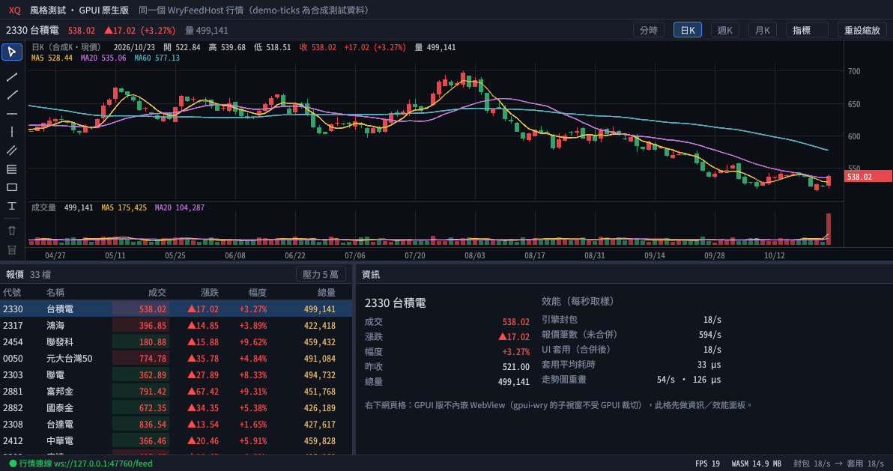 |
| 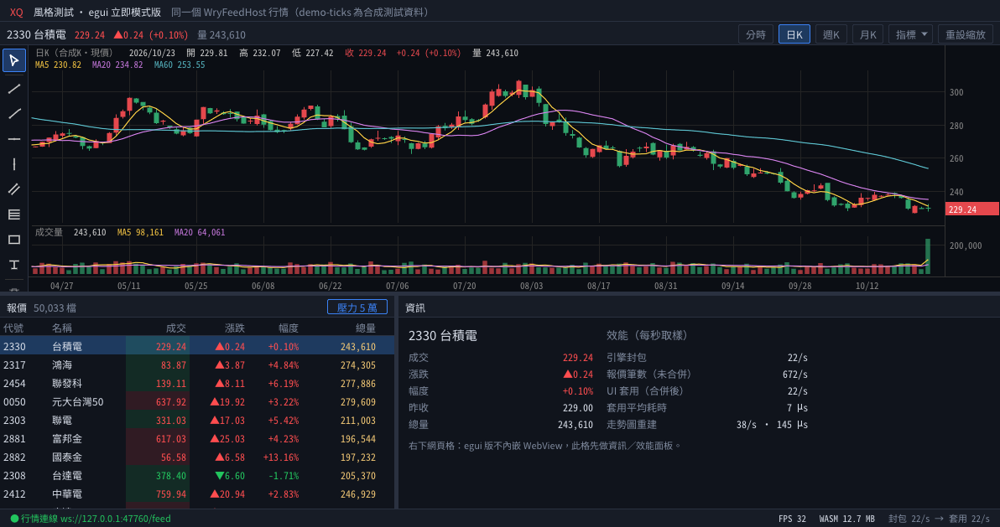 |  |
|  | 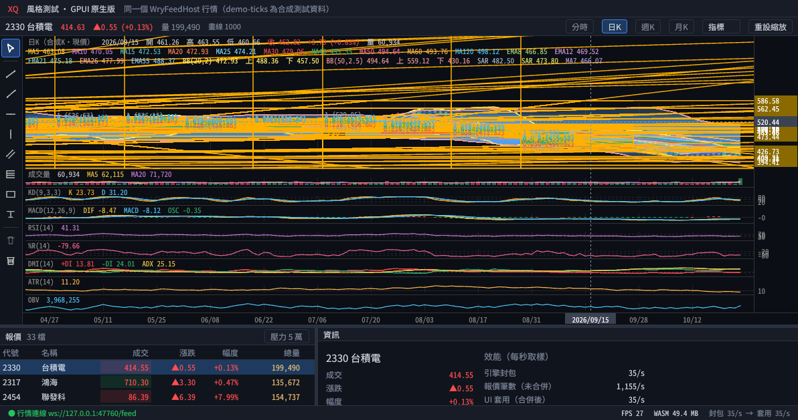 |
| 圖層正確性（上層文字框蓋住選取中的矩形）<br>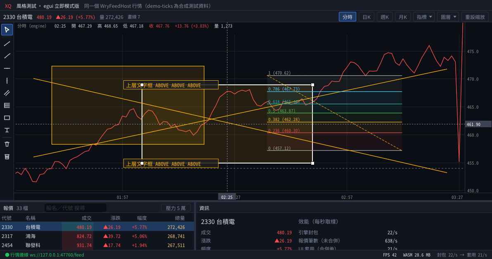 | <br> |
| 注音輸入（fcitx5＋新酷音，打「台積電」）<br>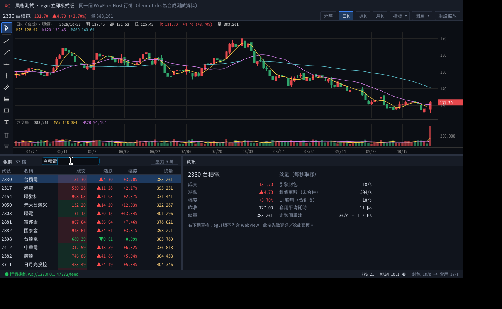 | <br>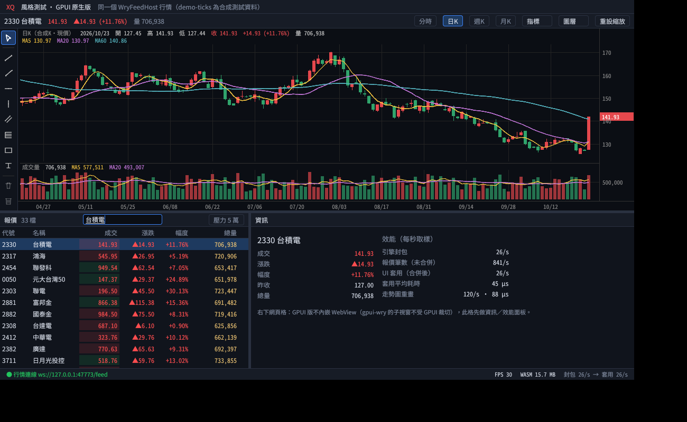 |
| 選字後搜尋結果<br> | <br> |

**注音輸入**：兩版都可以在網頁搜尋框用注音打字（Linux Chrome＋fcitx5 新酷音，`GTK_IM_MODULE=fcitx`），打「台積電」後出現 2330。這次只測了直接送字；候選字視窗的位置沒有驗證（這台截圖看不到 fcitx 的候選窗）。

### GPUI 網頁版：實際狀況（查證＋實測）

先更正之前的說法（「GPUI 網頁版還不能拿來做產品、只有社群實驗移植」）——**這已經過時**：

| 證據 | 內容 |
|---|---|
| Zed 官方 PR [#50228 GPUI on the web](https://github.com/zed-industries/zed/pull/50228) | 2026-02-26（台北時間 02-27）由 Zed 員工合併，新增 `crates/gpui_web`：`wasm32-unknown-unknown`、一張 canvas＝一個視窗、**WebGPU 優先、自動退回 WebGL2**、可選的 Web Worker 多執行緒模式 |
| 我們用的 `gpui-pre 0.3.7` | 同一組快照就有 `gpui-pre-web 0.3.7`（crates.io；最新 0.3.9），不用換 GPUI 版本 |
| 長橋 gpui-kit（原 gpui-component） | PR [#2102](https://github.com/longbridge/gpui-component/pull/2102)（huacnlee，2026-02-27）用 gpui_web 做網頁版元件展示；現在官網 [gpui-kit.com/gallery](https://gpui-kit.com/gallery/) 就是 wasm。當時 PR 自己列的待辦：沒有 app 選單（`set_menus`）、tree-sitter 編不進 wasm、**中文字型要自己內嵌** |
| 社群打包 | `gpui-web-gpui-unofficial`（gpui-archipelago，跟著 Zed 版本自動發佈，1.25.2） |

**我們的實測：GPUI 版 demo 整套編得過、跑得起來，功能跟原生一樣**（報價表 5 萬列、重圖表 1000 畫線、分隔線拖曳、搜尋框、行情）。過程中遇到、已解決的：

1. 第一次直接 `cargo build --target wasm32-unknown-unknown` 失敗：
   ```
   error[E0554]: `#![feature]` may not be used on the stable release channel
    --> wasm_thread-0.3.3/src/lib.rs:1:37
   ```
   原因：`gpui_platform` 會開 `gpui_web` 的預設 feature `multithreaded`（`wasm_thread`，要 nightly＋atomics＋SharedArrayBuffer）。
   解法：wasm 時不經過 `gpui_platform`，直接依賴 `gpui_web`（`default-features = false`），用 `WebPlatform::new(false)` 單執行緒。
   （長橋官網的 wasm 也是用 nightly 編多執行緒版。）
2. `std::time::Instant::now()`、`SystemTime::now()` 在 wasm32 會 panic → 換成 web-time（`plat.rs`）。
3. 原生的行情是背景執行緒＋TCP → 網頁版改成 WebSocket（`xq-ws-bridge` 轉送），解碼還是同一份 `xq-feed`。
4. 瀏覽器沒有系統的 Noto Sans CJK → 內嵌子集字型（`cx.text_system().add_fonts`）。
   gpui_web 其實會在缺字時退回瀏覽器 canvas 畫字（`CanvasFontFallback`），但為了跟原生同字型、同排版，這裡兩版都內嵌同一份子集。
5. 這台沒有 GPU：Chrome 有 `navigator.gpu` 但拿不到 adapter，gpui_web 印 `WebGPU initialization failed; falling back to WebGL2` 後改用 WebGL2（ANGLE＋Mesa llvmpipe）；
   另外 `Dual-source blending not available … Subpixel text antialiasing will be disabled`（文字少了次像素反鋸齒，原生 Linux 也一樣是灰階）。
   另外試了 Chrome 的軟體 WebGPU（`--enable-unsafe-webgpu --use-webgpu-adapter=swiftshader`）：gpui_web 印 `Browser graphics initialized successfully with BrowserWebGpu`，但截圖整片白（`docs/bench/web/webgpu-swiftshader-try.png`，只在 gpui repo），沒再深究、也沒壓測；上面的數字都是 WebGL2。

gpui_web 目前**做不到**的（原始碼 `gpui_web/src/platform.rs`）：第二個視窗／彈出視窗／浮動視窗（回 `WebWindowError`）、原生選單（`set_menus` 空實作）、
檔案對話框（`prompt_for_paths` 回「not supported on the web」）、`reveal_path`、防休眠、結束程式。輸入法走隱藏 `<textarea>`（`ime_mirror.rs`）。

### 網頁版做不到、或跟原生不一樣的地方（兩版共通）

| 原生有 | 網頁版 |
|---|---|
| 多視窗（`XQ_WINDOWS=N`） | **不行**：一個分頁只有一張 canvas。要多視窗只能開多個分頁／視窗，各自一份 wasm＋一條行情連線（不共用報價表）。程式裡強制 1 |
| 直接連行情 TCP 127.0.0.1:47631 | 瀏覽器不能開 TCP → 要 `xq-ws-bridge`（或引擎本身提供 WebSocket）。多一跳，本機實測 <1 ms（網頁版與原生的延遲差都在 ±1 ms 內） |
| 系統字型（mmap Noto Sans CJK，0 下載） | 要內嵌或下載字型：子集 3.0 MB（Big5 常用字＋注音），罕用字會變方塊；完整字型約 16 MB |
| 背景執行緒解碼行情 | 單執行緒：解碼、合併、畫面都在瀏覽器主執行緒（多執行緒 wasm 要 nightly＋COOP/COEP，未做） |
| 存檔 `~/.local/share/...` | 沒有檔案系統（這版不存；要存得改用 localStorage／IndexedDB） |
| 記憶體只有程式本身 | 要加上整個瀏覽器：**空白分頁的 Chrome 本身就 423 MB PSS**（開一張 WebGL2 canvas 431 MB；3 次中位數，`2026-10-23-chrome-baseline/`） |
| 原生選單、系統匣、檔案對話框、內嵌網頁格 | 沒有（瀏覽器本身就是網頁，所以「內嵌網頁」反而可以用一般 HTML 疊上去，但 canvas 上的元件無法和 DOM 混排） |
| 無障礙、文字選取、Ctrl+F 搜尋頁面 | 整個畫面是一張圖，瀏覽器看不到裡面的文字（egui 有實驗性 AccessKit→DOM，這版沒開） |
| 沒有 GPU／驅動被 Chrome 列入黑名單的電腦 | **畫面全黑**：Chrome 預設不讓軟體 OpenGL 開 WebGL（`WebGL2 blocklisted`），要加 `--ignore-gpu-blocklist` 才會畫（本測試有加）。一般有顯卡的電腦沒問題，但虛擬桌面／遠端桌面環境要先試 |


### 怎麼建置、怎麼跑

```bash
# 一次性：wasm 目標、wasm-bindgen（版本要跟 Cargo.lock 一樣，現在是 0.2.129）、binaryen 的 wasm-opt（可省略，省略就不最佳化）
rustup target add wasm32-unknown-unknown
cargo install wasm-bindgen-cli --version 0.2.129

# 建置（stable Rust 即可；輸出到 dist/web/）
WASM_OPT=/path/to/wasm-opt ./web/build.sh

# 轉接＋網頁伺服器（在 gpui-xq-demo repo：crates/xq-ws-bridge）
cargo run --release -p xq-ws-bridge -- --listen 127.0.0.1:8080 --feed 127.0.0.1:47631 --www dist/web
# 瀏覽器開 http://127.0.0.1:8080/index.html
```

- **網址參數＝原生的環境變數**：例如 `?XQ_PERIOD=D`、`?XQ_BENCH=1`、`?XQ_CHART_STRESS=1&XQ_CHART_LAYERS=100`、`?XQ_FEED_WS=ws://主機:埠/feed`（預設連同一個網址的 `/feed`）、`?XQ_SEARCH=0`（關搜尋框）。
- `xq-ws-bridge`：同一個埠同時提供網頁檔（`--www`，帶 `Cache-Control: no-store` 與 COOP/COEP 標頭）和 WebSocket 轉接（原封不動轉送位元組）。
- 壓測（在 gpui-xq-demo repo 的 `scripts/web/`，用 puppeteer-core 開系統 Chrome）：`OUT=輸出資料夾 ./run-all.sh 3` → `summarize.py 輸出資料夾` → `tables.py 輸出資料夾/summary.json docs/bench/2026-10-21-parity`。
  單場：`node bench-web.js <egui|gpui> <main|stress|heavy|ticks:s1k|…|ticks:burst> <輪次> <輸出資料夾>`。另有 `chrome-baseline.js`（空白 Chrome 記憶體）、`layers-smoke.js`（圖層冒煙測試）、`ime-web.sh`（注音）、`webgpu-try.js`（WebGPU 試跑）。
- 原始數據：`docs/bench/web/`（`results.jsonl` 每場一行、`summary.json` 中位數、`progress.log`、每場瀏覽器 console log、`contention.log` 每 10 秒的系統負載）。

## 手機版（Android）（2026-10-23 新增，egui 和 GPUI 一起做）

> 程式在 `mobile/` 資料夾（2026-10-24 合併到 main）。原始數據在 [`docs/bench/mobile/2026-10-23/`](docs/bench/mobile/2026-10-23/)（`summary.md` 是中位數表，`results.jsonl` 是每一輪原始值）。

> **2026-10-24 更新（GPUI）**：
> - 第 3 輪「畫面停住」原因找到並修好：gpui-mobile 只在 app 有輸入焦點時才畫，焦點被系統對話框／SystemUI 重啟搶走又沒還回來，就一直不畫。改成「看得到就畫」後，同樣的觸發方式修補前 6 輪凍住 2 次、修補後 4 輪 0 次；固定觸發（系統面板蓋住 app）修補前 3／3 輪停畫、修補後照畫。
> - 系統字型改 mmap：PSS 報價表 **91.6 → 57.6 MB**、走勢圖 **93.6 → 61.4 MB**（同一 APK A/B，各 3 輪中位數），和 egui 同一級。下表的 GPUI 記憶體是修補前的數字。
> - 詳見 [`docs/bench/mobile/2026-10-24/`](docs/bench/mobile/2026-10-24/README.md)。

### 結論先看

1. **兩個都能在 Android 上跑，功能一樣**：5 萬列報價表（手指甩動捲動）、點一列進走勢圖、雙指縮放、單指平移、長按出十字線、1000 條畫線／100 層的重圖表、中文字型、搜尋框。GPUI 用的是長橋（Longbridge）社群版 `gpui-mobile`，**不是 Zed 官方**；圖表邏輯照搬，沒有改寫。
2. **在這台模擬器上，egui 幾乎每一項都贏** 🏆：畫面更新快 2～4 倍、記憶體約一半、APK 約一半、每秒 1 千筆時的報價延遲約 1/4。啟動速度差不多（egui 12.2 秒、GPUI 13.7 秒）。
3. **不只是 GL 和 Vulkan 的差別**：egui 改用和 GPUI 一樣的 wgpu／Vulkan 畫圖（下表「egui（wgpu）」），大部分項目還是比 GPUI 快。
4. **重圖表 GPUI 只有約 1.4 fps，在模擬器上等於不能用**；egui 約 5 fps，也不順。
5. ⚠️ **這些都不是手機上的真實數字**。這台機器**沒有顯示卡**，硬體虛擬化（KVM）也壞了，所以：
   - 模擬器整顆手機 CPU 都是用軟體模擬，比真的慢很多倍；
   - 每一幀都由 CPU 用軟體畫（SwiftShader），沒有 GPU。

   真手機有 GPU。GPUI 又是靠 GPU 吃重活的設計，**到真機上差距可能縮小，甚至反過來**。這裡只能看「同一個環境下誰比較快」，而且這個排名到真機上也要重測才算數。

### 數字（3 輪取中位數；括號內 n＝有效輪數，不到 3 的原因見下面「沒做到／要注意」）

| 項目 | egui（glow） | egui（wgpu） | GPUI | 誰好 |
|---|---|---|---|---|
| APK 大小 x86_64（模擬器用） | **7.9 MB** | 13.7 MB | 17.0 MB | egui |
| APK 大小 arm64（真手機用） | **6.7 MB** | — | 15.4 MB | egui |
| 啟動 → 第一筆報價 | **12.2 秒** | 26.9 秒 | 13.7 秒 | 差不多 |
| 記憶體 PSS（報價表） | **58 MB**（n=1） | 69 MB（n=1） | 105 MB（n=2） | egui |
| 記憶體 PSS（走勢圖） | **53 MB**（n=2） | 64 MB（n=1） | 101 MB | egui |
| 畫面更新 fps：報價表跳價 | **6.3** | 5.5 | 3.3（n=2） | egui |
| 　報價表手指甩動 | **7.7** | 4.9 | 3.9（n=2） | egui |
| 　走勢圖跳價 | **13.3** | 5.1 | 3.1（n=2） | egui |
| 　走勢圖平移／雙指縮放／長按十字線 | **8.7／10.6／8.6** | 5.1／5.8／4.6 | 3.7／3.5／3.0（n=2） | egui |
| 重圖表（1000 畫線／100 層）跳價 fps | **5.0** | 3.6 | 1.4 | egui |
| 　重圖表每幀繪圖時間 | **55 ms** | 97 ms | 207 ms | egui |
| 耗電參考：app 每分鐘用掉的 CPU 秒（報價表） | **70 秒** | 81 秒 | 98 秒（n=2） | egui |
| 　同上（走勢圖） | **64 秒** | 72 秒 | 66 秒（n=2） | 差不多 |
| 模擬器整體 CPU（含軟體畫圖），報價表 | **202%** | 598% | 649%（n=2） | egui |
| 報價→畫面延遲，每秒 1 千筆（中位數／最慢 5%） | **101／164 ms** | 270／547 ms（n=2） | 443／600 ms | egui |
| 　每秒 1 萬筆 | 320／741 ms | **271／421 ms**（n=2） | 565／849 ms | egui |
| 　每秒 10 萬筆 | 8.9 秒 | 17.8 秒 | 10.0 秒（n=2） | 都跟不上 |
| 指標計算：每筆 tick 只補最後一根 | 19.6 µs | 20.0 µs | 22.3 µs | 一樣（同一份程式） |
| 指標計算：整段重算（1200 根、20 疊加＋8 副圖） | 122 ms | 210 ms | 189 ms | 見說明 |

怎麼看這張表：
- **fps**：每秒畫幾張畫面，越高越順。手機一般要 60。這裡全部都很低，原因就是上面講的軟體模擬。
- **PSS**：這個 app 真正分到的記憶體，Android 判斷要不要砍背景 app 就看它。
- **耗電參考**：app 每分鐘用掉幾秒 CPU。CPU 用越多越耗電。但模擬器裡畫圖是外面的主機代畫，**這個數字不含畫圖的電**。含畫圖的成本要看「模擬器整體 CPU」那一列：egui（glow）約 2 顆核心，wgpu 那兩個約 6 顆。
- **延遲**：從行情送出到畫面出現的時間。模擬器和主機的時鐘對不準，所以用「所有封包裡最快那一包」當基準來校正，數字算是**下界**（實際只會更長）。另外記了一個只用模擬器時鐘的「收到→畫面」，排名一樣，見 `summary.md` 的 `recvToPresent*`。
- **每秒 10 萬筆**：三個都積壓到好幾秒，產生器也被 TCP 擋住送不完（三邊中位數 168～193 萬筆／應送 200 萬）。資料最後都有收到，沒有掉，只是慢。這一項在模擬器上沒有參考價值。
- **指標計算**：兩邊是**同一份 Rust 程式**（`model.rs`），所以：
  - 每筆 tick 只補最後一根的時間三邊一樣，約 20 µs，跳價時指標不是瓶頸；
  - 「整段重算」是在 app 剛啟動、圖表剛建好時量的，那時候 GPUI／wgpu 還在初始化 Vulkan、載字型，CPU 被搶，所以比較慢。這個差距**反映的是當時 CPU 多忙，不是指標程式的快慢**。

截圖（左三張 egui：報價表、縮放後走勢圖、重圖表；右三張 GPUI 同樣三個畫面）：

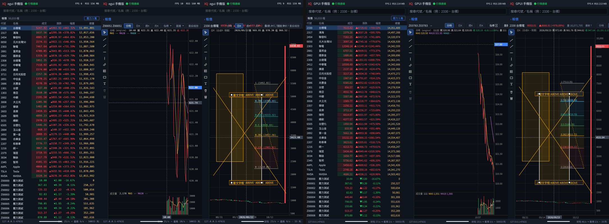

GPUI 長按出十字線（左：長按中；右：放開後）：

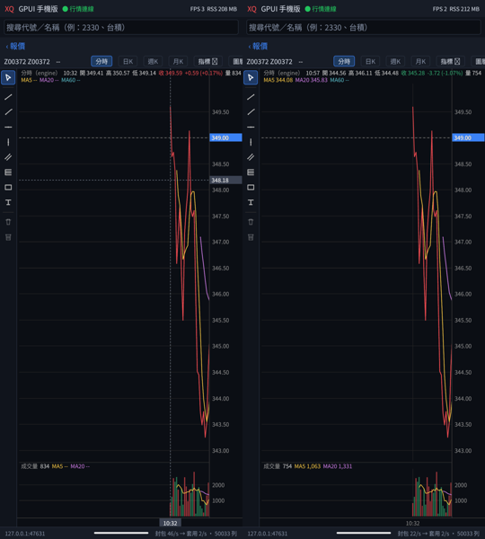

### 兩邊怎麼做的

| | egui | GPUI |
|---|---|---|
| Android 支援 | eframe 官方支援（`android-native-activity`） | 社群：長橋 `gpui-mobile`（rev c24a130，2026-10-24 起放在 `mobile/vendor/` 加修補）＋ `gpui-pre` 0.3.9 |
| 畫圖 | glow（OpenGL ES）；可選 wgpu（Vulkan） | wgpu（Vulkan）；GLES 在模擬器上開不起來（見下） |
| 觸控 | egui 內建：甩動慣性、雙指 `zoom_delta`；長按 400ms 自己判斷 | 0.3.9 內建手勢：拖曳→捲動事件（含甩動慣性）、`on_pinch`、`LongPressEvent` |
| 中文字型 | 直接 mmap 系統的 NotoSansCJK（不吃記憶體） | 原版 gpui-mobile 把所有系統字型**整個讀進記憶體**（光 CJK 就 32 MB）；2026-10-24 起本 repo 的 vendored 版改 mmap，PSS 少約 34 MB |
| 輸入法 | NativeActivity 沒有組字（中文輸入法候選字）介面 | `GpuiInputActivity` 有 InputConnection，理論上可組字 |

### 沒做到／要注意

- **沒有真手機測試**，全部是模擬器。box 上的 KVM 一開就讓主機核心報錯（`kvm_spurious_fault`，vCPU 直接當掉），只能用純軟體模擬（`-accel off`）。
- **GPUI 不能改用 OpenGL ES**：設 `XQ_GPU=gl` 時，wgpu 要求的 `max_compute_workgroups_per_dimension=65535` 超過模擬器 GLES 的上限，視窗開不起來（log：`docs/bench/mobile/2026-10-23/gpui-gles-fail.log`）。所以 GPUI 只有 Vulkan。模擬器的 Vulkan 和 GLES 其實都是外面主機的 SwiftShader 代畫。
- **GPUI 第 3 輪畫面停住**：報價照收（每秒約 20 次更新），但畫面 0 fps；後面重圖表也停在 drag 段，跑不完。這幾列都**排除不算**，所以 GPUI 很多項是 n=2。2026-10-24 查到原因是 gpui-mobile「沒焦點就不畫」，已修（見上面的更新）。
- **egui（wgpu）第 3 輪**每秒 1 千／1 萬筆兩項沒收到延遲樣本，排除不算（n=2）。
- 有幾次讀記憶體（dumpsys）逾時，所以部分 PSS 是 n=1。
- 測試期間（2026-10-23 12:45～20:08，Asia/Taipei）box 重開機兩次：
  - 第 1、2 輪的行情來自 box 上原本在跑的 127.0.0.1:47631 行情服務；
  - 第 3 輪是重開機後另外開的 `WryFeedHost --demo-ticks`；
  - 同一台 box 上還有別的工作在編譯／壓測，主機負載不固定，每一列都記了 `load1`。
- 「卡頓（jank）」沒有放進表：幀率低於每秒 4 張時這個定義沒意義。
- **中文輸入法沒測**：模擬器映像只有英文 LatinIME。搜尋框的比對功能有做，但沒用輸入法實際打中文。
- 第 1～2 輪原本有在跑的行情服務是哪種模式（真實或模擬）沒有記錄到，只確定是 127.0.0.1:47631 上的 dotnet 服務。

### iOS 呢？

- 需要 macOS＋Xcode，這台 Linux box 不能建。
- GPUI：Zed 官方已合併實驗性的 `gpui_ios`（zed PR #63068，2026-10-15 合併，Asia/Taipei），有 UIKit 觸控、手勢、輸入法橋接，但官方說明還不是完整功能。
- egui：官方沒有 iOS 目標（egui issue #3117 還開著），要靠社群補丁（winit／eframe 分支），鍵盤輸入過去一直有問題。

### 建置／執行

```bash
# 需要：Android SDK（platform 35、build-tools 35）、NDK 28.2、JDK 17 以上、cargo-ndk、
#       rustup target add x86_64-linux-android aarch64-linux-android
cd mobile
./build-apk.sh x86_64                 # 模擬器；真手機用 arm64-v8a；兩個都要用 "x86_64,arm64-v8a"
adb install -r android/app/build/outputs/apk/release/app-release.apk
adb reverse tcp:47631 tcp:47631       # 讓手機連到電腦上的行情服務（127.0.0.1:47631）
# 設定用 system property 傳（debug.xq.e0～e9 各放一個 KEY=VAL），例如：
adb shell setprop debug.xq.e0 XQ_METRICS=1     # 每秒在 logcat（tag xq）印 FRAMES|{fps, 記憶體, 指標計算時間…}
```

- egui 要 wgpu 版：`CARGO_FEATURES=wgpu ./build-apk.sh x86_64`，再設 `XQ_RENDERER=wgpu`。
- GPUI 要試 GLES：`XQ_GPU=gl`。真機可以試，模擬器開不起來。
- 壓測：`scripts/mobile/bench-android.py`，需要 adb root。觸控手勢用 `scripts/mobile/mt.c`，用 NDK 編成靜態執行檔，直接寫多點觸控事件，所以能做雙指縮放。
- 統計：`scripts/mobile/summarize.py docs/bench/mobile/2026-10-23` 產生中位數表。排除規則寫在程式開頭：畫面停住、沒有延遲樣本、重圖表沒跑完。

## 設計 token：一套設計規範，egui／GPUI 兩版共用（2026-10-23）

### 結論先看

- ✅ **可行，而且畫面完全沒變**：兩版的顏色、字級、圓角、線寬、版面尺寸都改成讀**同一份** token 檔
  （[`crates/xq-tokens/tokens/`](https://github.com/tina-moneydj/gpui-xq-demo/tree/main/crates/xq-tokens/tokens)，W3C DTCG 2025.10 格式，Figma 原生就能匯入／匯出）。
  用預設 token 截圖和 main 逐像素比對：**除了狀態列每秒變動的 RSS 數字，其他 0 個像素不同**（兩版都是）。
- ✅ **改一個 token，兩個 App 一起變**：只把 `color.chart.up`（K 棒漲色）從 `#e5484d` 改成 `#a855f7`，兩版都沒改程式，K 棒和成交量柱的漲色一起變紫（約 1.8 萬個像素）。
- ✅ **深色／淺色主題**：按 **F8** 即時切換，或 `XQ_THEME=light` 啟動；切換後的畫面和直接用淺色啟動一樣（只差每秒變的計數）。
- ✅ **熱更新**：`XQ_TOKENS_DIR=資料夾 XQ_TOKENS_WATCH=1` 執行時，程式每 0.3 秒檢查一次檔案，設計師存檔後畫面就換色（實測存檔後 2.5 秒截圖已是新顏色），不用重編。
- ✅ **效能沒變差**：主視窗中位數 GPUI 52.0→50.2 FPS、egui 61.3→60.9 FPS，每幀 CPU、走勢圖繪製時間、記憶體的差距都比同一版每輪之間的起伏小（記憶體多約 0.4–0.7 MB，是兩份主題的 token 表）。
- ✅ **改錯會被擋**：token 少一個或格式錯，`cargo build` 直接失敗並寫出是哪個 token（例：`[light] token「color.market.up」缺少`）。
- ⚠️ **盤點時發現兩版本來就不一致**：按鈕圓角 GPUI 4px、egui 2px；K 棒漲色（`#e5484d`）和報價表漲色（`#ff4d4f`）也是兩個不同的紅。先各給一個 token 保持畫面不變，之後由設計師決定要不要統一。

### 設計師怎麼改（不用懂程式）

1. 打開 `crates/xq-tokens/tokens/`：`color.dark.tokens.json`（深色）、`color.light.tokens.json`（淺色）、`base.tokens.json`（字級、間距、圓角、尺寸）。
2. **用 Figma**：第一次把這三個檔拖進 Figma 的 Variables 視窗匯入（名稱會變成 `color/market/up` 這種斜線分層）。之後在 Figma 改，
   在 collection 上按右鍵 → **Export modes**，每個 mode 一個 JSON，改成上面的檔名蓋回去、送 PR。
   **不用 Figma**：直接改 JSON 裡的 `"hex": "#ff4d4f"`（和旁邊的 `components`）也可以。
3. 想先看效果：`XQ_TOKENS_DIR=你的資料夾 XQ_TOKENS_WATCH=1 ./target/release/gpui-xq-demo`（egui 版同樣），邊改邊看。
4. 合進去後兩個 App 重編就會帶新值（token 內嵌在執行檔裡，不用另外附檔案）。

### 兩個 App 怎麼拿到

- GPUI 版直接依賴 workspace 裡的 `crates/xq-tokens`；egui 版用 Cargo git 依賴同一個 crate（鎖定 rev，和 `xq-feed` 的做法一樣）。
- 程式裡原本寫死的 `0xff4d4f`、`px(11.)`、`ROW_H = 22.0` 等，改成 `tk().market.up`、`tk().font.sm`、`tk().layout.table_row`。
  讀一個 token 只是一次原子讀取，沒有鎖、沒有查表。
- 換主題或熱更新時版本號 +1；App 看到就把烤了顏色的快取（走勢圖畫線、報價表列）丟掉重畫。
- 詳細格式、Figma 限制、完整盤點表：[`crates/xq-tokens/README.md`](https://github.com/tina-moneydj/gpui-xq-demo/blob/main/crates/xq-tokens/README.md)。

### 截圖（[docs/bench/2026-10-23-tokens/](docs/bench/2026-10-23-tokens/)）

| | GPUI | egui |
|---|---|---|
| 預設 token（和 main 一樣） |  |  |
| 只改 `color.chart.up` → 紫色 |  | 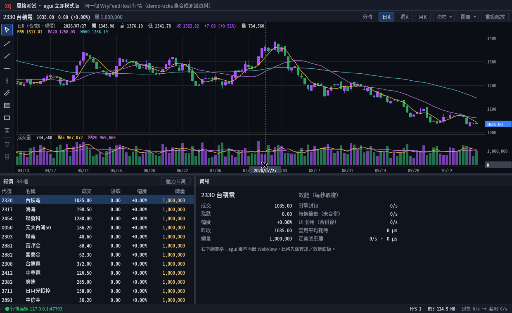 |
| 淺色主題（F8） |  | 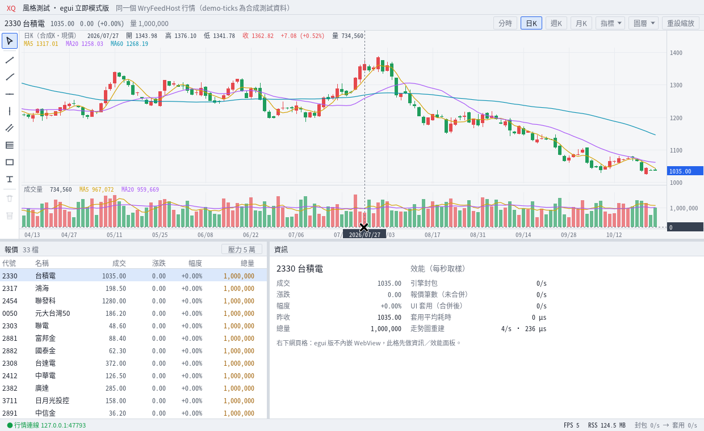 |

逐像素比對數字在 `shots-diff.json`；行情用 `xq-tickgen --rate 0 --seed 1`（只送一次快照，畫面固定才能逐像素比）。

### 效能（主視窗、每秒 2000 筆跳價、量 30 秒，main 與 token 版交錯跑 5 輪取中位數）

| 指標（中位數） | GPUI main | GPUI token | egui main | egui token |
|---|---|---|---|---|
| FPS | 52.0 | 50.2 | 61.3 | 60.9 |
| 記憶體 RSS (MB) | 190.5 | 191.2 | 124.8 | 125.2 |
| CPU（100%＝1 核） | 350.2% | 350.2% | 133.8% | 137.9% |
| 每幀 CPU (ms) | 60.89 | 61.70 | 21.83 | 22.63 |
| 走勢圖繪製 (µs/次) | 66 | 64 | 58 | 60 |

怎麼看：**差距都在雜訊內**。這台測試機沒有 GPU（軟體繪圖），而且同時跑著其他測試，GPUI 同一版 5 輪的 FPS 就在 31–61 之間跳（token 版 32–61），
所以 FPS 要看「每幀 CPU」比較穩：GPUI 差 1.3%、egui 差 3.7%，而 egui 同一版每輪自己就在 20.6–24.7 ms 之間。
egui 被螢幕更新率卡在約 60 FPS。原始資料：`docs/bench/2026-10-23-tokens/perf.json`；量測腳本 `tokbench.py`（獨立 Xvfb :73、行情埠 47793）。

### 還沒做的

- 間距 token 已定義，但 GPUI 的 `px_2()`／`gap_1()` 這類簡寫和 egui 的 `item_spacing` 還沒全部換；畫布上的小幾何（標籤高 16、控制點 9×9）和透明度係數也還寫在程式裡。
- egui 的字型是讀字型**檔**，字型名稱 token 目前只有 GPUI 用。
- 淺色主題的配色是我先排的初稿，要請設計師定稿。
- 網頁版、Android 版合併後也讀同一份 token（共用的報價表、走勢圖顏色都跟著變）；但手機版自己的版面（字級、列高等）還寫在 `mobile/src/` 裡，沒有換成 token。

## 功能

- 版面：上＝走勢圖、左下＝報價表、右下＝資訊／效能格；**上下、左右分隔線都可拖曳**。
- 報價表：代號／名稱／成交／漲跌／幅度／總量，**漲紅跌綠**，成交價底色顯示上一筆 tick 方向；
  `uniform_list` 虛擬化，按「壓力 5 萬」加 5 萬列合成資料測試捲動與記憶體。
- 走勢圖（canvas 自繪，**高頻看盤取向：每筆 tick 只增量更新最後一根，不整段重算**）：
  - 週期：**分時／日K／週K／月K**。分時＝引擎 `intraday` 快照＋`minutes` 增量分鐘線、昨收虛線；
    日 K 與 wry 版相同做法「合成 1200 根日 K、最後一根跟著現價」，週／月 K 由日 K 聚合。滾輪縮放、拖曳平移、「重設縮放」。
  - **主圖疊加（最多 20 個、可重複、可調參數）**：MA、EMA、布林通道（n, k）、SAR（step, max）。
  - **副圖（最多 10 個，共用時間軸）**：成交量（＋均量 MA5/20）、KD、MACD（DIF／MACD／OSC 柱）、RSI、威廉 %R、DMI（+DI／−DI／ADX）、ATR、OBV。
    「指標 ▾」選單：疊加 ±參數／刪除／新增，副圖勾選與參數 ±。
  - 指標都保存「每一根的遞迴狀態」（EMA、Wilder 平滑、SAR、KD…），跳價只重算最後一根，結果與整段重算一致（有單元測試）。
  - **畫線工具（左側工具列）**：趨勢線、射線、水平線、垂直線、平行通道、費波納契、矩形、文字；點選取、拖曳整條或控制點、
    Delete 刪除、全部清除、Esc 取消、雙擊文字可改字。
  - **畫線圖層與上下順序**（最多 200 層，顯示／隱藏、鎖定、上下移；`Ctrl+]`／`Ctrl+[`／`Ctrl+Shift+]`／`Ctrl+Shift+[`）：見[下面一節](#畫線圖層與上下順序2026-10-23-新增三版一起做)。
  - **畫線層效能**：幾何快取＋64px 格狀空間索引 hit-test、只建可見範圍（含平移預留）、平移時整批頂點位移不重建、
    只有尺度（價格範圍／K 寬／版面）或內容改變才重建。
  - 三個分層 cached view：主圖層（K 棒＋指標）、畫線層、即時層（圖例＋十字線＋選取中的畫線）；滑鼠移動只重畫即時層。
  - 十字線＋游標所在 K 棒的開高低收量與每個指標讀值（疊加圖例自動換行）。
  - **存檔**：每個「代號｜週期」的指標設定與畫線寫到 `~/.local/share/gpui-xq-demo/state.json`（`XQ_GPUI_STATE` 可改路徑；新代號沿用上次指標設定）。
  - 點報價列切換走勢圖代號（重新訂閱 `chart` 代號）。
- 狀態列：連線狀態、FPS、RSS（每秒取樣）、引擎封包數→UI 套用次數。
- **成交明細（範例模組，`XQ_TAPE=1` 才開）**：右下多一欄，由報價推導逐筆成交（總量差）、固定容量 5000 筆、`b` 只看大單、`[`／`]` 門檻、`Home` 回最新；
  團隊「照這個寫」的參考，說明見 [docs/team/example-module.md](docs/team/example-module.md)。

右下的「網頁格」**不在範圍內**：GPUI 沒有官方 WebView；`gpui-wry` 的子視窗畫在 GPUI 之上、不受 ContentMask 裁切
（舊測試程式保留在 `legacy/gpui_wry_window_test.rs`，不參與編譯）。此格先放資訊與效能數字。

## 建置／執行

```bash
export PATH="$HOME/.cargo/bin:$PATH"
cargo build --release            # rust-toolchain.toml 用 stable（GPUI 依賴 oo7 需要 rustc ≥ 1.92）
DISPLAY=:2 XQ_METRICS=1 ./target/release/gpui-xq-demo
cargo test --release --workspace # 協議切包／解碼、指標增量＝整段重算、週／月聚合、成交明細（含行為基準）
cargo bench -p xq-tape           # 成交明細熱路徑 micro-bench（各項有預算）
```

環境變數：

| 變數 | 用途 |
|---|---|
| `XQ_FEED_ADDR=127.0.0.1:47631` | 改行情位址（預設 47631） |
| `XQ_METRICS=1` | 每秒在 stderr 印 fps / rss / 封包數 / 套用耗時 |
| `XQ_NO_VIEW_CACHE=1` | 關掉 view cache（比較用） |
| `XQ_DEBUG=1` | 印滑鼠事件等除錯訊息 |
| `XQ_PERIOD=D` | 啟動週期：`T` 分時（預設）／`D` 日K／`W` 週K／`M` 月K |
| `XQ_TOP_FRAC=0.56` | 上方走勢圖佔比（重圖表壓測用 0.811，讓走勢圖面與 wry 版同為 1166×512） |
| `XQ_GPUI_STATE=路徑` | 存檔位置（預設 `~/.local/share/gpui-xq-demo/state.json`；`XQ_BENCH`／`XQ_CHART_STRESS` 時不讀不寫） |
| `XQ_CHART_STRESS=1` | 重圖表壓測（與 wry 版同流程）：等第一筆報價 → 20 疊加＋8 副圖＋1000 畫線（`XQ_CHART_DRAWINGS`）→ 暖身 `XQ_CHART_WARM_MS`（3000）→ ticks／crosshair／pan 各 `XQ_CHART_PHASE_MS`（10000），結果印 `CHARTPERF|{json}`（FPS、各層平均 paint ms、RSS） |
| `XQ_LAYER_MODE=split` | 實驗：圖層改成 quad／path／字分開（預設每層一個 scene layer，lavapipe 上較快） |
| `XQ_BENCH=1` | 第一幀／第一筆報價畫出後各印一行 `BENCH ...`（給 `scripts/bench-main-window.sh` 打時間戳） |
| `XQ_TAPE=1` | 開成交明細範例面板（預設關閉，壓測版面不變）；`XQ_TAPE_STATE=路徑` 改設定檔位置（預設 `~/.local/share/gpui-xq-demo/tick_tape.json`） |
| `XQ_WINDOWS=N` | 開 N 個看盤視窗（最多 8，各自走勢圖＝自選第 k 檔），共用同一條行情連線與同一個報價表 entity；`GPUI_X11_SCALE_FACTOR=2` 可開 2 倍縮放 |
| `XQ_GROUP_STRESS=1` | 壓測：1.2 秒後開 5 萬列＋合成跳價（`XQ_STRESS_TICK_HZ`，預設 3000 筆/s）`XQ_STRESS_TICK_MS`，再邊跳價邊捲動 `XQ_STRESS_SCROLL_MS`（預設各 2000 ms），結果印 `GROUPPERF|{json}` |

Linux 需要 Vulkan（或 GL）驅動；沒有 GPU 的機器裝 Mesa lavapipe：`sudo apt install mesa-vulkan-drivers vulkan-tools`。

> **WryFeedHost 只接受一個 client（後連者勝）**。GPUI 版和 wry 版同時開會互搶連線（各自 500ms 重連），
> 測試時先暫停另一個：`kill -STOP <wry pid>`，測完 `kill -CONT <wry pid>`。

## 架構

```
crates/xq-feed      ← 共用協議 crate（零依賴）：Subscribe 編碼、FrameReader 切包、型別化 decode、背景連線/重連執行緒
crates/xq-tape      ← 成交明細純邏輯（範例）：報價→成交推導、固定容量 Ring、格式化；單元測試＋行為基準＋micro-bench
src/tick_tape.rs    ← 成交明細面板（範例）：背景緩衝→每幀套用、uniform_list、actions/快捷鍵/焦點、背景存檔
src/bridge.rs       ← 背景執行緒 → UI 的合併層（Inbox）
src/table.rs        ← 報價表 view（uniform_list）
src/chart.rs        ← 走勢圖 view：三個 cached 繪圖層、左側畫線工具列、指標選單、事件、XQ_CHART_STRESS 壓測驅動
src/model.rs        ← 走勢圖狀態：版面（與 wry 同公式）、視圖、互動（畫線／拖曳／平移）、畫線快取鍵
src/indicators.rs   ← 主圖疊加（MA/EMA/BB/SAR）與副圖（VOL/KD/MACD/RSI/%R/DMI/ATR/OBV），每根保存遞迴狀態 → 增量更新
src/drawings.rs     ← 畫線資料（JSON 與 wry 相容）、幾何、hit-test、空間索引、幾何／圖元快取
src/gfx.rs          ← 自己的線段三角化（不靠 lyon）、quad／文字小工具
src/store.rs        ← 指標設定與畫線存檔（背景寫檔）
src/series.rs       ← K 線序列、合成日 K（1200 根）、週／月聚合
src/main.rs         ← Terminal 根 view：版面、分隔線、狀態列、資訊格、FPS/RSS 取樣
```

資料流：

1. `xq-feed` 背景執行緒讀 TCP → `FrameReader` 切包（半包保留）→ `decode` 成 `Msg`（不經 JSON）。
2. `bridge::merge` 在背景執行緒 O(1) 合併進 `Inbox`：**同代號報價只留最新**、分時快照只留最新、同分鐘的分鐘線只留最新。
   只有 Inbox 從空變非空時才送一次喚醒訊號。
3. UI 端一個 async task：被喚醒 → `take()` 整包取走 → 套用 → **睡 16ms 再收下一次**，所以引擎推再快 UI 最多 ~60 次/秒套用。
4. 套用只改有變的列（價／量相同就跳過），只有實際變動的 view 才 `notify`。
5. 報價表／走勢圖／資訊格是三個獨立 entity，用 `.cached()` 掛在根 view 下：報價 tick 只重畫報價表的**可見列**，
   走勢圖只有目前代號有 tick 時才重畫；字串只在 render 時為可見列格式化（5 萬列不預先建字串）。
6. 走勢圖狀態放在 `Rc<RefCell<Model>>`，三個繪圖層共用；tick 只改最後一根、每個指標只算最後一根，
   新分鐘才 append。換代號／週期／指標設定才 O(n) 重建一次。tick 只通知主圖層與即時層，
   畫線層只有在可見價格範圍改變時才重建（平移只位移）。每層包成一個 scene layer，讓 GPUI 每層只做一次 path 光柵批次。

## 效能數字（本機 box：8 核、無 GPU、Mesa lavapipe 軟體 Vulkan、Xvfb 1280×800，demo-ticks 行情；初版量測，完整對照見「效能比較」一節）

| 項目 | GPUI 版 | wry 版（同時段量測） |
|---|---|---|
| RSS（全部行程） | **≈ 184–196 MB**（單一行程） | 533 MB（主程式 85 + WebKitWebProcess 430 + Network 18）；先前量測右下空白時 615–650 MB |
| 加 5 萬列壓力資料 | +≈ 4.5 MB（191 MB） | — |
| 引擎封包 | 約 30–38 包/s、900–1,200 筆報價/s | 同一來源 |
| UI 套用 | 與封包數相同（≤ 60/s 上限），平均 **17–24 µs**/次 | — |
| 走勢圖 paint（CPU 端組 scene） | 分時 ≈ 0.3 ms、日線 ≈ 0.6–0.7 ms | — |
| FPS | 27–36（跟著 tick 頻率；無變動時不重畫） | — |
| CPU | ≈ 235%（**幾乎都是 lavapipe 軟體光柵**；有實體 GPU 時會低很多） | — |

注意：FPS 上限在這台機器上同時受「行情 ~30 包/s」與「lavapipe 軟體光柵每 frame 約 30ms」限制；
CPU 端每 frame 的工作（套用＋組 scene）不到 1 ms。

## 畫線圖層與上下順序（2026-10-23 新增，三版一起做）

像一般技術分析軟體一樣：畫線可以點選、拖曳，**可以調上下順序**，也可以分**圖層**（最多 200 層，可顯示／隱藏、鎖定、上下移）。

### 結論先看

- **三版功能對等，畫面順序正確。** 下層的線被上層蓋住、上層的線畫在下層之上、選取的控制點永遠在最上面；點選時抓「看得到的最上面那條」，隱藏或鎖定的圖層點不到。三版截圖見下。
- **100 層不會比較慢。** 1000 條畫線分 100 層 vs 全放 1 層，改順序／選取時重建畫面的時間幾乎一樣（差距 < 0.05 ms；wry 在 1 ms 內）。FPS 的差距比同一設定重測的誤差還小（例外：wry 跳價／十字線時 100 層慢約 15%，見下面「有沒有退步」）。
- **拖曳不重建。** 拖曳一條線時，其他 999 條用快取的「下層／上層」兩片，三版拖曳期間重建次數都是 0（只有開始時 1 次）。
- **反應最快：egui。** 點選或改順序到畫面更新：egui ≈ 17 ms、wry ≈ 47 ms、GPUI ≈ 64–80 ms。重建本身 egui、GPUI 都約 0.3 ms，wry 約 4–5 ms。
- **拖曳 FPS：egui 56 ＞ wry 28 ＞ GPUI 10**（這台沒顯卡，GPUI 的軟體繪圖最貴；而且這次 box 被另一個工作同時佔滿，GPUI 受影響最大，見下面注意事項）。

### 測了什麼、為什麼重要

壓測場景和「重圖表」相同（1000 條畫線＋20 個疊加指標＋8 個副圖、持續跳價），多加四段，每段 10 秒：

| 段落 | 做什麼 | 為什麼重要 |
|---|---|---|
| drag（拖曳） | 拖著第 500 條（在中間的第 50 層）來回移動 | 拖曳要順，不能每動一下就把 1000 條重畫 |
| select（選取） | 一直點選／取消選取中間那條 | 選取時那條要「浮」到上面並顯示控制點，其他線要拆成上下兩片快取 |
| reorder（改順序） | 一直 上移一層／下移一層／移到最上／移到最下、整個圖層上下移、圖層隱藏／顯示 | 這就是使用者按 Ctrl+] 等快捷鍵時的成本 |
| zshot（正確性） | 7 條互相重疊、分 3 層的畫線，拿中間那條當選取 | 截圖檢查誰蓋誰 |

同一套測法跑兩種設定：**100 層**（1000 條平均分到 100 層）和**不分層**（`XQ_CHART_LAYERS=1`，全部在 1 層），比較 100 層多花多少。

### 數字（交錯測 3 輪取中位數；括號內是不分層）

| 項目 | wry | GPUI | egui | 最好 |
|---|---|---|---|---|
| 拖曳 FPS | 27.7（40.9） | 9.9（11.0） | 55.8（49.7） | **egui** |
| 拖曳期間重建次數 | 0 | 0 | 0 | 三版相同 |
| 選取：重建 p50／p99 (ms) | 4／7（3／6） | 0.34／1.60（0.37／0.75） | 0.34／0.60（0.33／0.62） | **egui ≈ GPUI** |
| 選取：到畫面更新 p50／p99 (ms) | 47／67（33／73） | 80／145（96／144） | 17／37（19／28） | **egui** |
| 改順序：重建 p50／p99 (ms) | 5／12（5／9） | 0.32／0.58（0.36／0.57） | 0.36／0.55（0.32／0.51） | **egui ≈ GPUI** |
| 改順序：到畫面更新 p50／p99 (ms) | 49／73（51／76） | 64／131（81／128） | 18／25（17／26） | **egui** |
| 選取／改順序時 FPS | 21／20 | 13／14 | 56／54 | **egui** |
| 記憶體 RSS (MB) | 703（704） | 219（219） | 137（141） | **egui** |
| 重圖表 跳價／十字線／平移 FPS | 34.6／34.3／30.5 | 13.2／12.7／9.8 | 51.6／51.4／51.0 | **egui** |

- 「重建」＝改了順序或選取之後，把 1000 條重新排成上下兩片快取的 CPU 時間；「到畫面更新」＝從動作到下一幀開始（含等下一幀）。
- **100 層 vs 不分層：重建時間一樣**（排序用「圖層位置、陣列位置」兩個數字，100 層不會多跑迴圈）。表裡 FPS 的高低（例如 wry 拖曳 28 vs 41）在另一組完整重測裡是反過來的（43 vs 17），所以只是 box 雜訊，不是圖層造成的。
- wry 的時間是整數：WebKit 的 `performance.now()` 只精確到 1 ms。

### 和 10-21 重圖表比有沒有退步

| 跳價／十字線／平移 FPS | wry | GPUI | egui |
|---|---|---|---|
| 2026-10-21（安靜時） | 36.1／36.5／26.2 | 20.5／20.7／20.8 | 41.8／39.6／41.7 |
| 2026-10-23（box 被佔滿） | 34.6／34.3／30.5 | 13.2／12.7／9.8 | 51.6／51.4／51.0 |

上面兩列是不同時間測的，box 忙閒不同，不能直接比。下面是**同一時段、改版前後輪流跑**的對照（2026-10-23 早上，合成行情，1000 條畫線分 100 層，每段 6 秒，3 輪取中位數）。

**GPUI：確實退步過，已修好。**

| GPUI 跳價／十字線／平移 | FPS | CPU（整個程式，含軟體繪圖） | 每幀畫線批次 |
|---|---|---|---|
| 改版前（360cb93，沒有圖層） | 20.8／20.8／20.8 | 311%／323%／313% | 4 |
| 圖層版（0eeca4e） | 20.2／20.2／20.4（較忙時 17.9／18.2／18.3） | **480%／480%／473%** | 14 |
| 修正後（目前 main） | **20.8／20.8／20.8** | **298%／301%／307%** | **4** |

- 這台機器上 GPUI 重圖表最多約 21 FPS，改版前和修正後都頂到這個上限，所以要看 CPU：圖層版每秒多花約 1.6 顆 CPU，修正後回到改版前的水準（還略低一點）。
- 原因不是「上層那片多畫一次」（沒選取時那片本來就是空的），而是**畫線被切成很多批**：GPUI 每一批線條都要把整個視窗大小的暫存畫布清掉、畫、再貼回去，沒有顯卡時很貴。圖層版的價格軸標籤（水平線的價格）一個個夾在畫線中間，整個畫面每幀從 4 批變成 14 批。
- 修法：價格軸標籤整組放同一層；畫線開始前先放一個「隔板」，讓所有畫線的順位都排在圖上其他東西之上，連成一批。另外沒有選取時不再通知「選取那條」和「上層那片」重畫。
- 上下順序照樣正確：重跑正確性截圖，選取的中間層方框仍在上層文字框和線之下、下層線之上，控制點在最上面（和下面的截圖一致）。

**egui：沒有退步。** 改版前（3c5d06d）60.3／60.5／60.8 FPS、CPU 286%／289%／284%；圖層版 61.3／60.4／60.1 FPS、CPU 288%／289%／288%。egui 沒選取時本來就只畫一份畫線快取，不用改。

**wry：平移沒退步，但「100 層」時跳價、十字線變慢約 15%，原因不同、還沒修。**

| wry 跳價／十字線／平移 FPS | 中位數 |
|---|---|
| 改版前（d9e06ec，8 輪） | 23.5／21.9／33.0 |
| 圖層版，1000 條分 100 層（8 輪） | 19.0／19.3／34.8 |
| 圖層版，全部 1 層（4 輪） | 22.4／22.4／34.4 |

- wry 沒有 GPUI 那個「多一層」的問題（沒選取時上層那片本來就不畫）。
- 慢的只有「分 100 層」：壓測把 1000 條輪流分到 100 層，照順序畫時線、填色、文字、虛線一直交錯，瀏覽器畫布每條都要換一次畫筆設定；跳價和十字線時價格範圍一直變、整份畫線每幀重畫，所以吃到這個成本。平移只位移快取，不受影響；全部放 1 層就和改版前一樣。
- 實際使用時一個圖層裡通常是同類型的線，影響會比這個壓測小。要修可以學 GPUI：不重疊的同色線先併成一筆再畫。

### 正確性截圖

| wry | GPUI | egui |
|---|---|---|
| 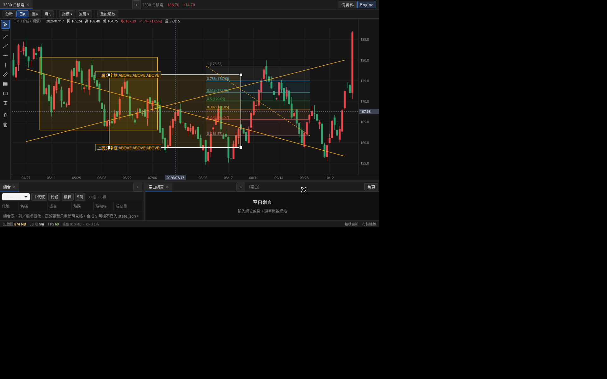 |  | 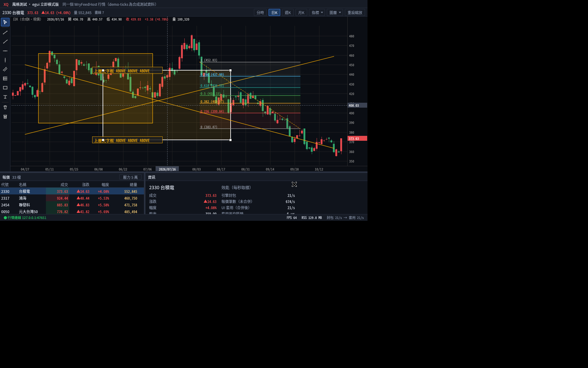 |

看法：中間被選取的白框矩形（第 2 層）邊線被上層（第 3 層）的兩個文字框蓋住；上層的趨勢線畫在白框之上、下層的在白框之下；白色控制點在最上面。三版一致。
拖曳中截圖：`docs/bench/2026-10-23-layers/ilv/r3-<程式>-L100/<程式>-drag.png`。

### 還不一樣的地方（框架限制）

- **GPUI**：同一個區段裡的文字一定畫在線條上面（GPUI 把文字放在自己的圖層）。換到上一個區段（例如上層的線）就會正確蓋住。
- **wry**：平移時，水平線往兩邊延伸的部分在快取邊緣會晚一幀補上（其他種畫線也一樣）。
- **wry**：時間只精確到 1 ms（見上）。

### 注意事項

- **這台沒有顯卡**：畫面全靠 CPU 模擬（wry＝WebKit＋llvmpipe、GPUI＝Vulkan lavapipe、egui＝OpenGL llvmpipe），FPS 主要是軟體繪圖的速度；有顯卡時 FPS 會高很多，但「重建時間」這種 CPU 端數字不受影響。
- **這次 box 很吵**：測試時另一個工作同時在建置與壓測網頁版，系統負載一直在 6–10（8 核）。所以用**交錯測**：每輪內同一個程式 100 層／不分層緊接著跑，3 輪取中位數。**請看同一輪的相對高低與「重建時間」，不要拿 FPS 絕對值跟其他輪比。**
- 測試在 Xvfb `:5`、行情用獨立的 WryFeedHost（埠 47651，`FEED_PORT`／`XQ_FEED_ADDR`），不和其他工作搶連線。
- 原始資料：[docs/bench/2026-10-23-layers/](docs/bench/2026-10-23-layers/)（`ilv/summary-ilv.json` 是上表；`layers100/`、`flat/` 是第一次一口氣跑完的完整版，雜訊更大，僅供參考）。

### 怎麼用

- 選一條線 → `Ctrl+]` 上移一層、`Ctrl+[` 下移一層、`Ctrl+Shift+]` 移到最上、`Ctrl+Shift+[` 移到最下（mac 用 ⌘）；工具列「圖層 ▾」開圖層面板：同樣四個順序按鈕、「+ 新圖層」、每層的 顯示／隱藏、鎖定、▲▼ 上下移，點圖層名稱設為作用中圖層（新畫的線放這層），「移到作用中圖層」把選取的線搬過去。順序調整都在該線自己的圖層內。
- 存檔多一個 `layers` 欄位；舊存檔沒有這欄照樣能讀（全部放在預設圖層）。
- 壓測：`XQ_CHART_STRESS=1 XQ_CHART_LAYERS=100`（`1`＝不分層）；`scripts/bench-main-window.sh 3 heavy` 會多跑 drag／select／reorder／zshot。

## 效能比較（wry vs GPUI vs egui）

本 repo 是 Rust + GPUI 原生繪圖版；對照組是 [tao + wry（WebView）版](https://github.com/tina-moneydj/wry-xq-demo) 和 [egui 立即模式版](https://github.com/tina-moneydj/egui-xq-demo)（公開 repo）。三版接同一個行情來源、顯示同樣內容。

> **測試機**：Linux（Debian 13）、8 核、**沒有顯示卡**——畫面全靠 CPU 模擬繪圖（wry＝WebKit＋llvmpipe、GPUI＝Vulkan lavapipe、egui＝OpenGL llvmpipe）。
> 三版都是 release build、視窗 1200×720，**2026-10-21 22:42–23:55（台北時間）同一時段輪流跑、每項 3 次取中位數**；多視窗 4K 情境 10-22 00:16–00:29。
> **這一輪是「功能對等版」**：egui 已補齊 GPUI main 的功能（成交明細、`XQ_DEBUG`／`XQ_NO_VIEW_CACHE`／`XQ_LAYER_MODE`、指標選單，見 [egui 的 parity.md](https://github.com/tina-moneydj/egui-xq-demo/blob/main/docs/parity.md)），
> 量測時三版都**不開**成交明細、**不放**搜尋框，畫面內容相同。
> **這台 box 很吵**：和上一輪比，程式沒改的 GPUI／wry 開啟時間慢了 10–40%、CPU 高了 20–60%（box 重開機過、背景有其他程序與桌面合成器）。
> **請比同一輪內三版的高低，不要跨輪比絕對值。** 原始檔：[docs/bench/2026-10-21-parity/](docs/bench/2026-10-21-parity/)。

### 結論先看

- **記憶體：egui 最省，GPUI 次之，wry 最多。** 主視窗 RSS egui 124、GPUI 185、wry 627 MB（PSS 87／150／402）；重圖表 140／220／697 MB。
- **開啟速度：egui 最快。** 第一筆報價上畫面 egui 0.15 秒、GPUI 0.41 秒、wry 0.89 秒；重圖表 0.48／0.68／1.23 秒。
- **CPU：egui 程式本身最省。** 主視窗扣掉軟體繪圖 egui 7%、GPUI 19%、wry 72%；含軟體繪圖 egui 56%、wry 171%、GPUI 247%。
- **重圖表：egui 42 FPS、wry 36、GPUI 21**；但「程式本身」CPU 是 GPUI 最省（33%，有局部重畫），egui 53%、wry 134%。
- **高頻報價延遲：egui 最低。** 每秒 1 千～10 萬筆延遲中位數 egui 30–31 ms、wry 46–51 ms、GPUI 74–75 ms；三版都 **0 掉筆**、不會越積越多。
- **高解析多視窗（4K、2 倍縮放、4 個視窗）：** 4 個視窗總 PSS egui 136、GPUI 440、wry 1,540 MB——每多一個視窗約 +10／+81／+329 MB；
  延遲中位數 egui 46、wry 92、GPUI 313 ms。三版都只用一條行情連線；egui／GPUI 共用同一份報價表資料，wry 每個視窗的網頁各存一份。
- **對等化沒有讓 egui 變慢**：補功能後（不開成交明細時）延遲、記憶體、CPU 和上一輪相差都在誤差內。

**怎麼選：** egui＝最省記憶體／CPU、開最快，多開視窗幾乎不加記憶體，但 UI 要自己畫（沒有網頁、沒有局部重畫）；
GPUI＝原生、元件模型完整、有局部重畫，程式本身 CPU 低，但這台沒顯卡時軟體繪圖最貴、高解析多視窗掉最多；
wry＝最快上線、沿用網頁 UI，記憶體是另外兩版的 3–5 倍，每多一個視窗再加約 300 MB。

### 名詞說明

| 名詞 | 白話意思 |
|---|---|
| RSS | 程式佔用的實體記憶體（MB）。多個程序共用的函式庫會被重複算，所以會偏高。 |
| PSS | 同上，但共用的部分按比例分攤，比 RSS 公平。多視窗比較看這個。 |
| p50／p99 | 所有量到的值由小排到大：p50 是中間值（一般情況），p99 是最慢的 1%（偶爾卡一下的程度）。 |
| FPS | 每秒畫面更新幾次。**算法不同**：wry 數瀏覽器畫面回呼（沒卡住就接近 60）；GPUI、egui 數真的畫出來的幀、**沒事不畫**，一般看盤時 ≈ 每秒行情包數。只當參考。 |
| CPU（扣掉軟體繪圖） | 100% = 一顆核心（這台最多 800%）。沒顯示卡時畫面由 CPU 模擬（llvmpipe／lavapipe），有顯示卡時這部分交給 GPU，所以另列「扣掉軟體繪圖」＝程式本身的工作量。 |
| 延遲 | 從報價送出到畫面更新完成（ms），越低越好。三版的「畫完」都取下一幀（上界）。 |
| 合併 vs 掉筆 | 合併：同一檔一幀內跳好幾次只畫最新，是刻意的。掉筆：報價根本沒收到，三版都是 0。 |
| 2 倍縮放（HiDPI） | 介面以 2 倍像素畫（像 4K 螢幕的 200% 縮放）：GPUI `GPUI_X11_SCALE_FACTOR=2`、egui `WINIT_X11_SCALE_FACTOR=2`、wry `GDK_SCALE=2`。 |

### 1. 開一個主視窗（一般看盤）

同樣內容（33 檔自選、2330 日線＋MA5/20/60＋量、報價表），模擬行情持續跳動（`WryFeedHost --demo-ticks`）。括號內是上一輪。

| 項目 | wry | GPUI | egui | 最好 |
|---|---|---|---|---|
| 開啟 → 第一個畫面 (ms) | 1,049（732） | 283（210） | 124（116） | **egui** |
| 開啟 → 第一筆報價 (ms) | 891（693） | 411（301） | 150（141） | **egui** |
| 記憶體 RSS，開 60 秒 (MB) | 627（614） | 185（182） | 124（124） | **egui** |
| 記憶體 PSS，開 60 秒 (MB) | 402（422） | 150（178） | 87（118） | **egui** |
| 程序數／執行緒 | 3／86 | 1／53 | 1／19 | **egui** |
| CPU 扣掉軟體繪圖 (%) | 72（52） | 19（11） | 7（4） | **egui** |
| CPU 全部 (%)（含軟體繪圖） | 171（133） | 247（155） | 56（42） | **egui** |
| FPS | 60（rAF） | 26.0 | 23.9 | — |
| 執行檔 (MB) | 1.7 | 25.5 | 13.0 | **wry** |

**5 萬列報價表＋每秒 3000 筆合成跳價＋邊跳邊捲：**

| 項目 | wry | GPUI | egui | 最好 |
|---|---|---|---|---|
| RSS／PSS，跳價中 (MB) | 622／397 | 189／154 | 131／93 | **egui** |
| CPU 跳價（全部／扣軟體繪圖）(%) | 182／67 | 299／22 | 126／12 | **egui** |
| CPU 捲動，全部 (%) | 187 | 296 | 190 | wry ≈ egui |
| FPS 跳價／捲動 | 60／60（rAF） | 32／32（40／54） | 55／85 | — |
| 捲動卡頓（幀間隔 > 32 ms） | 1 | 154（53） | 1 | wry、egui |

### 2. 重圖表（1000 條畫線＋20 個疊加指標＋8 個副圖）

把走勢圖塞到最重（圖面約 1166×505），一邊跳價、一邊移動十字線、一邊左右平移，各 10 秒。

| 項目（跳價那段） | wry | GPUI | egui | 最好 |
|---|---|---|---|---|
| 開啟 → 第一個重圖表 (ms) | 1,228 | 678 | 484 | **egui** |
| 記憶體 RSS／PSS (MB) | 697／472 | 220／185 | 140／103 | **egui** |
| CPU 扣掉軟體繪圖 (%) | 134 | 33 | 53 | **GPUI** |
| CPU 全部 (%) | 257 | 364 | 233 | **egui** |
| 每幀畫圖表時間 (ms) | 5.9 | 2.7 | 1.3 | **egui**（算法略不同） |
| FPS 跳價／十字線／平移 | 36.1／36.5／26.2 | 20.5／20.7／20.8 | 41.8／39.6／41.7 | **egui** |
| 平移時 RSS (MB) | 807 | 224 | 143 | **egui** |

### 3. 高頻報價（每秒 1 千～10 萬筆＋開盤爆量）

5 萬列報價表＋走勢圖（`xq-tickgen`），把報價速度一路加上去。三版都是「背景依代號合併、畫面每幀最多更新一次」。

| 每秒報價 | wry 延遲 p50／p99 (ms) | GPUI 延遲 p50／p99 (ms) | egui 延遲 p50／p99 (ms) | 最低 |
|---|---|---|---|---|
| 1 千 | 46.0／53.6 | 75.0／79.4 | **29.5／36.1** | **egui** |
| 1 萬 | 46.8／66.3 | 74.2／78.7 | **30.7／38.7** | **egui** |
| 5 萬 | 49.3／66.9 | 74.5／79.7 | **30.8／36.3** | **egui** |
| 10 萬 | 50.6／66.0 | 75.3／81.7 | **30.9／36.7** | **egui** |
| 開盤爆量 | 46.2／58.0 | 46.3／79.7 | **30.0／34.5** | **egui** |

| 每秒報價 | 記憶體 結束 (MB) wry／GPUI／egui | FPS wry／GPUI／egui | CPU 扣軟體繪圖 (%) wry／GPUI／egui | 點選切換 (ms) wry／GPUI／egui | 掉筆 |
|---|---|---|---|---|---|
| 1 千 | 644／198／**146** | 60／31／61 | 86／22／**14** | 36／47／**23** | 0 |
| 1 萬 | 681／200／**146** | 60／31／61 | 101／26／**17** | 50／47／**24** | 0 |
| 5 萬 | 762／199／**146** | 56／32／61 | 108／27／**20** | 55／53／**25** | 0 |
| 10 萬 | 795／199／**142** | 55／32／61 | 111／30／**24** | 52／47／**20** | 0 |
| 開盤爆量 | 688／198／**143** | 60／42／61 | 90／25／**14** | 29／40／**18** | 0 |

延遲大多是「等下一幀」：egui 約 61 FPS、套用到畫完約 16 ms；wry 多一道「轉成 JS 送進網頁」（約 18–20 ms）；GPUI 被軟體繪圖拖到約 32 FPS（約 44 ms）。
wry 記憶體在 30 秒內會漲（10 萬筆時到 795 MB），GPUI、egui 全程固定。

### 4. 高解析多視窗（4K 螢幕、2 倍縮放、1 個 vs 4 個視窗）

> **沒有 GPU，所以這裡的 FPS 不代表真機**（4K×2 倍全靠 CPU 光柵化，8 核幾乎被吃滿）；**記憶體與 CPU 的趨勢才有參考價值。**

- 獨立的 Xvfb 3840×2160、三版都開 2 倍縮放；每個視窗 1920×1080 實體像素（960×540 邏輯）、2×2 鋪滿不重疊。
- 每個視窗＝走勢圖（自選第 k 檔：2330／2317／2454／0050 日線＋MA＋量）＋5 萬 33 列報價表＋資訊格；`xq-tickgen` 每秒 1 萬筆、量 30 秒、3 次中位數。
- 開法：`XQ_WINDOWS=N`，**三版都是一個應用程式、只有一條行情連線**（行情解碼一次；wry 另有 WebKit 子程序）：
  - GPUI：多個視窗共用同一個 `QuoteTable` entity（同一份 5 萬列資料，只合併一次），每個視窗自己的走勢圖／資訊格 view。
  - egui：immediate viewport，共用同一個報價表（含 Mesh 快取），每個視窗自己的 `ChartView`。
  - wry：每個視窗一個 WebView；Rust 端同一包報價借用合併進每個視窗的批次（不重複配置），但 **WebView 架構使然，每個視窗的 JS 各存一份 5 萬列資料**。

| 項目（1 個 → 4 個視窗） | wry | GPUI | egui | 最好 |
|---|---|---|---|---|
| 總記憶體 PSS (MB) | 555 → 1,540 | 197 → 440 | 105 → 136 | **egui** |
| 總記憶體 RSS (MB) | 799 → 2,569 | 234 → 477 | 147 → 189 | **egui** |
| 每多一個視窗 PSS (MB) | +329 | +81 | +10 | **egui** |
| CPU 全部 (%)（滿載 800） | 333 → 578 | 485 → 613 | 285 → 507 | **egui** |
| CPU 扣掉軟體繪圖 (%) | 92 → 179 | 18 → 21 | 14 → 18 | **egui** |
| 每個視窗 FPS | 60 → 28／29／29／29 | 21 → 8／8／8／8 | 61 → 29／29／29／29 | — |
| 延遲 p50／p99，全部視窗合併 (ms) | 46／57 → 92／145 | 105／112 → 313／428 | 30／35 → 46／78 | **egui** |
| 最差視窗 p99 (ms) | 57 → 146 | 112 → 435 | 35 → 85 | **egui** |
| 掉筆 | 0 | 0 | 0 | — |
| 程序 | wry＋WebKit 網頁／網路程序 | 1 | 1 | — |

- **記憶體是最清楚的差別**：egui／GPUI 的多視窗共用資料，加視窗只加畫面本身（egui 約 10 MB、GPUI 約 81 MB，GPUI 多的是每個視窗的 GPU 繪圖資源）；
  wry 每個視窗是一個完整的網頁，約 +330 MB。
- **CPU**：程式本身（扣軟體繪圖）egui、GPUI 從 1 到 4 個視窗幾乎不變（行情只處理一次）；wry 加倍（每個網頁都要跑一次 JS 更新）。
  總 CPU 三版在 4 個視窗都接近吃滿 8 核，所以 FPS 一起掉——有 GPU 時這段光柵化不在 CPU 上。
- GPUI 在這台 4K 單視窗就只有 21 FPS（1200×720 時 31），4 個視窗 8 FPS、延遲 0.3 秒：lavapipe 每幀畫 4 個 4K 區塊最貴。
- egui 的 4 個視窗在同一幀依序畫，主視窗的「畫完」要等其他視窗也畫完才量到，所以主視窗延遲最高（約 68 ms，其他 34–51 ms）；合併值已含在內。
- 截圖：[wry](docs/bench/2026-10-21-parity/multi/multi-wry-4w.png)、[GPUI](docs/bench/2026-10-21-parity/multi/multi-gpui-4w.png)、[egui](docs/bench/2026-10-21-parity/multi/multi-egui-4w.png)（4 個視窗）；腳本 `gpui-xq-demo/scripts/bench-multi.sh`。

<details>
<summary>這一輪（對等版）和上一輪的差異</summary>

- **egui 補功能沒有變慢**（預設不開成交明細）：高頻延遲 p50 差 ≤ 1 ms（1 萬筆 p99 34.5 → 38.7 ms）、記憶體 +2–4 MB、CPU 扣軟體繪圖 +1–2 點；主視窗 PSS 118 → 87 MB。
- **GPUI／wry 程式沒改，但數字普遍變差**：開啟時間 +10–40%、主視窗 CPU +20–60%、GPUI 壓力捲動 54 → 32 FPS、卡頓 53 → 154——是 box 本身變吵（重開機後背景程序、桌面合成器），不是程式退步。
- **GPUI 開盤爆量**延遲 p50 74.9 → 46.3 ms（FPS 32 → 42），其他情境和上一輪相同；原因不明，可能也是 box 狀態。
- **排名與結論都沒變。**
- 量測紀錄：重圖表的 GPUI 有一輪程式意外結束，腳本自動重跑一輪（`heavy/gpui-failed-run.log`）；多視窗原本要用 Xvfb `:3`，但那個編號會被這台的桌面管理程式回收，改用 `:42`。

</details>

<details>
<summary>測試方法（這一輪）</summary>

- 主視窗＋5 萬列：`APPS_LIST=wry,gpui,egui FEED_RESTART=1 scripts/bench-main-window.sh 3 all`；重圖表：`… bench-main-window.sh 3 heavy`；
  高頻：`scripts/bench-ticks.sh 3 s1k,s10k,s50k,s100k,burst gpui,wry,egui`；多視窗：`scripts/bench-multi.sh 3 1,4 gpui,wry,egui`（腳本都在 gpui-xq-demo）。
  設定和上一輪完全相同（同腳本、同參數、Xvfb `:2` 1920×1200）。驅動腳本與標記檔：[run.sh](docs/bench/2026-10-21-parity/run.sh)。
- 多視窗的 CPU 用程序層級的 utime＋stime（含已結束的執行緒），軟體繪圖用 llvmpipe 執行緒加總；延遲取每個視窗的 TICKBENCH（`"win":k`）。
- 版本：gpui-xq-demo main、wry-xq-demo main、egui-xq-demo main（多視窗 `XQ_WINDOWS` 是之後才加的，預設 1 個視窗時路徑不變）。

</details>

<details>
<summary>上一輪：2026-10-21 19:48–21:42（egui 對等化之前）</summary>

> 上一輪的原始檔：[docs/bench/2026-10-21-three-way/](docs/bench/2026-10-21-three-way/)。

#### 結論先看

- **記憶體：egui 最省，GPUI 次之，wry 最多。** 一般開一個主視窗 egui 124 MB、GPUI 182 MB、wry 614 MB；重圖表 138／220／718 MB。egui 和 GPUI 都只有 1 個程序、不隨時間變大。
- **開啟速度：egui 最快。** 第一筆報價上畫面 egui 0.14 秒、GPUI 0.30 秒、wry 0.69 秒；重圖表 0.53／0.75／1.36 秒。
- **CPU：egui 程式本身最省。** 一般看盤扣掉軟體繪圖 egui 4%、GPUI 11%、wry 52%；含軟體繪圖 egui 42%、wry 133%、GPUI 155%（這台沒顯卡，GPUI 每幀用 CPU 畫整個視窗最貴）。
- **重圖表 FPS：egui 43、wry 33、GPUI 21。** egui 每幀畫圖表只要約 1.2 ms（快取好的三角形直接沿用），平移時也不掉（44 FPS；wry 掉到 25）。
- **高頻報價延遲：egui 最低。** 每秒 10 萬筆時延遲中位數 egui 31 ms、wry 50 ms、GPUI 75 ms；p99 35／66／80 ms。三版都是「同代號先合併、每幀最多更新一次」，差別主要在每幀多快畫完。
- **穩定性：三版從每秒 1 千到 10 萬筆、加上開盤爆量，都沒有掉筆、報價也不會越積越多。**

**怎麼選：** egui＝最省記憶體／CPU、開最快，但 UI 要自己畫（元件陽春、沒有網頁、沒有局部重畫）；GPUI＝原生、元件模型完整、有局部重畫，這台沒顯卡時最吃 CPU；wry＝最快上線、沿用網頁 UI，記憶體是另外兩版的 3–5 倍。

#### 名詞說明

| 名詞 | 白話意思 |
|---|---|
| RSS | 程式佔用的實體記憶體（MB）。多個程序共用的函式庫會被重複算，所以會偏高。 |
| PSS | 同上，但共用的部分按比例分攤，比 RSS 公平。 |
| p50／p99 | 把所有量到的值由小排到大：p50 是中間值（一般情況），p99 是最慢的 1%（偶爾卡一下的程度）。 |
| FPS | 每秒畫面更新幾次。**算法不同**：wry 數瀏覽器畫面回呼（沒卡住就接近 60）；GPUI、egui 數真的畫出來的幀，**沒事不畫**，所以一般看盤時 ≈ 每秒行情包數（約 20）。只能當參考。 |
| CPU（扣掉軟體繪圖） | 100% = 一顆核心。這台沒顯示卡，畫面由 CPU 模擬繪圖（llvmpipe／lavapipe），有顯示卡時這部分會交給 GPU，所以另外列「扣掉軟體繪圖」＝程式本身的工作量。 |
| 延遲 | 從報價送出到畫面更新完成的時間（ms），越低越好。三版的「畫完」都取下一幀（上界）。 |
| 合併 vs 掉筆 | 合併：同一檔一幀內跳了好幾次，只畫最新那筆，是刻意的。掉筆：報價根本沒收到，三版都是 0。 |

#### 1. 開一個主視窗（一般看盤）

同樣內容（33 檔自選、2330 日線＋MA5/20/60＋量、報價表），一般模擬行情持續跳動（`WryFeedHost --demo-ticks`）。

| 項目 | wry | GPUI | egui | 最好 |
|---|---|---|---|---|
| 開啟 → 第一個畫面 (ms) | 732 | 210 | 116 | **egui** |
| 開啟 → 第一筆報價 (ms) | 693 | 301 | 141 | **egui** |
| 記憶體 RSS，開 60 秒 (MB) | 614 | 182 | 124 | **egui** |
| 記憶體 PSS，開 60 秒 (MB) | 422 | 178 | 118 | **egui** |
| 程序數／執行緒 | 3／78 | 1／53 | 1／19 | **egui** |
| CPU 扣掉軟體繪圖 (%) | 52 | 11 | 4 | **egui** |
| CPU 全部 (%)（含軟體繪圖） | 133 | 155 | 42 | **egui** |
| FPS | 60（rAF） | 19.7 | 19.8 | — |

**5 萬列報價表＋每秒 3000 筆合成跳價 30 秒＋邊跳邊捲 10 秒：**

| 項目 | wry | GPUI | egui | 最好 |
|---|---|---|---|---|
| RSS／PSS，跳價中 (MB) | 612／419 | 186／181 | 131／125 | **egui** |
| CPU 跳價（全部／扣軟體繪圖）(%) | 144／50 | 315／20 | 129／11 | **egui** |
| CPU 捲動，全部 (%) | 160 | 408 | 180 | wry |
| FPS 跳價／捲動 | 60／60（rAF） | 40／54 | 62／87 | — |
| 捲動卡頓（幀間隔 > 32 ms） | 0 | 53 | 0 | wry、egui |

egui 捲動時 FPS 超過 60，是 16 ms 捲動計時器加上行情喚醒沒有對齊（沒有上限 60 的 vsync）；GPUI 同樣做法但被軟體繪圖拖在 ~54。

#### 2. 重圖表（1000 條畫線＋20 個疊加指標＋8 個副圖）

把走勢圖塞到最重（圖面約 1166×505），一邊跳價、一邊移動十字線、一邊左右平移，各 10 秒。

| 項目（跳價＋十字線那段） | wry | GPUI | egui | 最好 |
|---|---|---|---|---|
| 開啟 → 第一個重圖表 (ms) | 1,356 | 750 | 525 | **egui** |
| 記憶體 RSS (MB) | 713 | 221 | 138 | **egui** |
| CPU 扣掉軟體繪圖 (%) | 130 | 35 | 53 | **GPUI** |
| CPU 全部 (%) | 248 | 392 | 239 | **egui** |
| 每幀畫圖表時間 (ms) | 7.1 | 2.9 | 1.3 | **egui**（算法略不同） |
| FPS | 33.0 | 20.7 | 42.6 | **egui** |
| 平移時 FPS／RSS (MB) | 24.5／811 | 20.8／224 | 44.4／143 | **egui** |

GPUI 程式本身最省 CPU（有局部重畫）；egui 每幀要把整個視窗重新送給 GPU，程式本身 CPU 比 GPUI 多，但 OpenGL 軟體繪圖比 Vulkan lavapipe 便宜很多，所以總 CPU 最低、FPS 最高。

#### 3. 高頻報價（每秒 1 千～10 萬筆＋開盤爆量）

用 5 萬列報價表＋走勢圖（`xq-tickgen`），把報價速度一路加上去，看延遲、掉筆、卡住。三版都是「背景依代號合併、畫面每幀最多更新一次」。

| 每秒報價 | wry 延遲 p50／p99 (ms) | GPUI 延遲 p50／p99 (ms) | egui 延遲 p50／p99 (ms) | 延遲最低 |
|---|---|---|---|---|
| 1 千 | 46.4／56.0 | 74.4／79.7 | **29.2／34.6** | **egui** |
| 1 萬 | 46.8／58.8 | 73.1／78.2 | **29.8／34.5** | **egui** |
| 5 萬 | 47.9／66.1 | 75.0／79.3 | **30.8／34.3** | **egui** |
| 10 萬 | 49.5／66.4 | 75.2／79.5 | **30.9／35.0** | **egui** |
| 開盤爆量 | 47.0／60.5 | 74.9／79.3 | **30.0／34.8** | **egui** |

| 每秒報價 | 記憶體 結束 (MB) wry／GPUI／egui | FPS wry／GPUI／egui | CPU 扣軟體繪圖 (%) wry／GPUI／egui | 點選切換 (ms) wry／GPUI／egui | 掉筆 |
|---|---|---|---|---|---|
| 1 千 | 654／199／**142** | 60／32／61 | 82／22／**13** | 34／48／**20** | 0 |
| 1 萬 | 672／198／**144** | 60／31／61 | 100／27／**15** | 47／53／**21** | 0 |
| 5 萬 | 718／200／**142** | 59／32／61 | 106／26／**18** | 54／53／**20** | 0 |
| 10 萬 | 821／200／**144** | 56／32／61 | 110／30／**23** | 54／54／**22** | 0 |
| 開盤爆量 | 684／199／**143** | 60／32／61 | 97／25／**16** | 36／53／**21** | 0 |

**為什麼 egui 延遲最低？** 延遲大多是「等下一幀」。三版都是約 16 ms 套用一次，差在幀多快畫完：
egui 在這台約 61 FPS、套用到畫完約 16 ms；wry 約 60 FPS 但多一道「轉成 JS 送進網頁」（套用到畫完約 18–21 ms，總延遲約 47 ms）；
GPUI 被軟體繪圖拖到約 32 FPS（套用到畫完約 45 ms）。含軟體繪圖的總 CPU：wry 196–226%、GPUI 298–339%、egui 144–155%。
wry 記憶體在 30 秒內會漲（10 萬筆時 620 → 821 MB），GPUI、egui 全程固定。


<details>
<summary>2026-10-21 重測和先前 README 數字的差異</summary>

- **主視窗**：wry 第一個畫面 986 → 732 ms、第一筆報價 917 → 693 ms、RSS 674 → 614 MB、CPU 扣軟體繪圖 79 → 52%、全部 181 → 133%；
  GPUI 第一個畫面 285 → 210 ms、第一筆報價 398 → 301 ms、RSS 182 → 182 MB、CPU 扣軟體繪圖 22 → 11%、全部 246 → 155%。
  主要原因：這次每一輪前都重啟行情程式，demo-ticks 每秒約 18–21 包（先前約 30 包），GPUI／egui「有行情才畫」，幀數少 CPU 就低；
  另外 Xvfb 螢幕現在是 1920×1200（先前 1280×800），視窗大小一樣 1200×720。
- **重圖表**：和先前幾乎一樣（wry 1,294 → 1,356 ms、FPS 31.9 → 33.0；GPUI 763 → 750 ms、FPS 20.7 → 20.7、RSS 220 → 221 MB）。
- **高頻報價**：wry 延遲 p50 46–54 → 46–50 ms、GPUI 72 → 73–75 ms，記憶體與 FPS 差不多；結論不變。
- **作廢重跑**：量測中 box 被暫停過，高頻的 egui 1 千筆第 1 輪、wry 1 萬筆第 2 輪出現 4–6 分鐘的時間跳躍，已作廢並各補跑一輪
  （原始檔保留在 `ticks-results.with-suspended.json`）；主視窗 GPUI 第 3 輪的 CPU 計數異常（0%），CPU／FPS 中位數只取前兩輪。
- egui 的重圖表 FPS：改版前在同一台單獨試跑是約 55 FPS，這次三方輪流跑是 43 FPS（box 重開機過一次），以這次為準。

</details>

<details>
<summary>先前的兩方摘要（wry vs GPUI，2026-10-08～12 量測）</summary>

#### 結論先看（當時）

- **記憶體：GPUI 約只有 wry 的 1/3。** 一般開一個主視窗 182 MB vs 674 MB；重圖表 219 MB vs 685 MB；而且 GPUI 只有 1 個程序、不會隨時間變大。
- **開啟速度：GPUI 較快。** 第一筆報價上畫面 0.40 秒 vs 0.92 秒；重圖表 0.76 秒 vs 1.29 秒。
- **高頻報價：兩版現在都是「同代號先合併、每幀最多更新畫面一次」。** GPUI 從第一版就這樣做（背景執行緒合併，UI 約每 16 ms 套用一次）；wry 是 2026-10-12 才改成同樣做法（改前改後都有列出）。在這台機器上 wry 延遲較低：每秒 10 萬筆時延遲中位數 54 ms vs GPUI 72 ms，wry 的 FPS 也較高。
- **畫面更新率（FPS）：這台沒顯示卡，GPUI 被卡在約 20–31 FPS。** GPUI 自己的運算只用約 22–38% CPU，其餘都花在用 CPU 模擬畫圖；換到有顯示卡的電腦應該會改善很多，但這台無法實測。
- **穩定性：兩版從每秒 1 千到 10 萬筆、加上開盤爆量，都沒有掉筆、報價也不會越積越多。**
- **wry 在高頻下記憶體會漲**（30 秒內多 17–154 MB），GPUI 全程固定約 198 MB。

**怎麼選：** 在意記憶體、開啟速度、要開很多視窗／分割 → GPUI；要最快上線、沿用網頁 UI、在沒顯卡的機器上要高 FPS → wry（已節流的版本）。

#### 名詞說明

| 名詞 | 白話意思 |
|---|---|
| RSS | 程式佔用的實體記憶體（MB）。多個程序共用的函式庫會被重複算，所以會偏高。 |
| PSS | 同上，但共用的部分按比例分攤，比 RSS 公平。 |
| p50／p95／p99 | 把所有量到的值由小排到大：p50 是中間值（一般情況），p99 是最慢的 1%（偶爾卡一下的程度）。 |
| FPS | 每秒畫面更新幾次，越高越順。**兩版算法不同**：wry 數的是瀏覽器的畫面回呼次數（沒卡住就接近 60），GPUI 數的是真的畫出來的幀，所以只能當參考，不能直接比大小。 |
| CPU（扣掉軟體繪圖） | 100% = 一顆核心。這台沒顯示卡，畫面由 CPU 模擬繪圖（llvmpipe），這部分換到有顯示卡的電腦就會交給 GPU，所以另外列出「扣掉軟體繪圖」的數字，代表程式本身的工作量。 |
| 延遲 | 從報價送出到畫面更新完成的時間（ms），越低越好。 |
| 合併 vs 掉筆 | 合併：同一檔一幀內跳了好幾次，只畫最新那筆，是刻意的、不算遺失。掉筆：報價根本沒收到，兩版都是 0。 |

#### 1. 開一個主視窗（一般看盤）

同樣內容（33 檔自選、2330 日線＋MA＋量、報價表），一般模擬行情持續跳動。

| 項目 | wry | GPUI | 較好 |
|---|---|---|---|
| 開啟 → 第一個畫面 (ms) | 986 | 285 | **GPUI** |
| 開啟 → 第一筆報價 (ms) | 917 | 398 | **GPUI** |
| 記憶體 RSS，開 60 秒 (MB) | 674 | 182 | **GPUI** |
| 記憶體 PSS，開 60 秒 (MB) | 477 | 178 | **GPUI** |
| 程序數 | 3 | 1 | **GPUI** |
| CPU 扣掉軟體繪圖 (%) | 79 | 22 | **GPUI** |
| CPU 全部 (%)（含軟體繪圖） | 181 | 246 | wry（沒顯卡的影響） |

GPUI 記憶體約 1/3.7、開啟快約 2.3–3.5 倍；CPU 全部看起來較高，是因為這台沒有顯示卡、每幀都要用 CPU 畫整個視窗。另外加 5 萬列報價表壓測，兩邊記憶體幾乎不變（GPUI 187 MB、wry 623 MB）。（GPUI 這一節的日 K 是 260 根，後面重圖表改成 1200 根。）

#### 2. 重圖表（1000 條畫線＋20 個疊加指標＋8 個副圖）

把走勢圖塞到最重，然後一邊跳價、一邊移動十字線、一邊左右平移。下表取「跳價＋十字線」那段（其他兩段見詳細數據）。

| 項目 | wry | GPUI | 較好 |
|---|---|---|---|
| 開啟 → 第一個重圖表 (ms) | 1,294 | 763 | **GPUI** |
| 記憶體 RSS (MB) | 703 | 220 | **GPUI** |
| CPU 扣掉軟體繪圖 (%) | 132 | 38 | **GPUI** |
| 每幀畫圖表時間 (ms) | 7.3 | 3.1 | **GPUI**（算法略不同） |
| FPS | 31.9 | 20.7 | wry（這台沒顯卡） |

GPUI 用 1/3 的記憶體、約 1/3 的 CPU 工作量就畫完；但這台沒顯示卡，最後「把畫面畫出來」那步卡住 GPUI，所以 FPS 輸 wry。左右平移時 wry 記憶體會升到 804 MB、FPS 降到 23.9，GPUI 維持 223 MB、20.5 FPS。

#### 3. 高頻報價（每秒 1 千～10 萬筆＋開盤爆量）

用 5 萬列報價表＋走勢圖，把報價速度一路加上去，看會不會延遲變大、掉筆或卡住。wry 用的是**節流後（2026-10-12）**的數字；節流前的舊數字在詳細數據裡。

**兩版的更新方式現在相同**：報價在背景先依代號合併（同一檔只留最新），畫面每幀最多更新一次。
- **GPUI**：從第一版就是這樣（`src/bridge.rs`：行情執行緒合併，UI 約每 16 ms 取一次），沒有網頁／JS 這一層。
- **wry**：原本每收到一包就推給網頁一次（一秒約 200 次），2026-10-12 改成和 GPUI 一樣「每幀最多推一次」（`src/push.rs`）。

**那為什麼延遲還是不一樣？**
- **主要是幀間隔**：這台沒有顯示卡，wry 能跑到約 60 FPS（每幀約 16 ms），GPUI 要用 CPU 模擬繪圖，只有約 31 FPS（每幀約 32 ms）。報價都要等下一幀才上畫面，所以 GPUI 的約 72 ms 大多是在等畫面，而不是處理報價慢；換到有顯示卡的電腦這段應該會明顯縮短（這台無法實測）。
- **GPUI 少了一道轉換**：wry 每次要把報價轉成腳本送進網頁、再由 JS 解析套用；GPUI 直接在原生程式裡套用，所以 CPU 工作量較低，記憶體也固定在約 198 MB 不會漲。

| 每秒報價 | wry 延遲 p50 (ms) | GPUI 延遲 p50 (ms) | wry 延遲 p99 (ms) | GPUI 延遲 p99 (ms) | 延遲較低 |
|---|---|---|---|---|---|
| 1 千 | 46.1 | 71.5 | 64.1 | 104.2 | **wry** |
| 1 萬 | 46.4 | 72.4 | 68.4 | 120.4 | **wry** |
| 5 萬 | 50.5 | 71.7 | 79.5 | 120.6 | **wry** |
| 10 萬 | 53.5 | 72.3 | 72.3 | 107.7 | **wry** |
| 開盤爆量 | 47.6 | 72.1 | 86.3 | 105.0 | **wry** |

| 每秒報價 | wry 記憶體 結束 (MB) | GPUI 記憶體 結束 (MB) | wry FPS | GPUI FPS | wry 點選切換 (ms) | GPUI 點選切換 (ms) | 掉筆 |
|---|---|---|---|---|---|---|---|
| 1 千 | 632 | **198** | 60 | 31 | **31** | 54 | 0 |
| 1 萬 | 660 | **198** | 60 | 31 | **49** | 53 | 0 |
| 5 萬 | 762 | **198** | 55 | 31 | 60 | **51** | 0 |
| 10 萬 | 766 | **198** | 52 | 31 | 57 | **55** | 0 |
| 開盤爆量 | 683 | **199** | 60 | 31 | **49** | 56 | 0 |

兩版都是每幀最多更新一次；節流後 wry 的延遲每一級都比 GPUI 低，差別主要來自這台沒顯卡的機器上 GPUI 每幀較慢（約 31 vs 60 FPS）；GPUI 的記憶體則始終固定在約 198 MB，wry 是它的 3–4 倍。兩版都沒有掉筆、沒有積壓。

**wry 節流前後（每秒 10 萬筆）**：延遲 p50 83.8 → 53.5 ms、p99 164.2 → 72.3 ms、記憶體結束 1,163 → 766 MB、FPS 28 → 52、點選切換 130 → 57 ms。代價是低頻多等約一幀（1 千筆時 p50 31.0 → 46.1 ms）。

</details>

</details>

## 詳細數據與測試方法

（以下是上一輪 2026-10-21 19:48–21:42 的詳細數據；這一輪的原始檔在 [docs/bench/2026-10-21-parity/](docs/bench/2026-10-21-parity/)。）

以下是**先前（2026-10-08～12）wry vs GPUI 兩方**的完整表格、測試方法與注意事項，數字與 `docs/bench/` 的原始檔一致；2026-10-21 三方重測的原始檔在 `docs/bench/2026-10-21-three-way/`，量測腳本 `gpui-xq-demo/scripts/bench-*.sh`（已加 egui）。

<details>
<summary>展開完整數據、測試方法與注意事項</summary>

### 主視窗成本比較（詳細）

同一個行情來源、同一份畫面內容，各開**一個主視窗**的成本。對照專案：[tina-moneydj/wry-xq-demo](https://github.com/tina-moneydj/wry-xq-demo)（tao + wry 版）。

- **測試日期**：2026-10-08（Asia/Taipei 12:24–12:35）；每個情境兩邊各跑 **3 次取中位數**，兩個程式輪流跑（WryFeedHost 一次只服務一個 client）。
- **環境**：Linux box（Debian 13，kernel 6.12，8 vCPU Intel Xeon，**沒有 GPU**），Xvfb `:2` 1280×800＋xfwm4（X11）。
  wry 版＝WebKitGTK 2.54（`WEBKIT_DISABLE_COMPOSITING_MODE=1`）；GPUI 版＝`gpui-pre 0.3.7` 走 Vulkan，由 **Mesa 25.0.7 lavapipe 軟體光柵**。
  行情：`WryFeedHost --demo-ticks`（合成資料，約 30 包／900 筆報價每秒），測前重啟過 feedhost。兩邊都是 release build。
- **同樣的畫面**：視窗 1200×720、33 檔自選（同 `gpui-xq-demo/src/names.rs`）、單一走勢圖＝**2330 日線（合成日 K）＋MA5/20/60＋成交量**、
  左下報價表 6 欄（代號／名稱／成交／漲跌／幅度／總量）、右下空白（wry 是 `about:blank`，**不建子 WebView**；GPUI 是資訊格）、不開壓力 5 萬。
  wry 的 `state.json` 測試時換成同內容的最小設定（1 個走勢分頁、左下只有「組合」分頁），測完還原。
- **方法**（[`scripts/bench-main-window.sh`](scripts/bench-main-window.sh)，可重跑：`scripts/bench-main-window.sh 3 all`）：
  - 啟動：launch → 視窗出現（`xdotool` 輪詢）→ 第一幀畫完／第一筆報價畫上畫面（程式在 `XQ_BENCH=1` 時印 `BENCH first-frame`／`BENCH first-quote`，腳本收到時打時間戳）。
  - 記憶體：主行程＋所有子行程（wry：`WebKitWebProcess`、`WebKitNetworkProcess`）的 RSS，以及 PSS（`/proc/*/smaps_rollup`，共用函式庫按比例分攤，比較公平）。
  - CPU：所有行程（含所有執行緒）`utime+stime` 在 30 秒內的平均；100% = 一顆核心。另外依執行緒名稱拆出「軟體光柵（`llvmpipe` 執行緒）」佔多少。
  - FPS：程式自己回報（wry：狀態列 rAF 計幀；GPUI：每秒實際畫出的 frame 數），取 30–60 秒平均。

#### 一般情境（開一個主視窗、行情持續跳動）

| 項目（中位數，3 次） | wry（tao + wry / WebKitGTK） | GPUI（原生繪圖） |
|---|---|---|
| 啟動 → 視窗出現 | 228 ms | 261 ms |
| 啟動 → 第一幀畫完 | 986 ms | **285 ms** |
| 啟動 → 第一筆報價上畫面 | 917 ms¹ | **398 ms** |
| RSS 合計，t=10s | 600 MB | **182 MB** |
| RSS 合計，t=60s | 674 MB（主程式 195＋WebKitWebProcess 413＋Network 60）² | **182 MB**（單一行程） |
| PSS 合計，t=10s / t=60s | 414 / 477 MB | **178 / 178 MB** |
| 行程數／執行緒數 | 3／80 | **1／53** |
| CPU（30 秒平均，全部行程） | **181%** | 246% |
| 　└ 其中軟體光柵（llvmpipe 執行緒）³ | ≈ 102% | ≈ 224% |
| 　└ 扣掉軟體光柵（程式本身＋瀏覽器引擎）³ | ≈ 79%（WebKit 主執行緒 65%、wry 主程式 8%） | **≈ 22%** |
| FPS（程式回報） | 59.5（rAF 計幀，不代表每幀都有重畫） | 27.7（實際畫出的幀；被 lavapipe 每幀約 30 ms 卡住） |
| 執行檔大小 | **1.6 MB**（另需系統 WebKitGTK 4.1：`libwebkit2gtk` 96 MB＋`libjavascriptcoregtk` 33 MB；Windows 用系統 WebView2，安裝檔 3.1 MB） | 25.1 MB（單一執行檔，strip＋thin LTO；只需 Vulkan/GL 驅動） |

¹ wry 的第一筆報價和第一幀幾乎落在同一幀（兩個標記都是「兩次 rAF 後」送出，順序會互換）。
² wry 的 RSS 在開頭 60 秒內會從 600 爬到 674 MB（JS heap／WebKit 快取暖身）；GPUI 從第 10 秒起就持平。
³ 執行緒拆分取第 3 次的數字。

#### 壓力情境（5 萬列報價表＋高頻跳價＋捲動）

兩邊都開 **5 萬列合成表、6 欄**，每秒 **3000 筆合成跳價**（30 Hz 分批、隨機挑列，同 wry 版 `applyTicks`），
先只跳價 **30 秒**、再邊跳價邊上下正弦捲動 **10 秒**；行情 feed 照常進來。
wry：`XQ_GROUP_STRESS=1 XQ_STRESS_COLS=6 XQ_STRESS_TICK_MS=30000 XQ_STRESS_SCROLL_MS=10000`；
GPUI：`XQ_GROUP_STRESS=1`（同一組 `XQ_STRESS_*` 參數），結果都以 `GROUPPERF|{json}` 印出。

| 項目（中位數，3 次） | wry | GPUI |
|---|---|---|
| RSS／PSS，跳價 30 秒時（約 t=32s） | 623／426 MB | **187／183 MB**（比一般情境只多 ≈ 4 MB） |
| RSS／PSS，捲動中（約 t=40s） | 647／456 MB | **186／183 MB** |
| CPU，跳價 30 秒 | **171%** | 298%（其中 llvmpipe ≈ 272%） |
| CPU，捲動 10 秒 | **192%** | 305% |
| FPS，跳價中 | 59.5（rAF） | 35.8（實際幀） |
| FPS，捲動中 | 59.7（rAF） | 35.5（實際幀） |
| 捲動卡頓（幀間隔 > 32 ms） | 1 次（平均 35 ms） | 140 次（平均 33.1 ms，即穩定 ~30 fps 的幀距） |
| 可見格更新，跳價中 | 0.36 ms／次、約 1 格／次（只重畫髒列；30 秒 769 次） | **0.09 ms**／次、84 格／次（整個可見範圍重建；30 秒 1074 次） |
| 可見格更新，捲動中 | 1.15 ms／次、120 格／次（10 秒 834 次） | **0.09 ms**／次、84 格／次（10 秒 355 次） |

兩邊的差異（盡量對齊，但仍不完全相同）：
- 表格內容：wry 是純合成組合（50,000 列）；GPUI 是 33 檔真實自選＋50,000 合成列（最上面是真實列）。
- 更新策略：wry 只重畫「可見且有變」的格；GPUI 每次表格有變就重建整個可見範圍（14 列×6 欄），但每次只要 ~0.09 ms。
- 「可見格更新」只算組資料的時間：wry＝JS 組 DOM 字串＋`innerHTML`；GPUI＝建立可見列的元素樹。都**不含**版面計算與光柵化。
- 捲動驅動：wry 用 rAF（跟顯示同步）；GPUI 用 16 ms 計時器。可見列數：wry 約 20 列（含 overscan）、GPUI 14 列。
- FPS 定義不同（見上表）。

#### 結論

- **記憶體**：GPUI 版約是 wry 版的 **1/3.7（RSS 182 vs 674 MB）**，PSS 也只有 **~37%**（178 vs 477 MB），而且只有一個行程、不隨時間增長；
  5 萬列壓力表對兩邊都不太加記憶體（虛擬化），GPUI 只多約 4 MB。
- **啟動**：視窗出現時間差不多（~0.25 s），但 GPUI **~0.3 s 就畫出內容**、0.4 s 有報價；wry 要等 WebKit 子行程起來、載入 HTML/JS，約 **0.9–1.0 s**。
- **CPU／FPS（這台沒有 GPU）**：GPUI 看起來比較吃 CPU、FPS 也較低，原因是 lavapipe 用 CPU 光柵化**整個視窗每一幀**（佔它 CPU 的 ~90%）；
  扣掉軟體光柵，GPUI 本身只用 **~22%**，wry（WebKit 主執行緒＋主程式）約 **~79%**。有實體 GPU 時 GPUI 的光柵化交給 GPU，CPU 與 FPS 會大幅改善；
  wry 在 Windows／macOS 也會改用 GPU 合成，數字同樣會不同。
- GPUI 表格還能再省：只在跳價的列落在可見範圍時才 `notify`（wry 版已經這樣做）。

#### 注意事項

- 這是**沒有 GPU 的 Linux／Xvfb**：兩邊都靠 Mesa 軟體光柵（WebKit 也有 ~100% 的 `llvmpipe` 執行緒）。Windows（WebView2／DirectX）、macOS（WKWebView／Metal）的絕對數字會不同，請在目標機器重跑。
- wry 的 FPS 是 rAF 回呼次數（主執行緒沒被卡住就接近 60），GPUI 的 FPS 是實際畫出的幀數（沒變化就不畫），**兩者不能直接比**；看卡不卡要對照捲動卡頓與 CPU。
- demo-ticks 價格有向上漂移，測試約 25 分鐘內 2330 漲了 ~70%（假資料特性，不影響成本量測）。
- RSS 會重複計算共用函式庫（WebKit 三個行程共用很多 .so），所以同時列 PSS。
- 截圖（t≈60s／壓力跳價中）：

| wry | GPUI |
|---|---|
|  |  |
|  |  |

原始數據：[`docs/bench/summary.json`](docs/bench/summary.json)、[`docs/bench/results.json`](docs/bench/results.json)。

### 重圖表壓測（1000 畫線＋多指標，詳細）

上面兩個情境的走勢圖都很輕（MA×3＋成交量）。這一節把**同一個主視窗**的走勢圖塞到最重，比較看盤畫面最吃資源的情況。

- **測試日期**：2026-10-08（Asia/Taipei 13:15–13:19）；兩邊各跑 **3 次取中位數**，輪流跑（WryFeedHost 一次只服務一個 client），量測前重啟過 feedhost（避免 demo 價格漂移）。
- **環境**：同上（8 vCPU、**沒有 GPU**、Xvfb `:2`、WebKitGTK 2.54 `WEBKIT_DISABLE_COMPOSITING_MODE=1` Canvas 2D／`gpui-pre 0.3.7` wgpu → Mesa lavapipe），release build，視窗 1200×720。
- **同樣的負載**（兩邊同一套定義，GPUI 版照 wry `__perfSetupStress`／`__perfAddN`／`__perfContinuous` 移植）：
  - 2330 **日 K 1200 根**（合成，最後一根跟著現價）。
  - **主圖疊加 20 個**：MA×11（5、10、15、20、25、30、40、50、60、120、7）、EMA×5（8、12、21、26、55）、布林×2（20,2／50,2.5）、SAR×2（0.02/0.2、0.04/0.3）。
  - **副圖 8 個**共用時間軸：成交量＋均量 MA5/20、KD、MACD、RSI、威廉 %R、DMI、ATR、OBV。
  - **畫線 1000 筆**，同一個產生公式：趨勢線 40%、射線 8%、水平線 8%、垂直線 8%、平行通道 12%、費波納契 12%、矩形 6%、文字 6%。
  - **走勢圖 canvas 同為 1166×512**：1200×720 的預設上下比例下，20 個疊加的圖例＋8 個副圖會把主圖擠到只剩幾個像素，所以兩邊都把上方走勢圖放大
    （wry `XQ_CHART_TOP_RATIO=0.8`、GPUI `XQ_TOP_FRAC=0.811`；實際尺寸兩邊都在 `CHARTPERF setup` 印出確認）。
- **流程**（`XQ_CHART_STRESS=1` 自動執行）：等第一筆真實報價 → 300 ms 後套用上述負載（印 `BENCH heavy-frame`）→ 暖身 3 秒 → 三段各 **10 秒**：
  - **ticks**：每一幀跳一筆合成價（`最後收盤 + sin(f/7)×0.15`、量 +1），所有指標更新最後一根；
  - **crosshair**：跳價＋十字線依公式移動（`x = 80 + 13f mod (w−160)`、`y = 40 + 7f mod (h/2)`）；
  - **pan**：跳價＋十字線＋視圖左右正弦平移 ±12 根（拖曳中、價格軸凍結）。
- **量測**（[`scripts/bench-main-window.sh`](scripts/bench-main-window.sh) `heavy` 模式：`GPUI_TOP_FRAC=0.811 scripts/bench-main-window.sh 3 heavy`）：
  各段的 CPU（所有行程所有執行緒；另外扣掉 `llvmpipe` 軟體光柵執行緒）、各段第 5 秒的 RSS／PSS（全部行程）、
  程式回報的 FPS 與平均走勢圖繪製耗時（`CHARTPERF|{json}`）、啟動到第一個重圖表幀的時間。

| 項目（中位數，3 次；ticks／crosshair／pan） | wry（WebKitGTK Canvas 2D） | GPUI（原生繪圖） |
|---|---|---|
| 啟動 → 第一筆報價上畫面 | 913 ms | **405 ms** |
| 啟動 → 第一個重圖表幀（等報價＋300 ms＋套用負載） | 1,294 ms | **763 ms** |
| RSS 合計 | 685／703／804 MB（3 個行程） | **219／220／223 MB**（1 個行程） |
| PSS 合計 | 498／516／617 MB | **215／216／219 MB** |
| CPU 合計（100% = 一顆核心） | **249％／249％／285％** | 413％／422％／412％ |
| 　└ 其中 `llvmpipe` 軟體光柵 | ≈ 113％／117％／171％ | ≈ 376％／378％／377％ |
| 　└ 扣掉軟體光柵 | 136％／132％／110％（`WebKitWebProcess` 同名執行緒合計 ≈ 120％） | **37％／38％／36％**（`gpui-xq-demo` 同名執行緒合計 ≈ 34％） |
| FPS（程式回報，定義不同見下） | **31.7／31.9／23.9**（rAF 次數） | 20.6／20.7／20.5（實際畫出的幀） |
| 平均走勢圖繪製（每幀，定義不同見下） | 6.8／7.3／8.2 ms（`render()`，含 Canvas 2D 光柵） | **3.0／3.1／2.2 ms**（三層 CPU 端組圖元，不含光柵） |

GPUI 三層的細項（中位數那次）：主圖層 ≈ 1.2 ms／幀；畫線層 ≈ 1.1 ms（跳價改到可見價格範圍時重建可見的 ~193 筆，≈ 9,900 個頂點）、
平移時 ≈ 0.47 ms（只整批位移、不重建）；即時層（圖例＋十字線）≈ 0.6 ms。

**結論**

- **記憶體**：GPUI 約是 wry 的 **1/3**（RSS 219 vs 685–804 MB、PSS 215 vs 498–617 MB），而且三段幾乎不增長；wry 在平移段又多了約 100 MB（推測是 JS 物件／畫布暫存）。
- **啟動**：GPUI 0.76 s 就畫出完整重圖表，wry 要 1.29 s（多半是 WebKit 子行程與 HTML/JS 載入）。
- **CPU 端的繪圖工作**：GPUI 扣掉光柵只用 **~35%**，每幀組圖元 2–3 ms（指標全部增量、畫線分層快取＋平移位移＋可見範圍裁切）；
  wry 扣掉光柵約 **110–136%**（大多在 WebKitWebProcess）、每幀 `render()` 7–8 ms。
- **FPS（這台沒有 GPU）**：ticks／crosshair 時 **wry 較高（≈ 32 vs 21）**，pan 時差距縮小（24 vs 20.5）。GPUI 三段 FPS 幾乎一樣、
  CPU 端也只用一小部分時間，瓶頸是 **lavapipe 每一幀用 CPU 光柵化整個視窗**（≈ 3.8 顆核心；GPUI 的 path 還要先畫到 4× MSAA 中介貼圖）；
  wry 每幀只需重畫走勢圖 canvas 那一塊（Cairo 在 CPU 上畫）。換成有實體 GPU 的機器，GPUI 的光柵化會交給 GPU，FPS 應該會大幅提升，但**這台機器沒辦法驗證，需在目標機器重跑**。

**注意事項**

- **FPS 定義不同**：wry＝`__perfContinuous` 的 rAF 回呼次數（每次回呼同步跑完 `render()`，WebKit 之後才合成上畫面）；
  GPUI＝根 view 實際畫出的幀數（壓測用 `on_next_frame` 每幀驅動一步）。
- **繪製耗時定義不同**：wry 的 `render()` 包含 Canvas 2D（Cairo）實際光柵化；GPUI 只算三層 paint 在 CPU 端組 quad／path／文字的時間，光柵在 `llvmpipe` 執行緒，**不含在內**。
- **畫面放大**：兩邊都把上方走勢圖放大到同樣的 1166×512（見上），跟前兩個情境的版面比例不同。
- **合成 K 線不完全一樣**：兩邊都是「合成日 K、最後一根跟現價」，但亂數產生器不同，K 棒數值不同，所以畫線落點、可見價格範圍、畫線層重建次數會有差異
  （GPUI 第 3 次剛好價格範圍沒被跳價改到、畫線層 0 次重建，每幀 2.4 ms，FPS 仍是 20.3 → 再次說明瓶頸在光柵化）。
- GPUI 的日 K 根數為了這個測試從 260 改成 **1200**（與 wry 相同）；前兩節的 GPUI 數字是 260 根時量的。
- wry 平移時走 `lightOnly` 路徑，重型指標的快取會被丟掉、每幀重算；GPUI 所有指標都保存每根的遞迴狀態，平移與跳價都只算最後一根。
- 校正時先用一個跑了 25 分鐘、2330 已漂到 +1000% 的 feed 試跑，wry 只有 15–17 FPS、GPUI 19.5 FPS（價格範圍異常時畫線全擠在一起）；正式量測前已重啟 feedhost。
- 截圖（最後一次、crosshair 段中間）：

| wry | GPUI |
|---|---|
|  |  |

原始數據：[`docs/bench/summary-heavy.json`](docs/bench/summary-heavy.json)、[`docs/bench/results-heavy.json`](docs/bench/results-heavy.json)。

### 高頻進價壓測（詳細；tick→畫面延遲、積壓、合併、CPU／記憶體）

前面幾節的行情都是 WryFeedHost `--demo-ticks`，大約 40 Hz。這一節把進價頻率拉到 **每秒 1k～100k 筆**，再加上開盤爆量，看兩個版本會不會積壓、掉筆或卡住。

- **測試日期**：2026-10-08（Asia/Taipei 14:59–15:20）。每個情境、每個程式各跑 **3 次取中位數**，兩個程式輪流跑（一次只開一個）。每一輪都重開產生器，所以價格從昨收重新開始。
- **環境**：同上（8 vCPU、**沒有 GPU**、Xvfb `:2`、Mesa lavapipe 軟體光柵），release build，主視窗 1200×720，兩邊版面相同。
- **行情產生器** `xq-tickgen`（在 gpui-xq-demo 的 `crates/xq-feed/src/bin/`，只用 std）：
  - 協議和 WryFeedHost 完全相同，同樣是 127.0.0.1:47631、little-endian 封包；量測時 WryFeedHost 已先停掉。
  - **每 5 ms 送一包，不合併，每一筆都送**。每包第一筆是走勢圖那檔 2330（探針），其餘 20% 落在 33 檔自選、80% 均勻落在 `Z00000`–`Z49999`。
  - 價格以昨收為中心做均值回歸的隨機走動，夾在 ±10%，不會漂移。
  - 每包報價的尾端多附 20 bytes：`b"XQTS" + seq u64 + sent_us u64`。一般解碼器讀完 n 筆就停，會忽略這段，所以**向下相容**。程式只有在 `XQ_TICK_BENCH=1` 時才解析（預設關閉）。
- **情境**：
  - 穩定 **1k／10k／50k／100k 筆/秒**，各 30 秒。
  - **開盤爆量 burst**：`rate = 5k + 150k·e^(−t/3s)`，前 3 秒約 30 萬筆，30 秒共約 60 萬筆。
  - 每輪流程：程式訂閱後等 3 秒 → 送一次 50,033 檔快照（不計入）→ 暖身 3 秒 → 量 30 秒 → 收尾 4 秒。
- **畫面**：
  - 上方是 2330 日線（MA5/20/60＋量）。
  - 左下是 **50,033 列報價表**（33 檔自選＋5 萬列 Z，6 欄），engine 報價會 O(1) 對到每一列。wry 用組合分頁的暫時表格（不寫進 state.json），GPUI 用 QuoteTable 的 5 萬列加索引。
  - 1200×720 下，wry 的表可見約 8 列，GPUI 約 11 列。
- **怎麼量**（[`scripts/bench-ticks.sh`](scripts/bench-ticks.sh)，指令：`scripts/bench-ticks.sh 3`）：
  - **延遲 = present − sent**。兩邊時鐘都取同一台機器的 CLOCK_REALTIME（Rust `SystemTime`；JS `performance.timeOrigin + now()`，WebKit 精度 1 ms）。
    - 每一個畫出來的幀記兩個值：「這幀套用到的**最舊**一包」（下表主數字）和「**最新**一包」。
    - present 的定義：GPUI 是套用後的下一個 `window.on_next_frame`；wry 是套用後的第二個 rAF。兩者都是**上界**，最多多算約 1 幀。
  - **積壓**：比較前 5 秒和最後 5 秒的延遲中位數，並看收尾時程式收到的筆數是否等於送出的筆數。
  - **收到 vs 送出**：收到 = 程式解碼的筆數（未合併）。送出 − 收到 = 真的遺失（TCP 本身不會掉，會出現差額代表程式卡住沒讀）。收到 → 交給 UI → 表格更新的差額是**刻意合併**（同一代號只留最新），不算遺失。
  - **CPU**：整棵行程樹（wry 含 WebKitWebProcess）30 秒的平均，另列扣掉 `llvmpipe` 軟體光柵執行緒的數字。
  - **記憶體**：RSS／PSS 量測開始與結束的值。
  - **FPS**：程式自己每秒回報。wry 是 rAF 次數，GPUI 是 root render 次數。
  - **操作回應**：量測中每 6 秒用 xdotool 點報價表的 2317 列，1 秒後再點 2330 列，量 click → 切換代號後第一幀畫完（present 定義同上）。每格 3 輪共 24 次。
  - 量測程式碼只在 `XQ_TICK_BENCH=1` 時啟用，預設關閉，平常的熱路徑不多做事。

**結果（wry 為節流前 2026-10-08 的數字；節流後見下方）**（3 次中位數；延遲單位 ms，是每一幀「最舊一包」的延遲）

| 項目 | 1k/s wry | 1k/s GPUI | 10k/s wry | 10k/s GPUI | 50k/s wry | 50k/s GPUI | 100k/s wry | 100k/s GPUI | burst wry | burst GPUI |
|---|---|---|---|---|---|---|---|---|---|---|
| 延遲 p50 | **31.0** | 71.5 | **40.7** | 72.4 | **61.9** | 71.7 | 83.8 | **72.3** | **39.0** | 72.1 |
| 延遲 p95 | **38.9** | 76.5 | **52.6** | 76.4 | 80.1 | **76.6** | 115.7 | **76.4** | 77.6 | **76.5** |
| 延遲 p99 | **50.6** | 104.2 | **68.7** | 120.4 | **103.6** | 120.6 | 164.2 | **107.7** | 122.5 | **105.0** |
| 延遲 max | 175 | 173 | **173** | 216 | 211 | **170** | 336 | **169** | 198 | **186** |
| 最新一包延遲 p50 | 19.9 | 44.5 | 25.6 | 45.3 | 38.5 | 44.7 | 53.3 | 45.0 | 24.0 | 45.0 |
| 前 5 秒 → 最後 5 秒 p50 | 32 → 31 | 72 → 72 | 40 → 41 | 73 → 72 | 61 → 62 | 72 → 73 | 83 → 84 | 72 → 71 | **73 → 36** | 71 → 73 |
| 送出 = 收到（遺失） | 0 | 0 | 0 | 0 | 0 | 0 | 0 | 0 | 0 | 0 |
| 交給 UI（合併後）／收到 | 99% | 82% | 97% | 87% | 90% | 81% | 86% | 79% | 90% | 82% |
| UI 套用批數（30 秒） | 5,988 | 924 | 5,979 | 920 | 5,972 | 921 | 5,976 | 918 | 5,989 | 925 |
| CPU 合計 | **237%** | 353% | **226%** | 346% | **208%** | 354% | **202%** | 356% | **224%** | 348% |
| CPU 扣掉 llvmpipe | 106% | **27%** | 116% | **28%** | 127% | **33%** | 140% | **37%** | 117% | **29%** |
| RSS 開始 → 結束 (MB) | 623 → 672 | **198 → 198** | 622 → 779 | **197 → 198** | 622 → 939 | **198 → 198** | 623 → 1,163 | **197 → 198** | 621 → 808 | **198 → 199** |
| PSS 開始 → 結束 (MB) | 436 → 479 | **194 → 195** | 436 → 591 | **194 → 195** | 437 → 752 | **194 → 195** | 436 → 977 | **194 → 195** | 436 → 622 | **195 → 195** |
| FPS（中位／最低） | **60／50** | 31／26 | **49／40** | 31／27 | **35.5／28** | 31／27 | 28／20 | **31／28** | **50／23** | 31／27 |
| 點列切換 → 畫完 p50（max） | 52（70） | 54（105） | 66（341） | 53（133） | 91（198） | **51（65）** | 130（423） | **55（74）** | 64（121） | 56（109） |

產生器本身佔 CPU 1–5%，兩邊相同。產生器在 100k/s 偶爾有 1–2 包晚送（`maxDue` ≈ 3–4.5k 筆，被下一包補上），總筆數照排程送完。

**wry 節流：每個顯示幀最多一次 `evaluate_script`（2026-10-12）**

使用者核准後在 wry-xq-demo 實作：Rust 端合併同代號報價，網頁用 rAF 回 `ready` 才送下一批（in-flight = 1；250 ms 沒回就照送防卡死）；推送改精簡平行陣列 `__enginePushC`（代號第一次才送字串）。見 wry 版 `src/push.rs`。同機、同腳本，只重跑 wry（3 次中位數），對照 10-08 上表的 wry 欄：

| 項目 | 1k 前→後 | 10k 前→後 | 50k 前→後 | 100k 前→後 | burst 前→後 |
|---|---|---|---|---|---|
| 延遲 p50 (ms) | 31.0 → 46.1 | 40.7 → 46.4 | 61.9 → **50.5** | 83.8 → **53.5** | 39.0 → 47.6 |
| 延遲 p99 (ms) | 50.6 → 64.1 | 68.7 → 68.4 | 103.6 → **79.5** | 164.2 → **72.3** | 122.5 → **86.3** |
| RSS 結束 (MB) | 672 → **632** | 779 → **660** | 939 → **762** | 1,163 → **766** | 808 → **683** |
| RSS 成長 (MB) | 50 → **17** | 157 → **44** | 317 → **142** | 540 → **154** | 187 → **64** |
| FPS | 60 → 60 | 49 → **60** | 35.5 → **55** | 28 → **52** | 50 → **60** |
| CPU 扣 llvmpipe | 106 → **79** | 116 → **97** | 127 → **109** | 140 → **113** | 117 → **101** |
| 點列切換 p50 (ms) | 52 → **31** | 66 → **49** | 91 → **60** | 130 → **57** | 64 → **49** |
| UI 批數／30s | 5,988 → **1,788** | 5,979 → **1,792** | 5,972 → **1,591** | 5,976 → **1,541** | 5,989 → **1,699** |
| 遺失／積壓 | 0 / 0 | 0 / 0 | 0 / 0 | 0 / 0 | 0 / 0 |

判讀：

- **高頻明顯變好**：100k 時延遲 p50 84→54、p99 164→72，RSS 峰值約少 400 MB，FPS 28→52，點列切換 130→57 ms。50k／burst 同樣方向。
- **低頻多付約一幀**：1k／10k 的 p50 多約 5–15 ms（等 rAF `ready` 才推下一批），符合「每幀最多一次」的取捨；max／操作回應仍變好或持平。
- 批數從約 6,000 降到約 1,500–1,800（≈ 顯示幀率），WebKit IPC／JSON 壓力下降，記憶體成長也跟著降。
- 截圖（節流後）：[50k](docs/bench/tick-wry-s50k-throttle.png)、[burst](docs/bench/tick-wry-burst-throttle.png)。原始數據覆寫於 [`docs/bench/ticks-summary.json`](docs/bench/ticks-summary.json)（節流後 wry；GPUI 欄位仍以 10-08 為準見上表）。節流前備份：[`docs/bench/ticks-summary-before-throttle.json`](docs/bench/ticks-summary-before-throttle.json)。

**判讀**

- **兩邊都沒有遺失、沒有積壓**（修正 wry 的合併瓶頸之後，見下）。所有情境的送出都等於收到，收尾時沒有欠筆，延遲沒有隨時間上升。
  - wry 的 burst 前 5 秒中位數 73 ms，爆量退了之後回到 36 ms，有消化掉、沒有累積。
- **GPUI 延遲幾乎和頻率無關**（p50 一直約 72 ms、p95 約 76 ms）。
  - 背景執行緒解碼並合併，UI 每幀最多套用一次（30 秒約 920 批）。
  - 延遲的大頭是「套用 → 畫完」約 41 ms：這台沒有 GPU，lavapipe 每幀用 CPU 光柵整個視窗，只有 31 FPS（≈ 3.2 顆核心都在光柵）。
  - 扣掉光柵後只用 **27–37% CPU**，從 1k 到 100k/s 只多了約 10%。RSS／PSS 完全不增長（198 MB）。
- **wry 低頻時延遲較低，頻率越高就越吃力**。
  - 1k／10k 時 31／41 ms，因為 FPS 較高，而且只重畫有變動的那一塊。
  - 50k 時 62 ms；**100k 時 84 ms、p99 164 ms，已比 GPUI 差**，FPS 掉到 28。
  - 瓶頸在 **WebKitWebProcess 主執行緒（≈ 95%，一顆核心滿載）**：
    - Rust 每收一包就 `evaluate_script` 一次（30 秒約 6,000 次，等於每 5 ms 一次）。
    - JS 端每批要 JSON 解析＋套用最多約 500 筆，100k 時「evaluate → JS 套用」的中位數已排隊到 16 ms。
  - 修正後沒有發散，但沒有餘裕。
- **wry 記憶體隨頻率膨脹**：30 秒內 RSS 增加 50（1k）／157（10k）／317（50k）／540 MB（100k），而且大多在 WebKitWebProcess。
  - 停止進價後幾秒會回落一部分（100k 收尾約 1,000 MB）。看起來像 JS 字串／JSON 物件的 GC 堆積，不是無上限洩漏，但峰值很高（100k 時到約 1.2 GB）。
  - GPUI 全程約 198 MB。
- **操作回應**：
  - GPUI 點列切換穩定約 51–56 ms（max ≤ 133 ms），和頻率無關。
  - wry 低頻時差不多（52 ms），50k 時變成 91 ms、100k 時 130 ms（max 423 ms），10k 時也出現過一次 341 ms（推測是 GC 停頓；同一情境第 3 輪的延遲 max 也到 1.2 s）。
- 合併比例（交給 UI／收到）：GPUI 先在背景執行緒合併，再每幀套用一次，所以合併得比較多（79–87%）。wry 只合併同一次事件迴圈內的包，差不多是一包一批。

**wry 修了兩個小問題（修正前後都量過）**

1. **Engine 推送合併是 O(n²)，主執行緒會卡死**（`src/main.rs` `coalesce_engine_push`）。
   - 原因：原本每筆報價都對同一批已合併的陣列做線性搜尋。代號少的時候沒事（正式 feed 一次最多 64 檔），但一批裡出現大量不同代號（5 萬檔快照、高頻報價打到很多代號）就變成 O(n²)。
   - 修正前（`ticks-before`，1 輪）：
     - 1k/s 和 10k/s 都一樣：送 5 萬檔快照之後，**wry 主執行緒 100% CPU，30 秒內網頁收到 0 筆、0 個畫面更新**（連 ipc 的 log 都出不來）。
     - 1k/s 時 RSS 從 628 增加到 646 MB，10k/s 時從 641 增加到 884 MB（事件堆在 tao 的無上限 channel 裡）。
   - 修正：多一個「代號 → 位置」的 HashMap 索引（每次 flush 清空），每筆 O(1)，報價改用 move 不再 clone。修正後就是上表的數字。
2. **高頻跳價時，點報價表的列會被吃掉**（`ui/watchlist.js`）。
   - 原因：可見列每幀用 innerHTML 重建，按下到放開之間格子已經換掉，WebKit 就不送 `click`。
   - 修正前（試跑 1 輪）：1k/s 時點正在跳價的 2330 列，8 次掉 4 次；10k/s 時 **8 次全掉**。
   - 修正：改成 `mousedown`（左鍵）就選列。修正後 5 個情境 × 3 輪，每格 24 次點擊都沒有遺漏。

**注意事項**

- **沒有 GPU**：GPUI 的 FPS 與延遲都被 lavapipe 軟體光柵限制，大約多一幀，在實體 GPU 上應該會明顯降低，但**這台機器無法驗證，需要在目標機器重跑**。wry（WebKitGTK）只重畫有變的區域，在這台機器上佔便宜。
- **FPS 定義不同**：wry 是 rAF 次數，GPUI 是實際畫出的幀。present 兩邊都是「套用後下一個 frame 回呼」，是上界，GPUI 在 31 FPS 下這個上界比 wry 的 60 FPS 多約 16 ms。
- **延遲取每幀最舊一包**（保守）。最新一包的 p50 見表（wry 20–53 ms、GPUI 約 45 ms），真實每筆的延遲落在兩者之間。
- **5 萬列的 Z 代號是壓測專用**：正式 WryFeedHost 一次最多訂閱 64 檔，不會送 5 萬檔，所以 wry 的合併卡死只會在大量代號同時進價時出現。表格只有可見列會重畫，兩邊皆然。
- **wry 壓測時 Z 代號只進組合表**，不進左側報價清單（正式 feed 只會送有訂閱的代號）。GPUI 的 Z 列是 `XQ_TICK_BENCH=1` 時才放進索引。
- `XQ_TICK_BENCH`、尾端時間戳、`XQ_FEED_ADDR`（wry 新增，可指定行情位址，預設仍是 127.0.0.1:47631）都只在設定時才生效。
- 截圖（最後一輪、量測第 15 秒）：

| | wry | GPUI |
|---|---|---|
| 50k/s |  |  |
| burst |  |  |

原始數據：[`docs/bench/ticks-summary.json`](docs/bench/ticks-summary.json)、[`docs/bench/ticks-results.json`](docs/bench/ticks-results.json)，
修正前：[`docs/bench/ticks-before-results.json`](docs/bench/ticks-before-results.json)。
產生器用法（本 repo）：`cargo run --release -p xq-feed --bin xq-tickgen -- --rate 10000`（或 `--burst 150000,3,5000`），程式加上 `XQ_TICK_BENCH=1` 啟動。

</details>

## 平台狀態（GPUI）

- **macOS**：GPUI 的主平台（Zed 編輯器），Metal 繪圖，最成熟。
- **Windows**：已有官方支援（DirectX 11 / DirectComposition），Zed Windows 版已釋出；中文輸入法、HiDPI 要實測。
- **Linux**：X11 與 Wayland 都支援，這個版本（`gpui-pre 0.3.7`）繪圖走 wgpu（Vulkan 為主）；需要可用的 Vulkan/GL 驅動。
- **網頁（WebAssembly）**：Zed 官方 `gpui_web`（2026-02 合併），這個 demo 已能完整跑（WebGPU 優先、退回 WebGL2；單一視窗、沒有原生選單／檔案對話框），見上面「網頁版」。
- **iOS**：Zed 官方已合併實驗性的 `gpui_ios`（zed PR #63068，2026-10-15 合併，台北時間），還不是完整功能；這個 demo 還沒做 iOS（要 Mac＋Xcode）。
- **Android**：Zed 官方還沒有（zed PR #43207 未合併）；這個 demo 用長橋社群版 `gpui-mobile` 做出 Android 版（`mobile/`，`gpui-pre` 0.3.9），見上面「手機版」。
- 依賴：`gpui-pre` 是社群發佈的 Zed GPUI 快照（crates.io 上官方 `gpui` 0.2.x 版本較舊），API 仍在變動，版本鎖在 `=0.3.7`。

## 跟 wry 版相比還沒做的

- 右下嵌網頁（Yahoo 等）、多分頁、安裝檔。
- 畫線樣式（顏色／線寬）、畫線複製、指標顏色自訂。
- 自選清單編輯。（股名／代號搜尋框已有：網頁版預設開，原生版 `XQ_SEARCH=1` 才開。）
- `xq-feed` 已抽成獨立 crate；wry 版目前仍用自己的 `src/engine.rs`（同格式），之後可改成 path/git 依賴共用同一份實作。

## 已知行情來源問題（不是這個程式的 bug）

`WryFeedHost --demo-ticks` 的隨機漫步有向上漂移（每 tick 期望 +0.003%，40 次/s），跑久了價格會一路漲；
跑了數小時的 2330/2317/2454/0050 已經溢位成 ±21474836.48（`int` 分），表格顯示 `--`、走勢圖會忽略這種報價。
重開 feedhost 即可恢復正常數值。
