# gpui-xq-demo — XQ 風格看盤（Rust + GPUI 原生繪圖版）

與 [`wry-xq-demo`](https://github.com/tina-moneydj/wry-xq-demo)（tao + wry，HTML/JS 畫面）**接同一個行情來源**：
`WryFeedHost`（.NET，`127.0.0.1:47631`，little-endian 封包）。差別是這版整個主畫面都用 GPUI 原生繪圖，不用 WebView。

> **團隊文件（加入翻寫的成員從這裡開始）**：[docs/team/](docs/team/README.md) —— 學習路線、AI 開發規範、範例模組（成交明細）、prompt 模板；給 AI 代理的規則在 [AGENTS.md](AGENTS.md)。

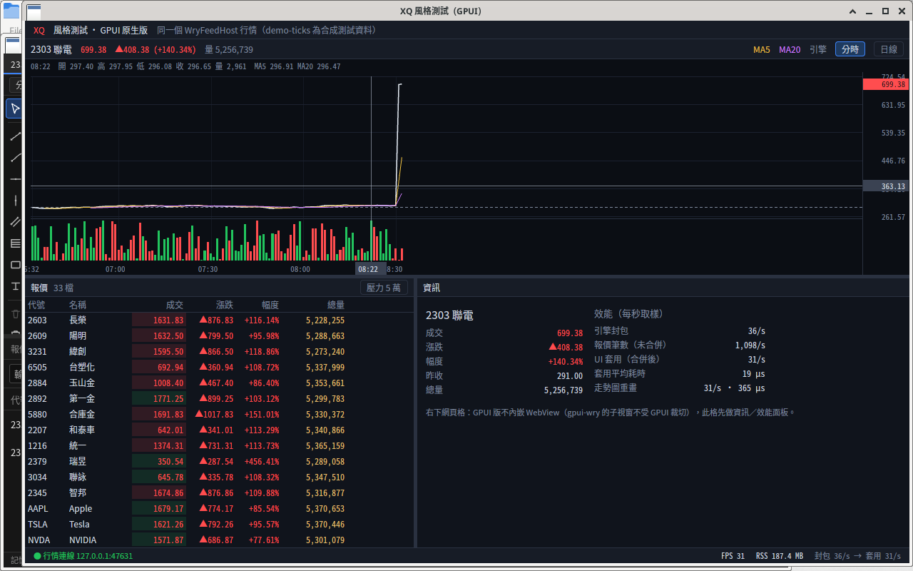

| 日線（合成）＋MA5/20/60＋成交量 | 壓力 5 萬列（虛擬化） |
|---|---|
| 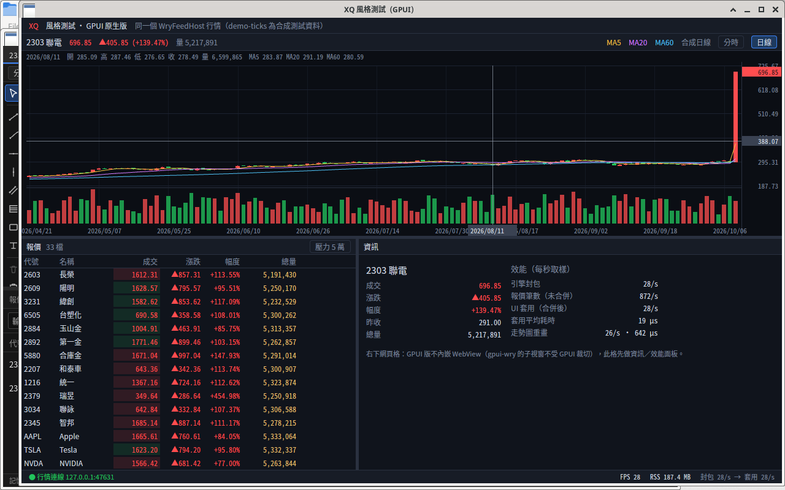 | 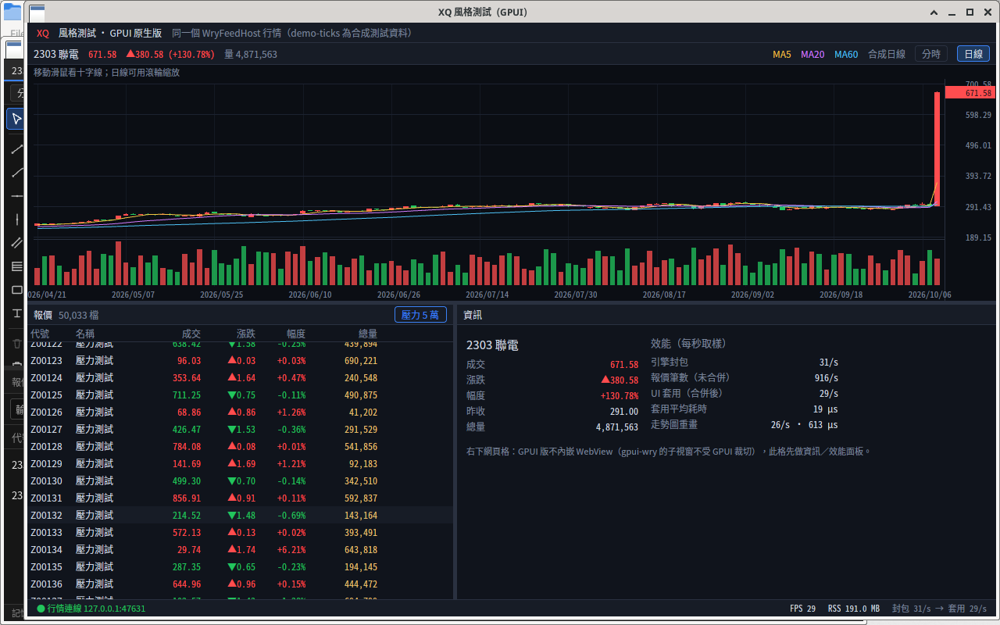 |

## 功能

- 版面：上＝走勢圖、左下＝報價表、右下＝資訊／效能格；**上下、左右分隔線都可拖曳**。
- 報價表：代號／名稱／成交／漲跌／幅度／總量，**漲紅跌綠**，成交價底色顯示上一筆 tick 方向；
  `uniform_list` 虛擬化，按「壓力 5 萬」加 5 萬列合成資料測試捲動與記憶體。
- 走勢圖（canvas 自繪，**高頻看盤取向：每筆 tick 只增量更新最後一根，不整段重算**）：
  - 週期：**分時／日K／週K／月K**。分時＝引擎 `intraday` 快照＋`minutes` 增量分鐘線、昨收虛線；
    日 K 與 wry 版相同做法「合成 1200 根日 K、最後一根跟著現價」，週／月 K 由日 K 聚合。滾輪縮放、拖曳平移、「重設縮放」。
  - **主圖疊加（最多 20 個、可重複、可調參數）**：MA、EMA、布林通道（n, k）、SAR（step, max）。
  - **副圖（最多 10 個，共用時間軸）**：成交量（＋均量 MA5/20）、KD、MACD（DIF／MACD／OSC 柱）、RSI、威廉 %R、DMI（+DI／−DI／ADX）、ATR、OBV。
    「指標 ▾」選單：疊加 ±參數／刪除／新增，副圖勾選與參數 ±。
  - 指標都保存「每一根的遞迴狀態」（EMA、Wilder 平滑、SAR、KD…），跳價只重算最後一根，結果與整段重算一致（有單元測試）。
  - **畫線工具（左側工具列）**：趨勢線、射線、水平線、垂直線、平行通道、費波納契、矩形、文字；點選取、拖曳整條或控制點、
    Delete 刪除、全部清除、Esc 取消、雙擊文字可改字。
  - **畫線層效能**：幾何快取＋64px 格狀空間索引 hit-test、只建可見範圍（含平移預留）、平移時整批頂點位移不重建、
    只有尺度（價格範圍／K 寬／版面）或內容改變才重建。
  - 三個分層 cached view：主圖層（K 棒＋指標）、畫線層、即時層（圖例＋十字線＋選取中的畫線）；滑鼠移動只重畫即時層。
  - 十字線＋游標所在 K 棒的開高低收量與每個指標讀值（疊加圖例自動換行）。
  - **存檔**：每個「代號｜週期」的指標設定與畫線寫到 `~/.local/share/gpui-xq-demo/state.json`（`XQ_GPUI_STATE` 可改路徑；新代號沿用上次指標設定）。
  - 點報價列切換走勢圖代號（重新訂閱 `chart` 代號）。
- 狀態列：連線狀態、FPS、RSS（每秒取樣）、引擎封包數→UI 套用次數。
- **成交明細（範例模組，`XQ_TAPE=1` 才開）**：右下多一欄，由報價推導逐筆成交（總量差）、固定容量 5000 筆、`b` 只看大單、`[`／`]` 門檻、`Home` 回最新；
  團隊「照這個寫」的參考，說明見 [docs/team/example-module.md](docs/team/example-module.md)。

右下的「網頁格」**不在範圍內**：GPUI 沒有官方 WebView；`gpui-wry` 的子視窗畫在 GPUI 之上、不受 ContentMask 裁切
（舊測試程式保留在 `legacy/gpui_wry_window_test.rs`，不參與編譯）。此格先放資訊與效能數字。

## 建置／執行

```bash
export PATH="$HOME/.cargo/bin:$PATH"
cargo build --release            # rust-toolchain.toml 用 stable（GPUI 依賴 oo7 需要 rustc ≥ 1.92）
DISPLAY=:2 XQ_METRICS=1 ./target/release/gpui-xq-demo
cargo test --release --workspace # 協議切包／解碼、指標增量＝整段重算、週／月聚合、成交明細（含行為基準）
cargo bench -p xq-tape           # 成交明細熱路徑 micro-bench（各項有預算）
```

環境變數：

| 變數 | 用途 |
|---|---|
| `XQ_FEED_ADDR=127.0.0.1:47631` | 改行情位址（預設 47631） |
| `XQ_METRICS=1` | 每秒在 stderr 印 fps / rss / 封包數 / 套用耗時 |
| `XQ_NO_VIEW_CACHE=1` | 關掉 view cache（比較用） |
| `XQ_DEBUG=1` | 印滑鼠事件等除錯訊息 |
| `XQ_PERIOD=D` | 啟動週期：`T` 分時（預設）／`D` 日K／`W` 週K／`M` 月K |
| `XQ_TOP_FRAC=0.56` | 上方走勢圖佔比（重圖表壓測用 0.811，讓走勢圖面與 wry 版同為 1166×512） |
| `XQ_GPUI_STATE=路徑` | 存檔位置（預設 `~/.local/share/gpui-xq-demo/state.json`；`XQ_BENCH`／`XQ_CHART_STRESS` 時不讀不寫） |
| `XQ_CHART_STRESS=1` | 重圖表壓測（與 wry 版同流程）：等第一筆報價 → 20 疊加＋8 副圖＋1000 畫線（`XQ_CHART_DRAWINGS`）→ 暖身 `XQ_CHART_WARM_MS`（3000）→ ticks／crosshair／pan 各 `XQ_CHART_PHASE_MS`（10000），結果印 `CHARTPERF|{json}`（FPS、各層平均 paint ms、RSS） |
| `XQ_LAYER_MODE=split` | 實驗：圖層改成 quad／path／字分開（預設每層一個 scene layer，lavapipe 上較快） |
| `XQ_BENCH=1` | 第一幀／第一筆報價畫出後各印一行 `BENCH ...`（給 `scripts/bench-main-window.sh` 打時間戳） |
| `XQ_TAPE=1` | 開成交明細範例面板（預設關閉，壓測版面不變）；`XQ_TAPE_STATE=路徑` 改設定檔位置（預設 `~/.local/share/gpui-xq-demo/tick_tape.json`） |
| `XQ_GROUP_STRESS=1` | 壓測：1.2 秒後開 5 萬列＋合成跳價（`XQ_STRESS_TICK_HZ`，預設 3000 筆/s）`XQ_STRESS_TICK_MS`，再邊跳價邊捲動 `XQ_STRESS_SCROLL_MS`（預設各 2000 ms），結果印 `GROUPPERF|{json}` |

Linux 需要 Vulkan（或 GL）驅動；沒有 GPU 的機器裝 Mesa lavapipe：`sudo apt install mesa-vulkan-drivers vulkan-tools`。

> **WryFeedHost 只接受一個 client（後連者勝）**。GPUI 版和 wry 版同時開會互搶連線（各自 500ms 重連），
> 測試時先暫停另一個：`kill -STOP <wry pid>`，測完 `kill -CONT <wry pid>`。

## 架構

```
crates/xq-feed      ← 共用協議 crate（零依賴）：Subscribe 編碼、FrameReader 切包、型別化 decode、背景連線/重連執行緒
crates/xq-tape      ← 成交明細純邏輯（範例）：報價→成交推導、固定容量 Ring、格式化；單元測試＋行為基準＋micro-bench
src/tick_tape.rs    ← 成交明細面板（範例）：背景緩衝→每幀套用、uniform_list、actions/快捷鍵/焦點、背景存檔
src/bridge.rs       ← 背景執行緒 → UI 的合併層（Inbox）
src/table.rs        ← 報價表 view（uniform_list）
src/chart.rs        ← 走勢圖 view：三個 cached 繪圖層、左側畫線工具列、指標選單、事件、XQ_CHART_STRESS 壓測驅動
src/model.rs        ← 走勢圖狀態：版面（與 wry 同公式）、視圖、互動（畫線／拖曳／平移）、畫線快取鍵
src/indicators.rs   ← 主圖疊加（MA/EMA/BB/SAR）與副圖（VOL/KD/MACD/RSI/%R/DMI/ATR/OBV），每根保存遞迴狀態 → 增量更新
src/drawings.rs     ← 畫線資料（JSON 與 wry 相容）、幾何、hit-test、空間索引、幾何／圖元快取
src/gfx.rs          ← 自己的線段三角化（不靠 lyon）、quad／文字小工具
src/store.rs        ← 指標設定與畫線存檔（背景寫檔）
src/series.rs       ← K 線序列、合成日 K（1200 根）、週／月聚合
src/main.rs         ← Terminal 根 view：版面、分隔線、狀態列、資訊格、FPS/RSS 取樣
```

資料流：

1. `xq-feed` 背景執行緒讀 TCP → `FrameReader` 切包（半包保留）→ `decode` 成 `Msg`（不經 JSON）。
2. `bridge::merge` 在背景執行緒 O(1) 合併進 `Inbox`：**同代號報價只留最新**、分時快照只留最新、同分鐘的分鐘線只留最新。
   只有 Inbox 從空變非空時才送一次喚醒訊號。
3. UI 端一個 async task：被喚醒 → `take()` 整包取走 → 套用 → **睡 16ms 再收下一次**，所以引擎推再快 UI 最多 ~60 次/秒套用。
4. 套用只改有變的列（價／量相同就跳過），只有實際變動的 view 才 `notify`。
5. 報價表／走勢圖／資訊格是三個獨立 entity，用 `.cached()` 掛在根 view 下：報價 tick 只重畫報價表的**可見列**，
   走勢圖只有目前代號有 tick 時才重畫；字串只在 render 時為可見列格式化（5 萬列不預先建字串）。
6. 走勢圖狀態放在 `Rc<RefCell<Model>>`，三個繪圖層共用；tick 只改最後一根、每個指標只算最後一根，
   新分鐘才 append。換代號／週期／指標設定才 O(n) 重建一次。tick 只通知主圖層與即時層，
   畫線層只有在可見價格範圍改變時才重建（平移只位移）。每層包成一個 scene layer，讓 GPUI 每層只做一次 path 光柵批次。

## 效能數字（本機 box：8 核、無 GPU、Mesa lavapipe 軟體 Vulkan、Xvfb 1280×800，demo-ticks 行情；初版量測，完整對照見下一節）

| 項目 | GPUI 版 | wry 版（同時段量測） |
|---|---|---|
| RSS（全部行程） | **≈ 184–196 MB**（單一行程） | 533 MB（主程式 85 + WebKitWebProcess 430 + Network 18）；先前量測右下空白時 615–650 MB |
| 加 5 萬列壓力資料 | +≈ 4.5 MB（191 MB） | — |
| 引擎封包 | 約 30–38 包/s、900–1,200 筆報價/s | 同一來源 |
| UI 套用 | 與封包數相同（≤ 60/s 上限），平均 **17–24 µs**/次 | — |
| 走勢圖 paint（CPU 端組 scene） | 分時 ≈ 0.3 ms、日線 ≈ 0.6–0.7 ms | — |
| FPS | 27–36（跟著 tick 頻率；無變動時不重畫） | — |
| CPU | ≈ 235%（**幾乎都是 lavapipe 軟體光柵**；有實體 GPU 時會低很多） | — |

注意：FPS 上限在這台機器上同時受「行情 ~30 包/s」與「lavapipe 軟體光柵每 frame 約 30ms」限制；
CPU 端每 frame 的工作（套用＋組 scene）不到 1 ms。

## 效能比較（wry vs GPUI）

本 repo 是 Rust + GPUI 原生繪圖版；對照組是 [tao + wry（WebView）版](https://github.com/tina-moneydj/wry-xq-demo)。兩版接同一個行情來源、顯示同樣內容。

> 測試機：Linux、8 核、**沒有顯示卡**（畫面全靠 CPU 模擬繪圖），兩版都是 release build，每項跑 3 次取中位數。完整數字、測試方法與原始檔在最後的〈詳細數據與測試方法〉。

### 結論先看

- **記憶體：GPUI 約只有 wry 的 1/3。** 一般開一個主視窗 182 MB vs 674 MB；重圖表 219 MB vs 685 MB；而且 GPUI 只有 1 個程序、不會隨時間變大。
- **開啟速度：GPUI 較快。** 第一筆報價上畫面 0.40 秒 vs 0.92 秒；重圖表 0.76 秒 vs 1.29 秒。
- **高頻報價：兩版現在都是「同代號先合併、每幀最多更新畫面一次」。** GPUI 從第一版就這樣做（背景執行緒合併，UI 約每 16 ms 套用一次）；wry 是 2026-10-12 才改成同樣做法（改前改後都有列出）。在這台機器上 wry 延遲較低：每秒 10 萬筆時延遲中位數 54 ms vs GPUI 72 ms，wry 的 FPS 也較高。
- **畫面更新率（FPS）：這台沒顯示卡，GPUI 被卡在約 20–31 FPS。** GPUI 自己的運算只用約 22–38% CPU，其餘都花在用 CPU 模擬畫圖；換到有顯示卡的電腦應該會改善很多，但這台無法實測。
- **穩定性：兩版從每秒 1 千到 10 萬筆、加上開盤爆量，都沒有掉筆、報價也不會越積越多。**
- **wry 在高頻下記憶體會漲**（30 秒內多 17–154 MB），GPUI 全程固定約 198 MB。

**怎麼選：** 在意記憶體、開啟速度、要開很多視窗／分割 → GPUI；要最快上線、沿用網頁 UI、在沒顯卡的機器上要高 FPS → wry（已節流的版本）。

### 名詞說明

| 名詞 | 白話意思 |
|---|---|
| RSS | 程式佔用的實體記憶體（MB）。多個程序共用的函式庫會被重複算，所以會偏高。 |
| PSS | 同上，但共用的部分按比例分攤，比 RSS 公平。 |
| p50／p95／p99 | 把所有量到的值由小排到大：p50 是中間值（一般情況），p99 是最慢的 1%（偶爾卡一下的程度）。 |
| FPS | 每秒畫面更新幾次，越高越順。**兩版算法不同**：wry 數的是瀏覽器的畫面回呼次數（沒卡住就接近 60），GPUI 數的是真的畫出來的幀，所以只能當參考，不能直接比大小。 |
| CPU（扣掉軟體繪圖） | 100% = 一顆核心。這台沒顯示卡，畫面由 CPU 模擬繪圖（llvmpipe），這部分換到有顯示卡的電腦就會交給 GPU，所以另外列出「扣掉軟體繪圖」的數字，代表程式本身的工作量。 |
| 延遲 | 從報價送出到畫面更新完成的時間（ms），越低越好。 |
| 合併 vs 掉筆 | 合併：同一檔一幀內跳了好幾次，只畫最新那筆，是刻意的、不算遺失。掉筆：報價根本沒收到，兩版都是 0。 |

### 1. 開一個主視窗（一般看盤）

同樣內容（33 檔自選、2330 日線＋MA＋量、報價表），一般模擬行情持續跳動。

| 項目 | wry | GPUI | 較好 |
|---|---|---|---|
| 開啟 → 第一個畫面 (ms) | 986 | 285 | **GPUI** |
| 開啟 → 第一筆報價 (ms) | 917 | 398 | **GPUI** |
| 記憶體 RSS，開 60 秒 (MB) | 674 | 182 | **GPUI** |
| 記憶體 PSS，開 60 秒 (MB) | 477 | 178 | **GPUI** |
| 程序數 | 3 | 1 | **GPUI** |
| CPU 扣掉軟體繪圖 (%) | 79 | 22 | **GPUI** |
| CPU 全部 (%)（含軟體繪圖） | 181 | 246 | wry（沒顯卡的影響） |

GPUI 記憶體約 1/3.7、開啟快約 2.3–3.5 倍；CPU 全部看起來較高，是因為這台沒有顯示卡、每幀都要用 CPU 畫整個視窗。另外加 5 萬列報價表壓測，兩邊記憶體幾乎不變（GPUI 187 MB、wry 623 MB）。（GPUI 這一節的日 K 是 260 根，後面重圖表改成 1200 根。）

### 2. 重圖表（1000 條畫線＋20 個疊加指標＋8 個副圖）

把走勢圖塞到最重，然後一邊跳價、一邊移動十字線、一邊左右平移。下表取「跳價＋十字線」那段（其他兩段見詳細數據）。

| 項目 | wry | GPUI | 較好 |
|---|---|---|---|
| 開啟 → 第一個重圖表 (ms) | 1,294 | 763 | **GPUI** |
| 記憶體 RSS (MB) | 703 | 220 | **GPUI** |
| CPU 扣掉軟體繪圖 (%) | 132 | 38 | **GPUI** |
| 每幀畫圖表時間 (ms) | 7.3 | 3.1 | **GPUI**（算法略不同） |
| FPS | 31.9 | 20.7 | wry（這台沒顯卡） |

GPUI 用 1/3 的記憶體、約 1/3 的 CPU 工作量就畫完；但這台沒顯示卡，最後「把畫面畫出來」那步卡住 GPUI，所以 FPS 輸 wry。左右平移時 wry 記憶體會升到 804 MB、FPS 降到 23.9，GPUI 維持 223 MB、20.5 FPS。

### 3. 高頻報價（每秒 1 千～10 萬筆＋開盤爆量）

用 5 萬列報價表＋走勢圖，把報價速度一路加上去，看會不會延遲變大、掉筆或卡住。wry 用的是**節流後（2026-10-12）**的數字；節流前的舊數字在詳細數據裡。

**兩版的更新方式現在相同**：報價在背景先依代號合併（同一檔只留最新），畫面每幀最多更新一次。
- **GPUI**：從第一版就是這樣（`src/bridge.rs`：行情執行緒合併，UI 約每 16 ms 取一次），沒有網頁／JS 這一層。
- **wry**：原本每收到一包就推給網頁一次（一秒約 200 次），2026-10-12 改成和 GPUI 一樣「每幀最多推一次」（`src/push.rs`）。

**那為什麼延遲還是不一樣？**
- **主要是幀間隔**：這台沒有顯示卡，wry 能跑到約 60 FPS（每幀約 16 ms），GPUI 要用 CPU 模擬繪圖，只有約 31 FPS（每幀約 32 ms）。報價都要等下一幀才上畫面，所以 GPUI 的約 72 ms 大多是在等畫面，而不是處理報價慢；換到有顯示卡的電腦這段應該會明顯縮短（這台無法實測）。
- **GPUI 少了一道轉換**：wry 每次要把報價轉成腳本送進網頁、再由 JS 解析套用；GPUI 直接在原生程式裡套用，所以 CPU 工作量較低，記憶體也固定在約 198 MB 不會漲。

| 每秒報價 | wry 延遲 p50 (ms) | GPUI 延遲 p50 (ms) | wry 延遲 p99 (ms) | GPUI 延遲 p99 (ms) | 延遲較低 |
|---|---|---|---|---|---|
| 1 千 | 46.1 | 71.5 | 64.1 | 104.2 | **wry** |
| 1 萬 | 46.4 | 72.4 | 68.4 | 120.4 | **wry** |
| 5 萬 | 50.5 | 71.7 | 79.5 | 120.6 | **wry** |
| 10 萬 | 53.5 | 72.3 | 72.3 | 107.7 | **wry** |
| 開盤爆量 | 47.6 | 72.1 | 86.3 | 105.0 | **wry** |

| 每秒報價 | wry 記憶體 結束 (MB) | GPUI 記憶體 結束 (MB) | wry FPS | GPUI FPS | wry 點選切換 (ms) | GPUI 點選切換 (ms) | 掉筆 |
|---|---|---|---|---|---|---|---|
| 1 千 | 632 | **198** | 60 | 31 | **31** | 54 | 0 |
| 1 萬 | 660 | **198** | 60 | 31 | **49** | 53 | 0 |
| 5 萬 | 762 | **198** | 55 | 31 | 60 | **51** | 0 |
| 10 萬 | 766 | **198** | 52 | 31 | 57 | **55** | 0 |
| 開盤爆量 | 683 | **199** | 60 | 31 | **49** | 56 | 0 |

兩版都是每幀最多更新一次；節流後 wry 的延遲每一級都比 GPUI 低，差別主要來自這台沒顯卡的機器上 GPUI 每幀較慢（約 31 vs 60 FPS）；GPUI 的記憶體則始終固定在約 198 MB，wry 是它的 3–4 倍。兩版都沒有掉筆、沒有積壓。

**wry 節流前後（每秒 10 萬筆）**：延遲 p50 83.8 → 53.5 ms、p99 164.2 → 72.3 ms、記憶體結束 1,163 → 766 MB、FPS 28 → 52、點選切換 130 → 57 ms。代價是低頻多等約一幀（1 千筆時 p50 31.0 → 46.1 ms）。

## 詳細數據與測試方法

以下是原本的完整表格、測試方法與注意事項，數字與 `docs/bench/` 的原始檔一致。

<details>
<summary>展開完整數據、測試方法與注意事項</summary>

### 主視窗成本比較（詳細）

同一個行情來源、同一份畫面內容，各開**一個主視窗**的成本。對照專案：[tina-moneydj/wry-xq-demo](https://github.com/tina-moneydj/wry-xq-demo)（tao + wry 版）。

- **測試日期**：2026-10-08（Asia/Taipei 12:24–12:35）；每個情境兩邊各跑 **3 次取中位數**，兩個程式輪流跑（WryFeedHost 一次只服務一個 client）。
- **環境**：Linux box（Debian 13，kernel 6.12，8 vCPU Intel Xeon，**沒有 GPU**），Xvfb `:2` 1280×800＋xfwm4（X11）。
  wry 版＝WebKitGTK 2.54（`WEBKIT_DISABLE_COMPOSITING_MODE=1`）；GPUI 版＝`gpui-pre 0.3.7` 走 Vulkan，由 **Mesa 25.0.7 lavapipe 軟體光柵**。
  行情：`WryFeedHost --demo-ticks`（合成資料，約 30 包／900 筆報價每秒），測前重啟過 feedhost。兩邊都是 release build。
- **同樣的畫面**：視窗 1200×720、33 檔自選（同 `gpui-xq-demo/src/names.rs`）、單一走勢圖＝**2330 日線（合成日 K）＋MA5/20/60＋成交量**、
  左下報價表 6 欄（代號／名稱／成交／漲跌／幅度／總量）、右下空白（wry 是 `about:blank`，**不建子 WebView**；GPUI 是資訊格）、不開壓力 5 萬。
  wry 的 `state.json` 測試時換成同內容的最小設定（1 個走勢分頁、左下只有「組合」分頁），測完還原。
- **方法**（[`scripts/bench-main-window.sh`](scripts/bench-main-window.sh)，可重跑：`scripts/bench-main-window.sh 3 all`）：
  - 啟動：launch → 視窗出現（`xdotool` 輪詢）→ 第一幀畫完／第一筆報價畫上畫面（程式在 `XQ_BENCH=1` 時印 `BENCH first-frame`／`BENCH first-quote`，腳本收到時打時間戳）。
  - 記憶體：主行程＋所有子行程（wry：`WebKitWebProcess`、`WebKitNetworkProcess`）的 RSS，以及 PSS（`/proc/*/smaps_rollup`，共用函式庫按比例分攤，比較公平）。
  - CPU：所有行程（含所有執行緒）`utime+stime` 在 30 秒內的平均；100% = 一顆核心。另外依執行緒名稱拆出「軟體光柵（`llvmpipe` 執行緒）」佔多少。
  - FPS：程式自己回報（wry：狀態列 rAF 計幀；GPUI：每秒實際畫出的 frame 數），取 30–60 秒平均。

#### 一般情境（開一個主視窗、行情持續跳動）

| 項目（中位數，3 次） | wry（tao + wry / WebKitGTK） | GPUI（原生繪圖） |
|---|---|---|
| 啟動 → 視窗出現 | 228 ms | 261 ms |
| 啟動 → 第一幀畫完 | 986 ms | **285 ms** |
| 啟動 → 第一筆報價上畫面 | 917 ms¹ | **398 ms** |
| RSS 合計，t=10s | 600 MB | **182 MB** |
| RSS 合計，t=60s | 674 MB（主程式 195＋WebKitWebProcess 413＋Network 60）² | **182 MB**（單一行程） |
| PSS 合計，t=10s / t=60s | 414 / 477 MB | **178 / 178 MB** |
| 行程數／執行緒數 | 3／80 | **1／53** |
| CPU（30 秒平均，全部行程） | **181%** | 246% |
| 　└ 其中軟體光柵（llvmpipe 執行緒）³ | ≈ 102% | ≈ 224% |
| 　└ 扣掉軟體光柵（程式本身＋瀏覽器引擎）³ | ≈ 79%（WebKit 主執行緒 65%、wry 主程式 8%） | **≈ 22%** |
| FPS（程式回報） | 59.5（rAF 計幀，不代表每幀都有重畫） | 27.7（實際畫出的幀；被 lavapipe 每幀約 30 ms 卡住） |
| 執行檔大小 | **1.6 MB**（另需系統 WebKitGTK 4.1：`libwebkit2gtk` 96 MB＋`libjavascriptcoregtk` 33 MB；Windows 用系統 WebView2，安裝檔 3.1 MB） | 25.1 MB（單一執行檔，strip＋thin LTO；只需 Vulkan/GL 驅動） |

¹ wry 的第一筆報價和第一幀幾乎落在同一幀（兩個標記都是「兩次 rAF 後」送出，順序會互換）。
² wry 的 RSS 在開頭 60 秒內會從 600 爬到 674 MB（JS heap／WebKit 快取暖身）；GPUI 從第 10 秒起就持平。
³ 執行緒拆分取第 3 次的數字。

#### 壓力情境（5 萬列報價表＋高頻跳價＋捲動）

兩邊都開 **5 萬列合成表、6 欄**，每秒 **3000 筆合成跳價**（30 Hz 分批、隨機挑列，同 wry 版 `applyTicks`），
先只跳價 **30 秒**、再邊跳價邊上下正弦捲動 **10 秒**；行情 feed 照常進來。
wry：`XQ_GROUP_STRESS=1 XQ_STRESS_COLS=6 XQ_STRESS_TICK_MS=30000 XQ_STRESS_SCROLL_MS=10000`；
GPUI：`XQ_GROUP_STRESS=1`（同一組 `XQ_STRESS_*` 參數），結果都以 `GROUPPERF|{json}` 印出。

| 項目（中位數，3 次） | wry | GPUI |
|---|---|---|
| RSS／PSS，跳價 30 秒時（約 t=32s） | 623／426 MB | **187／183 MB**（比一般情境只多 ≈ 4 MB） |
| RSS／PSS，捲動中（約 t=40s） | 647／456 MB | **186／183 MB** |
| CPU，跳價 30 秒 | **171%** | 298%（其中 llvmpipe ≈ 272%） |
| CPU，捲動 10 秒 | **192%** | 305% |
| FPS，跳價中 | 59.5（rAF） | 35.8（實際幀） |
| FPS，捲動中 | 59.7（rAF） | 35.5（實際幀） |
| 捲動卡頓（幀間隔 > 32 ms） | 1 次（平均 35 ms） | 140 次（平均 33.1 ms，即穩定 ~30 fps 的幀距） |
| 可見格更新，跳價中 | 0.36 ms／次、約 1 格／次（只重畫髒列；30 秒 769 次） | **0.09 ms**／次、84 格／次（整個可見範圍重建；30 秒 1074 次） |
| 可見格更新，捲動中 | 1.15 ms／次、120 格／次（10 秒 834 次） | **0.09 ms**／次、84 格／次（10 秒 355 次） |

兩邊的差異（盡量對齊，但仍不完全相同）：
- 表格內容：wry 是純合成組合（50,000 列）；GPUI 是 33 檔真實自選＋50,000 合成列（最上面是真實列）。
- 更新策略：wry 只重畫「可見且有變」的格；GPUI 每次表格有變就重建整個可見範圍（14 列×6 欄），但每次只要 ~0.09 ms。
- 「可見格更新」只算組資料的時間：wry＝JS 組 DOM 字串＋`innerHTML`；GPUI＝建立可見列的元素樹。都**不含**版面計算與光柵化。
- 捲動驅動：wry 用 rAF（跟顯示同步）；GPUI 用 16 ms 計時器。可見列數：wry 約 20 列（含 overscan）、GPUI 14 列。
- FPS 定義不同（見上表）。

#### 結論

- **記憶體**：GPUI 版約是 wry 版的 **1/3.7（RSS 182 vs 674 MB）**，PSS 也只有 **~37%**（178 vs 477 MB），而且只有一個行程、不隨時間增長；
  5 萬列壓力表對兩邊都不太加記憶體（虛擬化），GPUI 只多約 4 MB。
- **啟動**：視窗出現時間差不多（~0.25 s），但 GPUI **~0.3 s 就畫出內容**、0.4 s 有報價；wry 要等 WebKit 子行程起來、載入 HTML/JS，約 **0.9–1.0 s**。
- **CPU／FPS（這台沒有 GPU）**：GPUI 看起來比較吃 CPU、FPS 也較低，原因是 lavapipe 用 CPU 光柵化**整個視窗每一幀**（佔它 CPU 的 ~90%）；
  扣掉軟體光柵，GPUI 本身只用 **~22%**，wry（WebKit 主執行緒＋主程式）約 **~79%**。有實體 GPU 時 GPUI 的光柵化交給 GPU，CPU 與 FPS 會大幅改善；
  wry 在 Windows／macOS 也會改用 GPU 合成，數字同樣會不同。
- GPUI 表格還能再省：只在跳價的列落在可見範圍時才 `notify`（wry 版已經這樣做）。

#### 注意事項

- 這是**沒有 GPU 的 Linux／Xvfb**：兩邊都靠 Mesa 軟體光柵（WebKit 也有 ~100% 的 `llvmpipe` 執行緒）。Windows（WebView2／DirectX）、macOS（WKWebView／Metal）的絕對數字會不同，請在目標機器重跑。
- wry 的 FPS 是 rAF 回呼次數（主執行緒沒被卡住就接近 60），GPUI 的 FPS 是實際畫出的幀數（沒變化就不畫），**兩者不能直接比**；看卡不卡要對照捲動卡頓與 CPU。
- demo-ticks 價格有向上漂移，測試約 25 分鐘內 2330 漲了 ~70%（假資料特性，不影響成本量測）。
- RSS 會重複計算共用函式庫（WebKit 三個行程共用很多 .so），所以同時列 PSS。
- 截圖（t≈60s／壓力跳價中）：

| wry | GPUI |
|---|---|
| 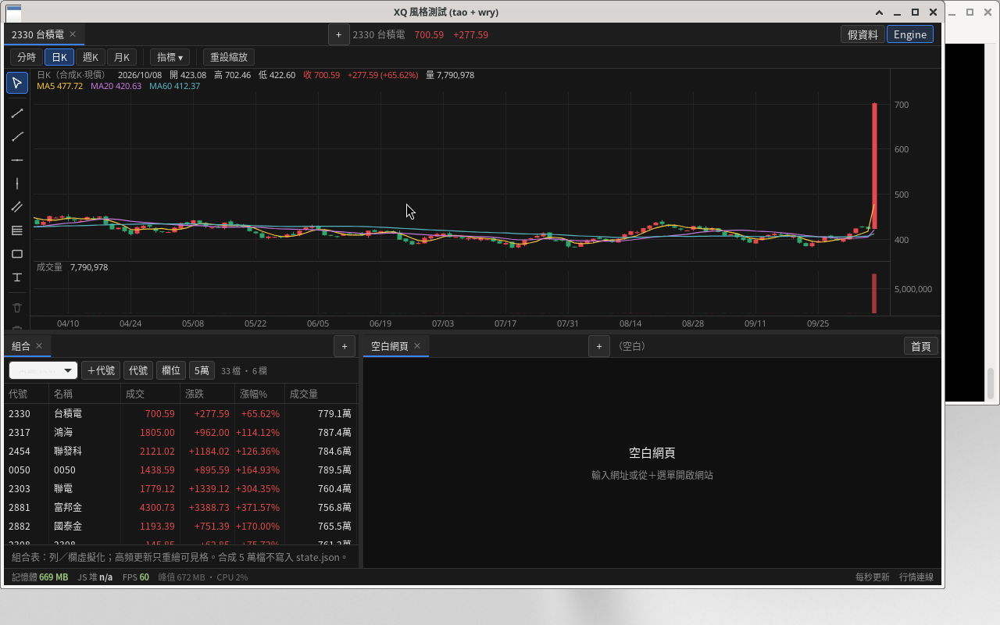 | 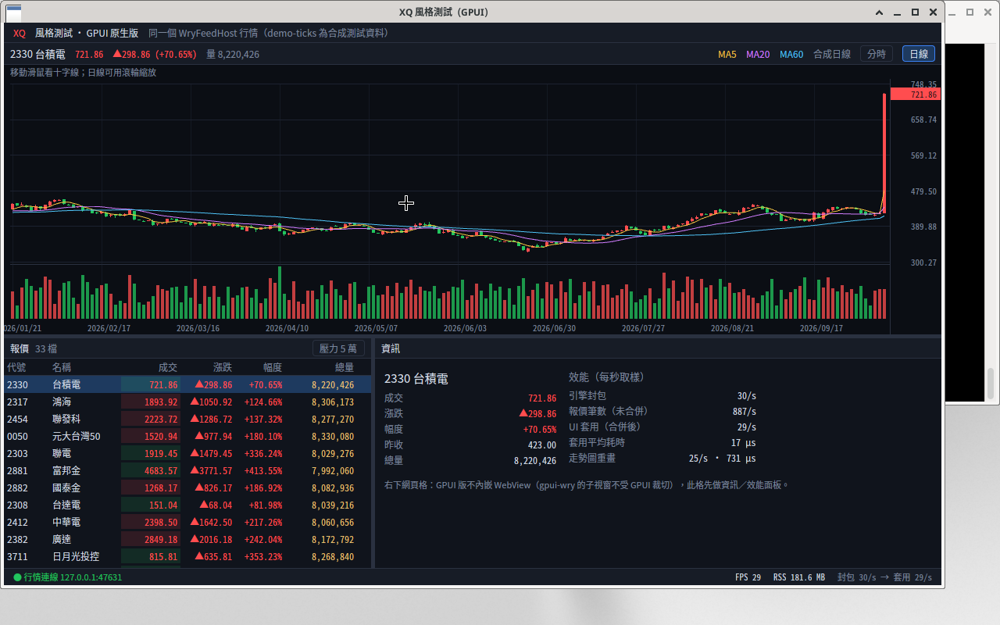 |
| 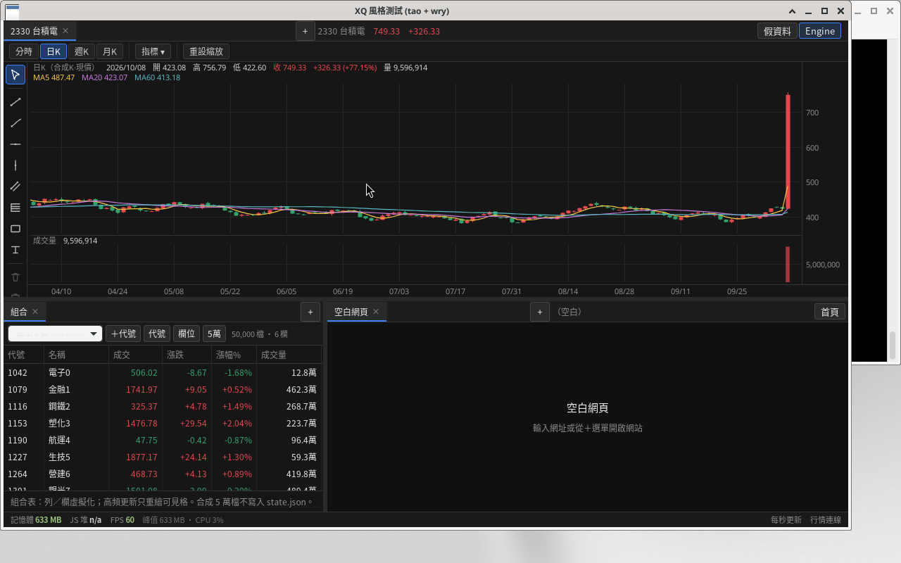 | 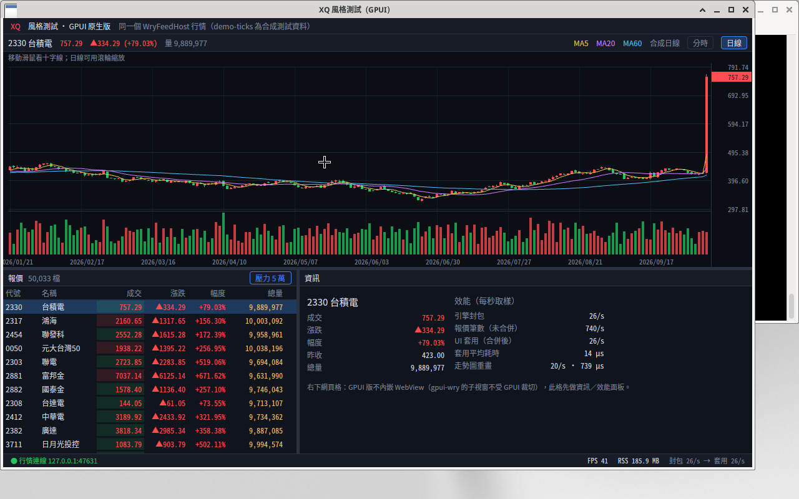 |

原始數據：[`docs/bench/summary.json`](docs/bench/summary.json)、[`docs/bench/results.json`](docs/bench/results.json)。

### 重圖表壓測（1000 畫線＋多指標，詳細）

上面兩個情境的走勢圖都很輕（MA×3＋成交量）。這一節把**同一個主視窗**的走勢圖塞到最重，比較看盤畫面最吃資源的情況。

- **測試日期**：2026-10-08（Asia/Taipei 13:15–13:19）；兩邊各跑 **3 次取中位數**，輪流跑（WryFeedHost 一次只服務一個 client），量測前重啟過 feedhost（避免 demo 價格漂移）。
- **環境**：同上（8 vCPU、**沒有 GPU**、Xvfb `:2`、WebKitGTK 2.54 `WEBKIT_DISABLE_COMPOSITING_MODE=1` Canvas 2D／`gpui-pre 0.3.7` wgpu → Mesa lavapipe），release build，視窗 1200×720。
- **同樣的負載**（兩邊同一套定義，GPUI 版照 wry `__perfSetupStress`／`__perfAddN`／`__perfContinuous` 移植）：
  - 2330 **日 K 1200 根**（合成，最後一根跟著現價）。
  - **主圖疊加 20 個**：MA×11（5、10、15、20、25、30、40、50、60、120、7）、EMA×5（8、12、21、26、55）、布林×2（20,2／50,2.5）、SAR×2（0.02/0.2、0.04/0.3）。
  - **副圖 8 個**共用時間軸：成交量＋均量 MA5/20、KD、MACD、RSI、威廉 %R、DMI、ATR、OBV。
  - **畫線 1000 筆**，同一個產生公式：趨勢線 40%、射線 8%、水平線 8%、垂直線 8%、平行通道 12%、費波納契 12%、矩形 6%、文字 6%。
  - **走勢圖 canvas 同為 1166×512**：1200×720 的預設上下比例下，20 個疊加的圖例＋8 個副圖會把主圖擠到只剩幾個像素，所以兩邊都把上方走勢圖放大
    （wry `XQ_CHART_TOP_RATIO=0.8`、GPUI `XQ_TOP_FRAC=0.811`；實際尺寸兩邊都在 `CHARTPERF setup` 印出確認）。
- **流程**（`XQ_CHART_STRESS=1` 自動執行）：等第一筆真實報價 → 300 ms 後套用上述負載（印 `BENCH heavy-frame`）→ 暖身 3 秒 → 三段各 **10 秒**：
  - **ticks**：每一幀跳一筆合成價（`最後收盤 + sin(f/7)×0.15`、量 +1），所有指標更新最後一根；
  - **crosshair**：跳價＋十字線依公式移動（`x = 80 + 13f mod (w−160)`、`y = 40 + 7f mod (h/2)`）；
  - **pan**：跳價＋十字線＋視圖左右正弦平移 ±12 根（拖曳中、價格軸凍結）。
- **量測**（[`scripts/bench-main-window.sh`](scripts/bench-main-window.sh) `heavy` 模式：`GPUI_TOP_FRAC=0.811 scripts/bench-main-window.sh 3 heavy`）：
  各段的 CPU（所有行程所有執行緒；另外扣掉 `llvmpipe` 軟體光柵執行緒）、各段第 5 秒的 RSS／PSS（全部行程）、
  程式回報的 FPS 與平均走勢圖繪製耗時（`CHARTPERF|{json}`）、啟動到第一個重圖表幀的時間。

| 項目（中位數，3 次；ticks／crosshair／pan） | wry（WebKitGTK Canvas 2D） | GPUI（原生繪圖） |
|---|---|---|
| 啟動 → 第一筆報價上畫面 | 913 ms | **405 ms** |
| 啟動 → 第一個重圖表幀（等報價＋300 ms＋套用負載） | 1,294 ms | **763 ms** |
| RSS 合計 | 685／703／804 MB（3 個行程） | **219／220／223 MB**（1 個行程） |
| PSS 合計 | 498／516／617 MB | **215／216／219 MB** |
| CPU 合計（100% = 一顆核心） | **249％／249％／285％** | 413％／422％／412％ |
| 　└ 其中 `llvmpipe` 軟體光柵 | ≈ 113％／117％／171％ | ≈ 376％／378％／377％ |
| 　└ 扣掉軟體光柵 | 136％／132％／110％（`WebKitWebProcess` 同名執行緒合計 ≈ 120％） | **37％／38％／36％**（`gpui-xq-demo` 同名執行緒合計 ≈ 34％） |
| FPS（程式回報，定義不同見下） | **31.7／31.9／23.9**（rAF 次數） | 20.6／20.7／20.5（實際畫出的幀） |
| 平均走勢圖繪製（每幀，定義不同見下） | 6.8／7.3／8.2 ms（`render()`，含 Canvas 2D 光柵） | **3.0／3.1／2.2 ms**（三層 CPU 端組圖元，不含光柵） |

GPUI 三層的細項（中位數那次）：主圖層 ≈ 1.2 ms／幀；畫線層 ≈ 1.1 ms（跳價改到可見價格範圍時重建可見的 ~193 筆，≈ 9,900 個頂點）、
平移時 ≈ 0.47 ms（只整批位移、不重建）；即時層（圖例＋十字線）≈ 0.6 ms。

**結論**

- **記憶體**：GPUI 約是 wry 的 **1/3**（RSS 219 vs 685–804 MB、PSS 215 vs 498–617 MB），而且三段幾乎不增長；wry 在平移段又多了約 100 MB（推測是 JS 物件／畫布暫存）。
- **啟動**：GPUI 0.76 s 就畫出完整重圖表，wry 要 1.29 s（多半是 WebKit 子行程與 HTML/JS 載入）。
- **CPU 端的繪圖工作**：GPUI 扣掉光柵只用 **~35%**，每幀組圖元 2–3 ms（指標全部增量、畫線分層快取＋平移位移＋可見範圍裁切）；
  wry 扣掉光柵約 **110–136%**（大多在 WebKitWebProcess）、每幀 `render()` 7–8 ms。
- **FPS（這台沒有 GPU）**：ticks／crosshair 時 **wry 較高（≈ 32 vs 21）**，pan 時差距縮小（24 vs 20.5）。GPUI 三段 FPS 幾乎一樣、
  CPU 端也只用一小部分時間，瓶頸是 **lavapipe 每一幀用 CPU 光柵化整個視窗**（≈ 3.8 顆核心；GPUI 的 path 還要先畫到 4× MSAA 中介貼圖）；
  wry 每幀只需重畫走勢圖 canvas 那一塊（Cairo 在 CPU 上畫）。換成有實體 GPU 的機器，GPUI 的光柵化會交給 GPU，FPS 應該會大幅提升，但**這台機器沒辦法驗證，需在目標機器重跑**。

**注意事項**

- **FPS 定義不同**：wry＝`__perfContinuous` 的 rAF 回呼次數（每次回呼同步跑完 `render()`，WebKit 之後才合成上畫面）；
  GPUI＝根 view 實際畫出的幀數（壓測用 `on_next_frame` 每幀驅動一步）。
- **繪製耗時定義不同**：wry 的 `render()` 包含 Canvas 2D（Cairo）實際光柵化；GPUI 只算三層 paint 在 CPU 端組 quad／path／文字的時間，光柵在 `llvmpipe` 執行緒，**不含在內**。
- **畫面放大**：兩邊都把上方走勢圖放大到同樣的 1166×512（見上），跟前兩個情境的版面比例不同。
- **合成 K 線不完全一樣**：兩邊都是「合成日 K、最後一根跟現價」，但亂數產生器不同，K 棒數值不同，所以畫線落點、可見價格範圍、畫線層重建次數會有差異
  （GPUI 第 3 次剛好價格範圍沒被跳價改到、畫線層 0 次重建，每幀 2.4 ms，FPS 仍是 20.3 → 再次說明瓶頸在光柵化）。
- GPUI 的日 K 根數為了這個測試從 260 改成 **1200**（與 wry 相同）；前兩節的 GPUI 數字是 260 根時量的。
- wry 平移時走 `lightOnly` 路徑，重型指標的快取會被丟掉、每幀重算；GPUI 所有指標都保存每根的遞迴狀態，平移與跳價都只算最後一根。
- 校正時先用一個跑了 25 分鐘、2330 已漂到 +1000% 的 feed 試跑，wry 只有 15–17 FPS、GPUI 19.5 FPS（價格範圍異常時畫線全擠在一起）；正式量測前已重啟 feedhost。
- 截圖（最後一次、crosshair 段中間）：

| wry | GPUI |
|---|---|
| 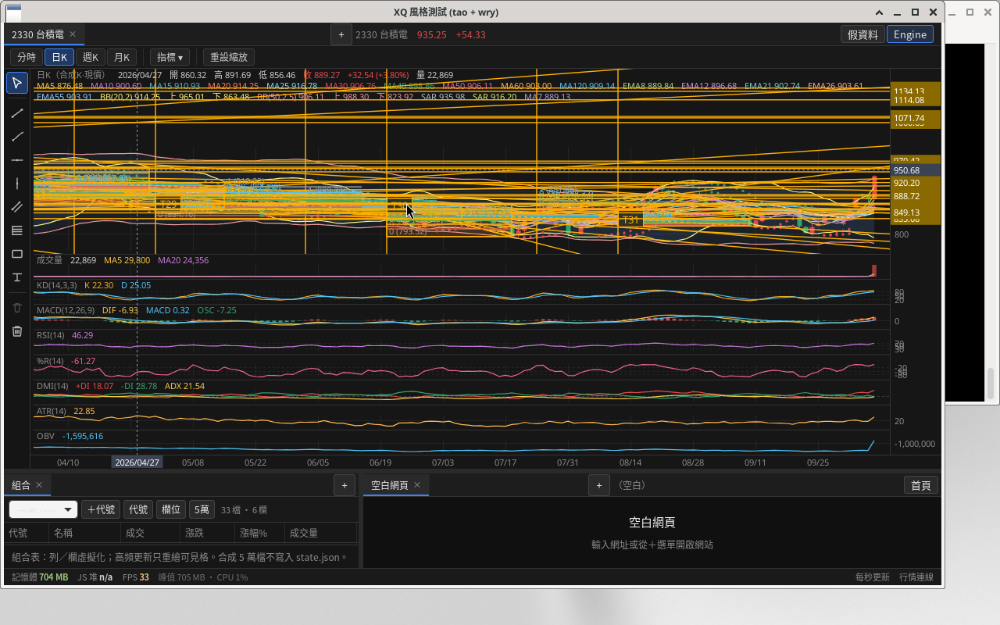 | 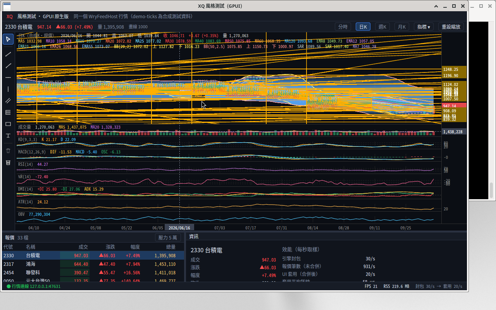 |

原始數據：[`docs/bench/summary-heavy.json`](docs/bench/summary-heavy.json)、[`docs/bench/results-heavy.json`](docs/bench/results-heavy.json)。

### 高頻進價壓測（詳細；tick→畫面延遲、積壓、合併、CPU／記憶體）

前面幾節的行情都是 WryFeedHost `--demo-ticks`，大約 40 Hz。這一節把進價頻率拉到 **每秒 1k～100k 筆**，再加上開盤爆量，看兩個版本會不會積壓、掉筆或卡住。

- **測試日期**：2026-10-08（Asia/Taipei 14:59–15:20）。每個情境、每個程式各跑 **3 次取中位數**，兩個程式輪流跑（一次只開一個）。每一輪都重開產生器，所以價格從昨收重新開始。
- **環境**：同上（8 vCPU、**沒有 GPU**、Xvfb `:2`、Mesa lavapipe 軟體光柵），release build，主視窗 1200×720，兩邊版面相同。
- **行情產生器** `xq-tickgen`（在 gpui-xq-demo 的 `crates/xq-feed/src/bin/`，只用 std）：
  - 協議和 WryFeedHost 完全相同，同樣是 127.0.0.1:47631、little-endian 封包；量測時 WryFeedHost 已先停掉。
  - **每 5 ms 送一包，不合併，每一筆都送**。每包第一筆是走勢圖那檔 2330（探針），其餘 20% 落在 33 檔自選、80% 均勻落在 `Z00000`–`Z49999`。
  - 價格以昨收為中心做均值回歸的隨機走動，夾在 ±10%，不會漂移。
  - 每包報價的尾端多附 20 bytes：`b"XQTS" + seq u64 + sent_us u64`。一般解碼器讀完 n 筆就停，會忽略這段，所以**向下相容**。程式只有在 `XQ_TICK_BENCH=1` 時才解析（預設關閉）。
- **情境**：
  - 穩定 **1k／10k／50k／100k 筆/秒**，各 30 秒。
  - **開盤爆量 burst**：`rate = 5k + 150k·e^(−t/3s)`，前 3 秒約 30 萬筆，30 秒共約 60 萬筆。
  - 每輪流程：程式訂閱後等 3 秒 → 送一次 50,033 檔快照（不計入）→ 暖身 3 秒 → 量 30 秒 → 收尾 4 秒。
- **畫面**：
  - 上方是 2330 日線（MA5/20/60＋量）。
  - 左下是 **50,033 列報價表**（33 檔自選＋5 萬列 Z，6 欄），engine 報價會 O(1) 對到每一列。wry 用組合分頁的暫時表格（不寫進 state.json），GPUI 用 QuoteTable 的 5 萬列加索引。
  - 1200×720 下，wry 的表可見約 8 列，GPUI 約 11 列。
- **怎麼量**（[`scripts/bench-ticks.sh`](scripts/bench-ticks.sh)，指令：`scripts/bench-ticks.sh 3`）：
  - **延遲 = present − sent**。兩邊時鐘都取同一台機器的 CLOCK_REALTIME（Rust `SystemTime`；JS `performance.timeOrigin + now()`，WebKit 精度 1 ms）。
    - 每一個畫出來的幀記兩個值：「這幀套用到的**最舊**一包」（下表主數字）和「**最新**一包」。
    - present 的定義：GPUI 是套用後的下一個 `window.on_next_frame`；wry 是套用後的第二個 rAF。兩者都是**上界**，最多多算約 1 幀。
  - **積壓**：比較前 5 秒和最後 5 秒的延遲中位數，並看收尾時程式收到的筆數是否等於送出的筆數。
  - **收到 vs 送出**：收到 = 程式解碼的筆數（未合併）。送出 − 收到 = 真的遺失（TCP 本身不會掉，會出現差額代表程式卡住沒讀）。收到 → 交給 UI → 表格更新的差額是**刻意合併**（同一代號只留最新），不算遺失。
  - **CPU**：整棵行程樹（wry 含 WebKitWebProcess）30 秒的平均，另列扣掉 `llvmpipe` 軟體光柵執行緒的數字。
  - **記憶體**：RSS／PSS 量測開始與結束的值。
  - **FPS**：程式自己每秒回報。wry 是 rAF 次數，GPUI 是 root render 次數。
  - **操作回應**：量測中每 6 秒用 xdotool 點報價表的 2317 列，1 秒後再點 2330 列，量 click → 切換代號後第一幀畫完（present 定義同上）。每格 3 輪共 24 次。
  - 量測程式碼只在 `XQ_TICK_BENCH=1` 時啟用，預設關閉，平常的熱路徑不多做事。

**結果（wry 為節流前 2026-10-08 的數字；節流後見下方）**（3 次中位數；延遲單位 ms，是每一幀「最舊一包」的延遲）

| 項目 | 1k/s wry | 1k/s GPUI | 10k/s wry | 10k/s GPUI | 50k/s wry | 50k/s GPUI | 100k/s wry | 100k/s GPUI | burst wry | burst GPUI |
|---|---|---|---|---|---|---|---|---|---|---|
| 延遲 p50 | **31.0** | 71.5 | **40.7** | 72.4 | **61.9** | 71.7 | 83.8 | **72.3** | **39.0** | 72.1 |
| 延遲 p95 | **38.9** | 76.5 | **52.6** | 76.4 | 80.1 | **76.6** | 115.7 | **76.4** | 77.6 | **76.5** |
| 延遲 p99 | **50.6** | 104.2 | **68.7** | 120.4 | **103.6** | 120.6 | 164.2 | **107.7** | 122.5 | **105.0** |
| 延遲 max | 175 | 173 | **173** | 216 | 211 | **170** | 336 | **169** | 198 | **186** |
| 最新一包延遲 p50 | 19.9 | 44.5 | 25.6 | 45.3 | 38.5 | 44.7 | 53.3 | 45.0 | 24.0 | 45.0 |
| 前 5 秒 → 最後 5 秒 p50 | 32 → 31 | 72 → 72 | 40 → 41 | 73 → 72 | 61 → 62 | 72 → 73 | 83 → 84 | 72 → 71 | **73 → 36** | 71 → 73 |
| 送出 = 收到（遺失） | 0 | 0 | 0 | 0 | 0 | 0 | 0 | 0 | 0 | 0 |
| 交給 UI（合併後）／收到 | 99% | 82% | 97% | 87% | 90% | 81% | 86% | 79% | 90% | 82% |
| UI 套用批數（30 秒） | 5,988 | 924 | 5,979 | 920 | 5,972 | 921 | 5,976 | 918 | 5,989 | 925 |
| CPU 合計 | **237%** | 353% | **226%** | 346% | **208%** | 354% | **202%** | 356% | **224%** | 348% |
| CPU 扣掉 llvmpipe | 106% | **27%** | 116% | **28%** | 127% | **33%** | 140% | **37%** | 117% | **29%** |
| RSS 開始 → 結束 (MB) | 623 → 672 | **198 → 198** | 622 → 779 | **197 → 198** | 622 → 939 | **198 → 198** | 623 → 1,163 | **197 → 198** | 621 → 808 | **198 → 199** |
| PSS 開始 → 結束 (MB) | 436 → 479 | **194 → 195** | 436 → 591 | **194 → 195** | 437 → 752 | **194 → 195** | 436 → 977 | **194 → 195** | 436 → 622 | **195 → 195** |
| FPS（中位／最低） | **60／50** | 31／26 | **49／40** | 31／27 | **35.5／28** | 31／27 | 28／20 | **31／28** | **50／23** | 31／27 |
| 點列切換 → 畫完 p50（max） | 52（70） | 54（105） | 66（341） | 53（133） | 91（198） | **51（65）** | 130（423） | **55（74）** | 64（121） | 56（109） |

產生器本身佔 CPU 1–5%，兩邊相同。產生器在 100k/s 偶爾有 1–2 包晚送（`maxDue` ≈ 3–4.5k 筆，被下一包補上），總筆數照排程送完。

**wry 節流：每個顯示幀最多一次 `evaluate_script`（2026-10-12）**

使用者核准後在 wry-xq-demo 實作：Rust 端合併同代號報價，網頁用 rAF 回 `ready` 才送下一批（in-flight = 1；250 ms 沒回就照送防卡死）；推送改精簡平行陣列 `__enginePushC`（代號第一次才送字串）。見 wry 版 `src/push.rs`。同機、同腳本，只重跑 wry（3 次中位數），對照 10-08 上表的 wry 欄：

| 項目 | 1k 前→後 | 10k 前→後 | 50k 前→後 | 100k 前→後 | burst 前→後 |
|---|---|---|---|---|---|
| 延遲 p50 (ms) | 31.0 → 46.1 | 40.7 → 46.4 | 61.9 → **50.5** | 83.8 → **53.5** | 39.0 → 47.6 |
| 延遲 p99 (ms) | 50.6 → 64.1 | 68.7 → 68.4 | 103.6 → **79.5** | 164.2 → **72.3** | 122.5 → **86.3** |
| RSS 結束 (MB) | 672 → **632** | 779 → **660** | 939 → **762** | 1,163 → **766** | 808 → **683** |
| RSS 成長 (MB) | 50 → **17** | 157 → **44** | 317 → **142** | 540 → **154** | 187 → **64** |
| FPS | 60 → 60 | 49 → **60** | 35.5 → **55** | 28 → **52** | 50 → **60** |
| CPU 扣 llvmpipe | 106 → **79** | 116 → **97** | 127 → **109** | 140 → **113** | 117 → **101** |
| 點列切換 p50 (ms) | 52 → **31** | 66 → **49** | 91 → **60** | 130 → **57** | 64 → **49** |
| UI 批數／30s | 5,988 → **1,788** | 5,979 → **1,792** | 5,972 → **1,591** | 5,976 → **1,541** | 5,989 → **1,699** |
| 遺失／積壓 | 0 / 0 | 0 / 0 | 0 / 0 | 0 / 0 | 0 / 0 |

判讀：

- **高頻明顯變好**：100k 時延遲 p50 84→54、p99 164→72，RSS 峰值約少 400 MB，FPS 28→52，點列切換 130→57 ms。50k／burst 同樣方向。
- **低頻多付約一幀**：1k／10k 的 p50 多約 5–15 ms（等 rAF `ready` 才推下一批），符合「每幀最多一次」的取捨；max／操作回應仍變好或持平。
- 批數從約 6,000 降到約 1,500–1,800（≈ 顯示幀率），WebKit IPC／JSON 壓力下降，記憶體成長也跟著降。
- 截圖（節流後）：[50k](docs/bench/tick-wry-s50k-throttle.png)、[burst](docs/bench/tick-wry-burst-throttle.png)。原始數據覆寫於 [`docs/bench/ticks-summary.json`](docs/bench/ticks-summary.json)（節流後 wry；GPUI 欄位仍以 10-08 為準見上表）。節流前備份：[`docs/bench/ticks-summary-before-throttle.json`](docs/bench/ticks-summary-before-throttle.json)。

**判讀**

- **兩邊都沒有遺失、沒有積壓**（修正 wry 的合併瓶頸之後，見下）。所有情境的送出都等於收到，收尾時沒有欠筆，延遲沒有隨時間上升。
  - wry 的 burst 前 5 秒中位數 73 ms，爆量退了之後回到 36 ms，有消化掉、沒有累積。
- **GPUI 延遲幾乎和頻率無關**（p50 一直約 72 ms、p95 約 76 ms）。
  - 背景執行緒解碼並合併，UI 每幀最多套用一次（30 秒約 920 批）。
  - 延遲的大頭是「套用 → 畫完」約 41 ms：這台沒有 GPU，lavapipe 每幀用 CPU 光柵整個視窗，只有 31 FPS（≈ 3.2 顆核心都在光柵）。
  - 扣掉光柵後只用 **27–37% CPU**，從 1k 到 100k/s 只多了約 10%。RSS／PSS 完全不增長（198 MB）。
- **wry 低頻時延遲較低，頻率越高就越吃力**。
  - 1k／10k 時 31／41 ms，因為 FPS 較高，而且只重畫有變動的那一塊。
  - 50k 時 62 ms；**100k 時 84 ms、p99 164 ms，已比 GPUI 差**，FPS 掉到 28。
  - 瓶頸在 **WebKitWebProcess 主執行緒（≈ 95%，一顆核心滿載）**：
    - Rust 每收一包就 `evaluate_script` 一次（30 秒約 6,000 次，等於每 5 ms 一次）。
    - JS 端每批要 JSON 解析＋套用最多約 500 筆，100k 時「evaluate → JS 套用」的中位數已排隊到 16 ms。
  - 修正後沒有發散，但沒有餘裕。
- **wry 記憶體隨頻率膨脹**：30 秒內 RSS 增加 50（1k）／157（10k）／317（50k）／540 MB（100k），而且大多在 WebKitWebProcess。
  - 停止進價後幾秒會回落一部分（100k 收尾約 1,000 MB）。看起來像 JS 字串／JSON 物件的 GC 堆積，不是無上限洩漏，但峰值很高（100k 時到約 1.2 GB）。
  - GPUI 全程約 198 MB。
- **操作回應**：
  - GPUI 點列切換穩定約 51–56 ms（max ≤ 133 ms），和頻率無關。
  - wry 低頻時差不多（52 ms），50k 時變成 91 ms、100k 時 130 ms（max 423 ms），10k 時也出現過一次 341 ms（推測是 GC 停頓；同一情境第 3 輪的延遲 max 也到 1.2 s）。
- 合併比例（交給 UI／收到）：GPUI 先在背景執行緒合併，再每幀套用一次，所以合併得比較多（79–87%）。wry 只合併同一次事件迴圈內的包，差不多是一包一批。

**wry 修了兩個小問題（修正前後都量過）**

1. **Engine 推送合併是 O(n²)，主執行緒會卡死**（`src/main.rs` `coalesce_engine_push`）。
   - 原因：原本每筆報價都對同一批已合併的陣列做線性搜尋。代號少的時候沒事（正式 feed 一次最多 64 檔），但一批裡出現大量不同代號（5 萬檔快照、高頻報價打到很多代號）就變成 O(n²)。
   - 修正前（`ticks-before`，1 輪）：
     - 1k/s 和 10k/s 都一樣：送 5 萬檔快照之後，**wry 主執行緒 100% CPU，30 秒內網頁收到 0 筆、0 個畫面更新**（連 ipc 的 log 都出不來）。
     - 1k/s 時 RSS 從 628 增加到 646 MB，10k/s 時從 641 增加到 884 MB（事件堆在 tao 的無上限 channel 裡）。
   - 修正：多一個「代號 → 位置」的 HashMap 索引（每次 flush 清空），每筆 O(1)，報價改用 move 不再 clone。修正後就是上表的數字。
2. **高頻跳價時，點報價表的列會被吃掉**（`ui/watchlist.js`）。
   - 原因：可見列每幀用 innerHTML 重建，按下到放開之間格子已經換掉，WebKit 就不送 `click`。
   - 修正前（試跑 1 輪）：1k/s 時點正在跳價的 2330 列，8 次掉 4 次；10k/s 時 **8 次全掉**。
   - 修正：改成 `mousedown`（左鍵）就選列。修正後 5 個情境 × 3 輪，每格 24 次點擊都沒有遺漏。

**注意事項**

- **沒有 GPU**：GPUI 的 FPS 與延遲都被 lavapipe 軟體光柵限制，大約多一幀，在實體 GPU 上應該會明顯降低，但**這台機器無法驗證，需要在目標機器重跑**。wry（WebKitGTK）只重畫有變的區域，在這台機器上佔便宜。
- **FPS 定義不同**：wry 是 rAF 次數，GPUI 是實際畫出的幀。present 兩邊都是「套用後下一個 frame 回呼」，是上界，GPUI 在 31 FPS 下這個上界比 wry 的 60 FPS 多約 16 ms。
- **延遲取每幀最舊一包**（保守）。最新一包的 p50 見表（wry 20–53 ms、GPUI 約 45 ms），真實每筆的延遲落在兩者之間。
- **5 萬列的 Z 代號是壓測專用**：正式 WryFeedHost 一次最多訂閱 64 檔，不會送 5 萬檔，所以 wry 的合併卡死只會在大量代號同時進價時出現。表格只有可見列會重畫，兩邊皆然。
- **wry 壓測時 Z 代號只進組合表**，不進左側報價清單（正式 feed 只會送有訂閱的代號）。GPUI 的 Z 列是 `XQ_TICK_BENCH=1` 時才放進索引。
- `XQ_TICK_BENCH`、尾端時間戳、`XQ_FEED_ADDR`（wry 新增，可指定行情位址，預設仍是 127.0.0.1:47631）都只在設定時才生效。
- 截圖（最後一輪、量測第 15 秒）：

| | wry | GPUI |
|---|---|---|
| 50k/s | 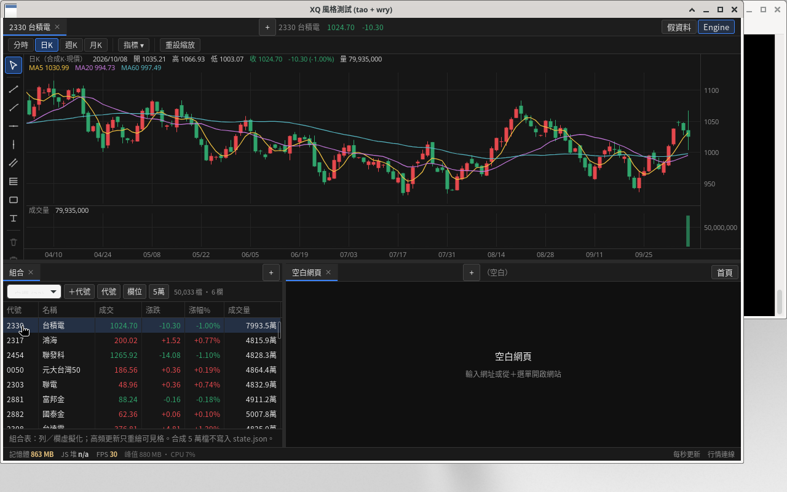 | 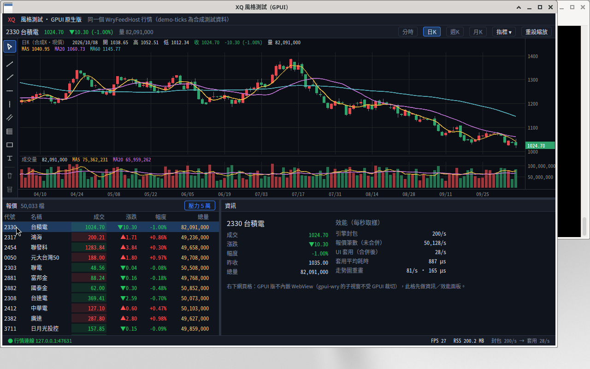 |
| burst | 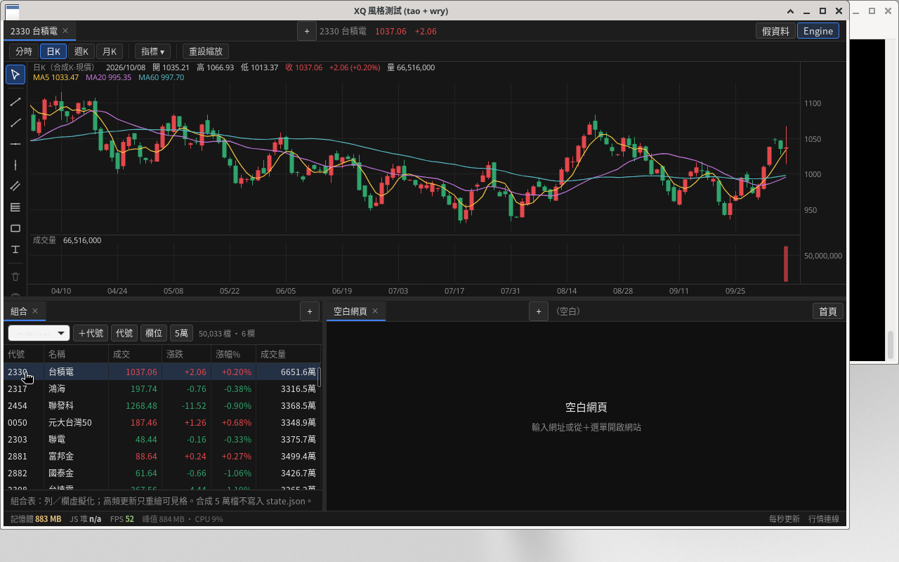 | 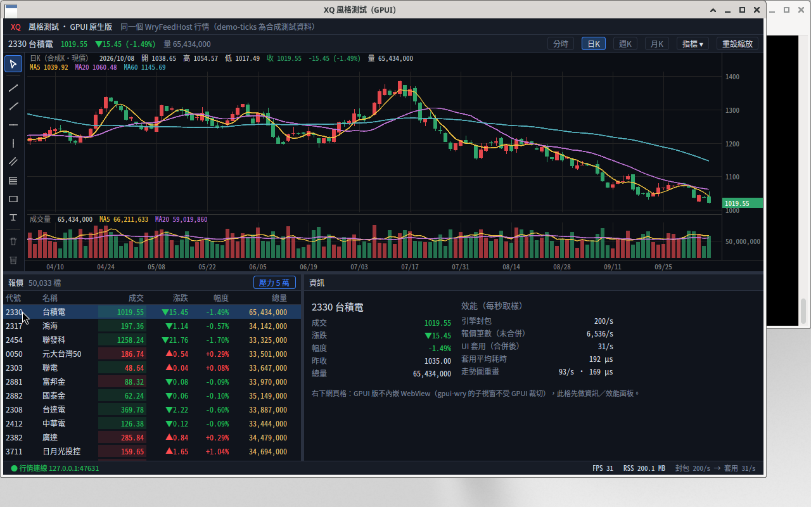 |

原始數據：[`docs/bench/ticks-summary.json`](docs/bench/ticks-summary.json)、[`docs/bench/ticks-results.json`](docs/bench/ticks-results.json)，
修正前：[`docs/bench/ticks-before-results.json`](docs/bench/ticks-before-results.json)。
產生器用法（本 repo）：`cargo run --release -p xq-feed --bin xq-tickgen -- --rate 10000`（或 `--burst 150000,3,5000`），程式加上 `XQ_TICK_BENCH=1` 啟動。

</details>

## 平台狀態（GPUI）

- **macOS**：GPUI 的主平台（Zed 編輯器），Metal 繪圖，最成熟。
- **Windows**：已有官方支援（DirectX 11 / DirectComposition），Zed Windows 版已釋出；中文輸入法、HiDPI 要實測。
- **Linux**：X11 與 Wayland 都支援，這個版本（`gpui-pre 0.3.7`）繪圖走 wgpu（Vulkan 為主）；需要可用的 Vulkan/GL 驅動。
- **iOS / iPadOS / Android**：GPUI **不支援**行動平台；全平台要另做行動端（共用 `xq-feed` 協議／Rust 核心）。
- 依賴：`gpui-pre` 是社群發佈的 Zed GPUI 快照（crates.io 上官方 `gpui` 0.2.x 版本較舊），API 仍在變動，版本鎖在 `=0.3.7`。

## 跟 wry 版相比還沒做的

- 右下嵌網頁（Yahoo 等）、多分頁、安裝檔。
- 畫線樣式（顏色／線寬）、畫線複製、指標顏色自訂。
- 自選清單編輯、搜尋代號。
- `xq-feed` 已抽成獨立 crate；wry 版目前仍用自己的 `src/engine.rs`（同格式），之後可改成 path/git 依賴共用同一份實作。

## 已知行情來源問題（不是這個程式的 bug）

`WryFeedHost --demo-ticks` 的隨機漫步有向上漂移（每 tick 期望 +0.003%，40 次/s），跑久了價格會一路漲；
跑了數小時的 2330/2317/2454/0050 已經溢位成 ±21474836.48（`int` 分），表格顯示 `--`、走勢圖會忽略這種報價。
重開 feedhost 即可恢復正常數值。
