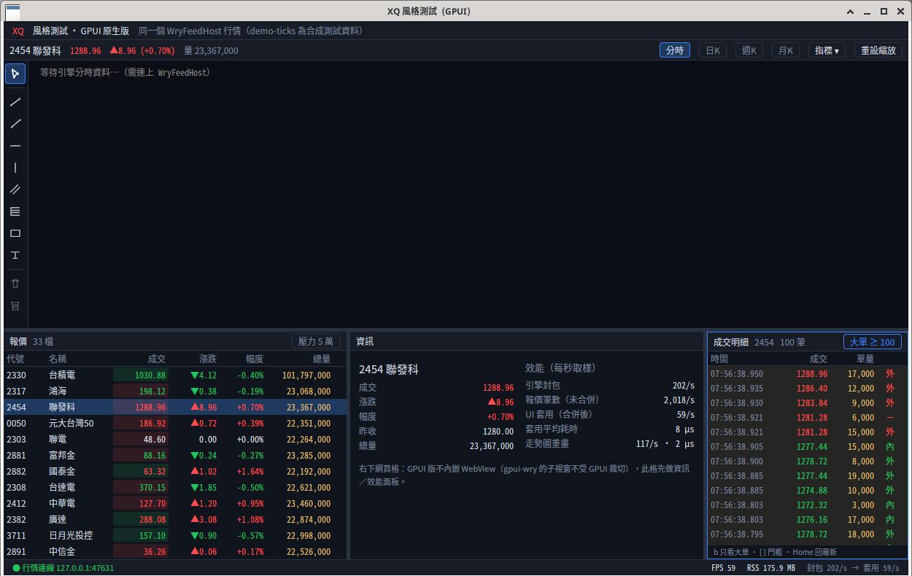

# 範例模組：成交明細（tick tape）——「照這個寫」



一個面板＝**純邏輯 crate**＋**一個 GPUI view 檔**。成交明細是刻意挑的範例：它小（view 約 510 行、純邏輯約 360 行，都含大量註解與測試），但用到了這個專案所有關鍵模式，而且有一個跟報價表不同的難點——**每一筆都要，不能合併**。

## 開起來看

```bash
export PATH="$HOME/.cargo/bin:$PATH"
cargo build --release
# 行情：WryFeedHost --demo-ticks，或內建產生器（另開終端機）：
./target/release/xq-tickgen --rate 2000 --duration 600 --rows 0
XQ_TAPE=1 ./target/release/gpui-xq-demo
```

右下多一欄「成交明細」。點一下面板取得焦點（外框變藍），然後：`b` 只看大單、`[`／`]` 調大單門檻、`Home` 回到最新。點報價表換代號，成交明細跟著換。設定存在 `~/.local/share/gpui-xq-demo/tick_tape.json`（`XQ_TAPE_STATE` 可改路徑）。

預設**不開**（`XQ_TAPE` 沒設時熱路徑完全不多做事），所以現有壓測的版面和數字不變。

## 檔案

| 檔案 | 內容 | 示範什麼 |
|---|---|---|
| `crates/xq-tape/src/lib.rs` | `TapeCore`（報價 → 成交）、`Ring<T>`（固定容量環狀緩衝）、`format_row`、9 個單元測試 | 純邏輯不依賴 GPUI；`Copy` 小 struct；借用 `&Quote` 不 clone；時區當參數 |
| `crates/xq-tape/tests/baseline.rs` | 讀 `tests/baseline/*.json` 逐步重播比對 | **行為基準測試**（對 WPF 行為）的標準寫法 |
| `crates/xq-tape/tests/baseline/tick_tape_basic.json` | 9 步輸入與預期畫面文字、`known_diffs`（刻意／海外版差異） | 行為基準檔格式 |
| `crates/xq-tape/benches/tape.rs` | 4 項 micro-bench，各有預算，`XQ_BENCH_STRICT=1` 超標就失敗 | 不用外部套件的 bench；預算怎麼推導 |
| `src/tick_tape.rs` | `TapeFeed`（背景）、`TickTape`（Entity view）、actions、設定存檔、3 個測試 | 五個【模式】，見下 |
| `src/bridge.rs`（+6 行） | `merge` 在合併報價**之前**把整包交給 `TapeFeed::on_quotes` | 新資料消費者怎麼接到行情執行緒 |
| `src/main.rs`（+20 行） | `XQ_TAPE=1` 才建立；掛在 `apply_feed` 同一個節奏；換代號時 `set_symbol`；`bind_keys` | 面板怎麼掛進主視窗 |

## 五個模式（對應 `src/tick_tape.rs` 的【模式 X】註解）

| 模式 | 做法 | 為什麼 |
|---|---|---|
| **A 背景 → UI** | 行情執行緒：`TapeFeed::on_quotes` 一包鎖一次，推導出的成交放進固定容量 `Ring`（滿了擠掉最舊並計數）。UI：`TickTape::apply` 鎖裡只做 `std::mem::swap` 交換雙緩衝，鎖外處理。由 `Terminal::apply_feed` 呼叫，每幀最多一次 | 背景不碰 UI；UI 不被每筆報價打爆；記憶體有上限；不每幀配置 |
| **B Entity 狀態** | `TickTape` 是 `Entity`；有新成交才 `cx.notify()`；換代號 `set_symbol` | 沒 notify 就不重畫，省 CPU |
| **C Render＋虛擬化** | `uniform_list` 只對可見列呼叫 `render_rows`；`format_row` 只在那裡跑；「只看大單」另存一個 `Ring`，切換 O(1) | 5000 筆也只格式化十幾列 |
| **D Action＋快捷鍵＋焦點** | `actions!(tick_tape, [...])`、`bind_keys` 綁在 `KEY_CONTEXT`、render 裡 `key_context`+`track_focus`+`on_action`；按鈕和快捷鍵呼叫同一個 handler；聚焦時外框變色 | 對齊 WPF 快捷鍵的標準做法；焦點不在這裡時不會搶別人的鍵 |
| **E 存檔不在 UI 執行緒** | 讀：`cx.spawn` → `background_executor().spawn(load)` → `this.update`。寫：防抖 450 ms（`save_gen`）→ 背景寫 `.tmp` → `rename`；壓測模式不讀不寫；`#[serde(default)]` 相容舊檔 | 盤中不因 I/O 卡頓；寫一半當機也不會壞檔 |

## 測試與量測結果（2026-10-20，本機）

- `cargo test --release --workspace`：全過（xq-tape 9＋行為基準 1、tick_tape 3、既有 xq-feed 3／指標與序列 3）。
- `cargo clippy --release -p xq-tape --all-targets -- -D warnings`：乾淨；`src/tick_tape.rs` 0 警告。
- `cargo bench -p xq-tape`：

| 項目 | ns/次 | 預算 |
|---|---|---|
| `TapeCore::on_quote`（每筆報價，背景執行緒） | 1.4 | 50 |
| `Ring::push`（每筆成交） | 5.9 | 10 |
| `Ring::newest`（每個可見列） | 6.1 | 10 |
| `format_row`（每個可見列） | 247 | 1000 |

- 實機（`xq-tickgen --rate 2000`，`XQ_TAPE=1`）：FPS 54–61、RSS ≈ 176 MB、UI 套用 ≈ 10 µs／次；面板滿 5000 筆後記憶體不再增加。

## 照這個做新面板的清單

1. 複製結構：`crates/xq-<名稱>/`（`src/lib.rs`、`tests/baseline.rs`、`tests/baseline/*.json`、`benches/<名稱>.rs`、`Cargo.toml` 的 `[[bench]] harness = false`），加進根目錄 `Cargo.toml` 的 `members` 和 `[dependencies]`。
2. 先寫基準 JSON 和單元測試（`prompt-templates.md` §3），確認後再寫邏輯。
3. 決定資料策略：**可以合併**（照 `bridge.rs` 的 `Inbox`）還是**每筆都要**（照 `TapeFeed` 的固定容量 `Ring`＋丟棄計數）。
4. 複製 `src/tick_tape.rs`，保留五個【模式】的段落，換成你的資料與畫面。
5. 在 `main.rs`：用環境變數開關建立 Entity、掛到 `apply_feed`、`bind_keys`、版面 `.cached()`。
6. 跑 build／clippy／test／bench，PR 附截圖與數字（`ai-dev-guidelines.md` §7）。

## 已知限制（範例刻意簡化的地方）

- 協議沒有逐筆成交封包：成交量用「總量差」推導，外／內盤用價格升降近似（`known_diffs` TT-D1）。時間是收到時間，不是交易所成交時間。
- 使用者往下捲動看舊資料時，新成交進來會讓內容往下移（沒有做「捲動時暫停跟隨」）。正式版要加：以 `seq` 為錨點凍結可見範圍。
- 時區固定 +08:00（`utc_offset_sec`）；海外版應從使用者設定傳入。
